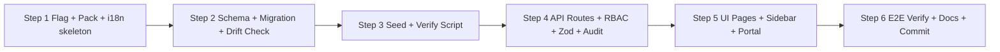

# Spec Implementasi Teknis — Fase 1 MVP: Modul Community (RT/RW)

> **Status:** Spec final untuk eksekusi subtask Code.
> **Basis arsitektur:** [`plans/community-gov-product-analysis.md`](plans/community-gov-product-analysis.md) — arsitektur **hybrid** (domain module di `apps/web` + industry pack `community` + feature flag `COMMUNITY_MODULE`), cashbook-first, custom Role.
> **Tanggal:** 10 Oktober 2026
> **Aturan kerja:** Dokumen ini HANYA spec. Subtask Code yang mengeksekusi. File yang boleh disentuh tercantum eksplisit di setiap section. **Do-Not-Touch:** [`apps/web/lib/auth.ts`](apps/web/lib/auth.ts), [`apps/web/middleware.ts`](apps/web/middleware.ts), [`apps/web/lib/audit.ts`](apps/web/lib/audit.ts), [`apps/web/lib/session.ts`](apps/web/lib/session.ts) — tidak ada perubahan satu karakter pun; semua kebutuhan auth/RBAC/audit dipenuhi lewat helper yang sudah ada.

---

## Daftar Isi

1. [Scope Fase 1 — IN / OUT](#1-scope-fase-1--in--out)
2. [Prisma Schema Design](#2-prisma-schema-design)
3. [API Contract](#3-api-contract)
4. [Role & Access Control](#4-role--access-control)
5. [UI / Pages](#5-ui--pages)
6. [Feature Flag & Industry Pack](#6-feature-flag--industry-pack)
7. [Seed Data](#7-seed-data)
8. [Estimasi & Urutan Eksekusi](#8-estimasi--urutan-eksekusi)

---

## 1. Scope Fase 1 — IN / OUT

### 1.1 IN Scope (MVP RT/RW)

| # | Fitur | Keterangan |
|---|-------|------------|
| 1 | **Master warga** | CRUD `CommunityMember`: kode warga, nama, NIK (terenkripsi), nomor KK (terenkripsi), jenis kelamin, alamat/rumah, status keanggotaan (ACTIVE/INACTIVE/MOVED), kontak |
| 2 | **Jenis iuran** | CRUD `CommunityDuesType`: kode, nama, nominal, frekuensi (MONTHLY/QUARTERLY/YEARLY/ONE_TIME), aktif/tidak |
| 3 | **Generate tagihan manual** | Tombol **"Generate Tagihan Bulan Ini"** — membuat `CommunityDuesBill` untuk semua warga ACTIVE × semua `CommunityDuesType` aktif pada periode terpilih (`YYYY-MM`). Idempoten (unique constraint menjamin tidak dobel) |
| 4 | **Pencatatan pembayaran iuran** | POST `/bills/[id]/pay` — catat pembayaran parsial/penuh, update status bill UNPAID→PARTIAL→PAID, upload bukti pembayaran |
| 5 | **Cashbook (kas RT)** | CRUD `CommunityCashTransaction` (INCOME/EXPENSE) dengan **approval state machine sederhana** CREATED(PENDING)→APPROVED/REJECTED — bukan integrasi `ApprovalRequest` |
| 6 | **Laporan bulanan** | Ringkasan per periode: total iuran tertagih/terbayar, pemasukan/pengeluaran kas, saldo kas, daftar tunggakan |
| 7 | **Overview dashboard** | Kartu ringkasan: jumlah warga aktif, tagihan bulan ini, % pembayaran, saldo kas, transaksi menunggu approval |
| 8 | **Pengumuman** | CRUD `CommunityAnnouncement` sederhana (judul, konten, kategori, prioritas) |
| 9 | **Portal Warga (read-only)** | WARGA login → melihat tagihan miliknya sendiri + laporan kas bulan berjalan + pengumuman. Tanpa aksi tulis |
| 10 | **4 preset role custom** | KETUA, BENDAHARA, SEKRETARIS, WARGA via tabel `Role` existing (bukan system role baru) |
| 11 | **Feature flag + pack** | `COMMUNITY_MODULE` di [`packages/config/src/features.ts`](packages/config/src/features.ts) + industry pack `community` di [`packages/industry-config/src/packs/`](packages/industry-config/src/packs/) |
| 12 | **Seed demo** | Modul seed shared `community.ts` + tenant demo RT baru + verify script |

### 1.2 OUT of Scope (Fase 2 / 3 — JANGAN dikerjakan)

| Fitur | Fase |
|-------|------|
| Multi-RT/RW, konsolidasi kas lintas unit, super-admin pengawas | Fase 2 |
| Surat pengantar / domisili / SK (`SuratPengantar`) | Fase 2 |
| Aset & inventaris RT (`CommunityAsset` + integrasi `StockMovement`) | Fase 2 |
| Kegiatan & anggaran (`CommunityActivity`, renstra) | Fase 2 |
| Segmen desa/kelurahan/dinas | Fase 3 |
| Otomasi tagihan via cron (`RecurringInvoice` pattern) — Fase 1 **manual button** | Fase 2 |
| Integrasi `ApprovalRequest` multi-level untuk kas | Fase 2 |
| Integrasi jurnal/COA (`JournalEntry`, `Account`), period closing community | Fase 2 |
| Notifikasi WhatsApp/surat edaran digital | Fase 2 |
| Aplikasi mobile portal warga | Fase 3 |
| Pencarian NIK (butuh kolom terenkripsi dapat diquery — sengaja dihindari) | Fase 2 (deterministic encryption) |

---

## 2. Prisma Schema Design

### 2.1 Keputusan: Model BARU dedicated, bukan reuse `Invoice`/`Expense`/`Payment`

**Keputusan: buat 6 model baru dedicated (`CommunityMember`, `CommunityDuesType`, `CommunityDuesBill`, `CommunityDuesPayment`, `CommunityCashTransaction`, `CommunityAnnouncement`). Reuse terbatas: `Tenant`, `User`, `Role`, `AuditLog`.**

Alasan (ringkas dari analisis produk, §5.2, dipertegas pada level kode):

1. **Bentuk tagihan berbeda.** Iuran RT = [(warga/rumah) × jenis iuran × periode `YYYY-MM`] dengan unique key ketat. `Invoice` punya nomor dokumen, contact, item lines, tax, due date bisnis, approval workflow, dsb. Memaksa iuran RT ke `Invoice` menghasilkan 90% kolom kosong/tidak relevan + angka pajak aneh untuk warga. Uniqueness `[tenantId, memberId, duesTypeId, period]` tidak dapat diekspresikan bersih di `Invoice`.
2. **Cashbook ≠ Expense.** Kas RT adalah **buku kas single-akun** (cashbook-first, tanpa COA) — arus masuk/keluar + saldo berjalan + approval inline. `Expense` terikat approval engine & period closing akuntansi penuh. Domain kas RT butuh juga tipe INCOME (pemasukan iuran, sumbangan) yang tidak dimodel `Expense`.
3. **Semantik portal warga.** Warga melihat "tagihan SAYA" — relasi langsung `CommunityDuesBill.memberId` jauh lebih sederhana daripada join `Invoice→Contact` + filter membership.
4. **Isolasi risiko.** 6 model baru = migration additive murni. Menyuntikkan perilaku RT ke model finance existing berisiko regresi ke modul production (Rule 5: finance adalah core).

Apa yang TETAP direuse (tanpa duplikasi):

| Kebutuhan | Reuse |
|-----------|-------|
| Isolasi multi-tenant | `Tenant` + `tenantId` di semua model + relasi `@@relation` |
| Akun pengguna & role | `User` (+ `roleId` → `Role` custom), **tanpa system role baru** |
| Trail audit | `AuditLog` via [`logAudit()`](apps/web/lib/audit.ts) |
| Enkripsi NIK/NKK | [`encrypt`/`safeDecrypt`](apps/web/lib/encryption.ts) (AES-256-GCM) |
| Upload bukti bayar | pola [`getUploadSubDir('community')`](apps/web/lib/upload-dir.ts) |
| RBAC route | `requirePermissionForRoute` + `ROUTE_PERMISSIONS` |

### 2.2 Konvensi yang WAJIB diikuti (dari `schema.prisma` existing)

- `id String @id @default(cuid())`
- `tenantId String` + relasi `Tenant` + `@@index([tenantId])` di SEMUA model
- Uang: `Decimal @db.Decimal(19, 4)` (lihat `Invoice.totalAmount`)
- Status: `String @default(...)` + **comment enum** di baris yang sama (konvensi `Expense.status`) — BUKAN Prisma `enum` (ikuti pola dominan repo)
- Business key: `@@unique([tenantId, <key>])`
- Soft delete: `deletedAt DateTime?` + `deletedBy String?` (master & transaksi)
- Audit fields: `createdBy String?` (tanpa FK — pola `Expense.createdBy`), `createdAt`, `updatedAt`
- Penulisan: taruh semua model community di **bagian paling bawah** `schema.prisma` di bawah comment `// ─── Community Module (Fase 1: RT/RW) ───`

### 2.3 Kode `.prisma` siap tempel

Tambahkan ke [`packages/db/prisma/schema.prisma`](packages/db/prisma/schema.prisma) (ADDITIVE — tidak mengubah model existing kecuali menambah field relasi reverse di `Tenant`, lihat §2.3.7):

```prisma
// ─── Community Module (Fase 1: RT/RW) ─────────────────────────────────────────
// Referensi: plans/community-mvp-implementation.md
// Cashbook-first iuran warga + kas RT. Dedicated models — bukan reuse Invoice/Expense.

model CommunityMember {
  id          String    @id @default(cuid())
  tenantId    String
  tenant      Tenant    @relation(fields: [tenantId], references: [id])

  // Identitas & keanggotaan
  code        String    // Kode warga unik per tenant, e.g. "W-001" (business key)
  fullName    String
  nikEncrypted   String? // NIK dienkripsi AES-256-GCM (encrypt()) — JANGAN simpan plain
  nomorKkEncrypted String? // Nomor KK dienkripsi
  gender      String?   // L, P
  birthDate   DateTime?
  birthPlace   String?

  // Domisili
  address     String?   // Alamat / blok-rumah, e.g. "Blok C No. 12"
  rtRw        String?   // Informatif, e.g. "001/002" — Fase 1 satu RT = satu tenant
  houseStatus String    @default("OWNER") // OWNER, RENT

  // Kontak
  phone       String?
  email       String?

  // Status keanggotaan
  status      String    @default("ACTIVE") // ACTIVE, INACTIVE, MOVED
  joinedAt    DateTime?
  notes       String?

  // Meta
  createdBy   String?
  createdAt   DateTime  @default(now())
  updatedAt   DateTime  @updatedAt
  deletedAt   DateTime?
  deletedBy   String?

  bills       CommunityDuesBill[]
  payments    CommunityDuesPayment[]

  // Unik: 1 kode warga per tenant. Saat warga pindah → status MOVED + buat record
  // baru (code baru) — tagihan lama tetap menempel ke record lama (riwayat utuh).
  @@unique([tenantId, code])
  @@index([tenantId, status])
  @@index([tenantId])
}

model CommunityDuesType {
  id          String   @id @default(cuid())
  tenantId    String
  tenant      Tenant   @relation(fields: [tenantId], references: [id])

  code        String   // e.g. "IURAN-BULANAN" (business key)
  name        String   // e.g. "Iuran Bulanan"
  description String?
  amount      Decimal  @db.Decimal(19, 4) // Nominal default per periode
  frequency   String   @default("MONTHLY") // MONTHLY, QUARTERLY, YEARLY, ONE_TIME
  isActive    Boolean  @default(true)
  startDate   DateTime? // Berlaku mulai (opsional, batasi generate)
  endDate     DateTime? // Berakhir (opsional)

  createdBy   String?
  createdAt   DateTime @default(now())
  updatedAt   DateTime @updatedAt

  bills            CommunityDuesBill[]
  cashTransactions CommunityCashTransaction[]

  @@unique([tenantId, code])
  @@index([tenantId, isActive])
  @@index([tenantId])
}

model CommunityDuesBill {
  id          String   @id @default(cuid())
  tenantId    String
  tenant      Tenant   @relation(fields: [tenantId], references: [id])

  billNumber  String   // Auto: "TAG/<periode>/<kodeWarga>-<kodeIuran>", e.g. "TAG/2026-10/W-001-IURAN-BULANAN"
  memberId    String
  member      CommunityMember @relation(fields: [memberId], references: [id])
  duesTypeId  String
  duesType    CommunityDuesType @relation(fields: [duesTypeId], references: [id])
  period      String   // "YYYY-MM" — periode tagihan (bulan iuran)

  amountDue   Decimal  @db.Decimal(19, 4) // Nominal tagihan (default dari duesType.amount)
  amountPaid  Decimal  @default(0) @db.Decimal(19, 4) // Akumulasi pembayaran
  status      String   @default("UNPAID") // UNPAID, PARTIAL, PAID, VOID
  dueDate     DateTime?
  paidAt      DateTime? // Waktu pelunasan (set saat amountPaid >= amountDue)
  notes       String?

  createdBy   String?
  createdAt   DateTime @default(now())
  updatedAt   DateTime @updatedAt
  deletedAt   DateTime?
  deletedBy   String?

  payments    CommunityDuesPayment[]

  // KEPUTUSAN (a): tagihan unik per [warga, jenis iuran, periode, tenant].
  // "Generate Bulan Ini" aman dijalankan berulang tanpa duplikat (upsert skip).
  @@unique([tenantId, memberId, duesTypeId, period])
  @@unique([tenantId, billNumber])
  @@index([tenantId, status])
  @@index([tenantId, period])
  @@index([tenantId, memberId])
  @@index([tenantId])
}

model CommunityDuesPayment {
  id            String   @id @default(cuid())
  tenantId      String
  tenant        Tenant   @relation(fields: [tenantId], references: [id])

  paymentNumber String   // Auto: "BYR/<YYYYMMDD>-<seq>", unik per tenant
  billId        String
  bill          CommunityDuesBill @relation(fields: [billId], references: [id])
  memberId      String
  member        CommunityMember @relation(fields: [memberId], references: [id])

  amount        Decimal  @db.Decimal(19, 4)
  paidAt        DateTime @default(now())
  method        String   @default("CASH") // CASH, TRANSFER, QRIS
  receiptUrl    String?  // Bukti bayar: "/uploads/community/<tenantId>/..." (getUploadSubDir)
  notes         String?

  createdBy     String?  // User id bendahara yang mencatat
  createdAt     DateTime @default(now())
  updatedAt     DateTime @updatedAt

  @@unique([tenantId, paymentNumber])
  @@index([tenantId, paidAt])
  @@index([tenantId, billId])
  @@index([tenantId])
}

model CommunityCashTransaction {
  id          String   @id @default(cuid())
  tenantId    String
  tenant      Tenant   @relation(fields: [tenantId], references: [id])

  txNumber    String   // Auto: "KAS/<YYYYMMDD>-<seq>", unik per tenant
  type        String   // INCOME, EXPENSE
  category    String?  // Label bebas: "Iuran", "Kebersihan", "Keamanan", "Perbaikan", "Sosial", "Rapat"
  duesTypeId  String?  // Opsional: sumber iuran (INCOME dari iuran)
  duesType    CommunityDuesType? @relation(fields: [duesTypeId], references: [id])
  amount      Decimal  @db.Decimal(19, 4) // Selalu positif; arah ditentukan `type`
  description String
  txDate      DateTime
  attachmentUrl String? // Foto nota/kwitansi (opsional)

  // KEPUTUSAN (c): approval state machine inline — BUKAN integrasi ApprovalRequest.
  status        String   @default("PENDING") // PENDING, APPROVED, REJECTED
  approvedBy    String?
  approvedAt    DateTime?
  rejectedBy    String?
  rejectedAt    DateTime?
  rejectReason  String?

  createdBy   String?   // Bendahara pencatat — kunci cek SoD (tidak boleh approve sendiri)
  createdAt   DateTime  @default(now())
  updatedAt   DateTime  @updatedAt
  deletedAt   DateTime?
  deletedBy   String?

  @@unique([tenantId, txNumber])
  @@index([tenantId, status])
  @@index([tenantId, txDate])
  @@index([tenantId, type])
  @@index([tenantId])
}

model CommunityAnnouncement {
  id          String   @id @default(cuid())
  tenantId    String
  tenant      Tenant   @relation(fields: [tenantId], references: [id])

  title       String
  content     String   // Plain text / markdown ringan
  category    String   @default("GENERAL") // GENERAL, MEETING, PAYMENT, EVENT, EMERGENCY
  priority    String   @default("NORMAL") // LOW, NORMAL, HIGH, URGENT
  publishedAt DateTime?
  expiresAt   DateTime?
  isActive    Boolean  @default(true)

  createdBy   String?
  createdAt   DateTime @default(now())
  updatedAt   DateTime @updatedAt
  deletedAt   DateTime?
  deletedBy   String?

  @@index([tenantId, isActive])
  @@index([tenantId])
}
```

#### 2.3.7 Relasi reverse di model `Tenant` (ADDITIVE)

Tambahkan 6 field berikut ke model `Tenant` (pola sama dengan `invoices Invoice[]` dsb.):

```prisma
  // Community module (Fase 1)
  communityMembers        CommunityMember[]
  communityDuesTypes      CommunityDuesType[]
  communityDuesBills      CommunityDuesBill[]
  communityDuesPayments   CommunityDuesPayment[]
  communityCashTransactions CommunityCashTransaction[]
  communityAnnouncements  CommunityAnnouncement[]
```

> ⚠️ **Jangan tambahkan relasi FK ke `User`** untuk `createdBy`/`approvedBy` — ikuti pola `Expense.createdBy String?` (tanpa relasi) agar tidak menyentuh model `User` yang dipakai lintas modul.

#### 2.3.8 Keputusan `CommunityAnnouncement` — MASUK Fase 1

**Keputusan: inklusif di Fase 1** (ringan: 1 tabel, tanpa relasi, CRUD sederhana, nila demo & adopsi tinggi — pengumuman rapat/denda adalah kebutuhan inti RT). Jika estimasi Code meleset, ini kandidat pertama yang diturunkan ke Fase 2 tanpa dampak ke model lain (tidak direferensikan model mana pun).

### 2.4 Keputusan desain wajib (a–d)

#### (a) Reuse `Category`/`Expense`/`Payment` vs model baru → **model baru dedicated**

Sudah diringkas di §2.1. Tambahan pada level kolom:

- `CommunityCashTransaction.category` = **String label bebas** — BUKAN FK ke `Category`. Alasan: kategori kas RT (Kebersihan, Keamanan…) adalah domain rt, bukan COA bisnis; FK ke `Category` memaksa warga memahami master kategori finance. Fase 2 bila COA diaktifkan.
- `CommunityDuesPayment` terpisah dari `CommunityDuesBill` (bukan kolom `paidAt` saja) karena iuran mendukung **pembayaran parsial** dan riwayat multiple pembayaran per tagihan.
- Setiap pembayaran iuran **sekaligus** menghasilkan baris `CommunityCashTransaction` type `INCOME` (link via `duesTypeId` + deskripsi) — satu tempat sumber kas; laporan kas cukup baca `CommunityCashTransaction`. (Implementasi di route `/bills/[id]/pay`: `prisma.$transaction` — update bill + create payment + create cash INCOME.)

#### (b) Generate tagihan: cron vs tombol manual → **TOMBOL MANUAL**

**Keputusan: `POST /api/community/bills/generate` (tombol "Generate Tagihan Bulan Ini" di UI).**

Alasan:
1. **Tanpa risiko scheduler.** Cron dispatcher [`/api/cron/run`](apps/web/app/api/cron/run/route.ts) menuntut `CRON_SECRET`, dedup `shouldRun()`, logging `CronRunLog`, dan konfigurasi aaPanel — semua beban operasional yang tidak memberi nilai demo di Fase 1.
2. **Idempoten by design.** Unique `[tenantId, memberId, duesTypeId, period]` menjamin generate ulang aman — menghilangkan ketergantungan pada state "last run".
3. **Kontrol pengurus.** Pengurus RT memilih kapan tagihan bulan dibuka (mis. setelah rapat awal bulan) — lebih sesuai alur kerja nyata daripada auto-jalan tengah malam.

Fase 2: naikkan ke pola `RecurringInvoice` + cron task `community-dues-generate` (daily 07:00) mengikuti [`docs/CRON-JOBS.md`](docs/CRON-JOBS.md).

#### (c) Approval kas: `ApprovalRequest` vs state machine inline → **state machine inline**

**Keputusan: kolom status + approved/rejected fields langsung di `CommunityCashTransaction` (PENDING→APPROVED/REJECTED).**

Alasan:
1. **ApprovalRequest dirancang multi-level + notifikasi email + auto-approve threshold + workflow hooks** ([`apps/web/lib/approval.ts`](apps/web/lib/approval.ts)) — 1 level approver tunggal (KETUA) tidak membutuhkan seluruh mesin itu; integrasinya menambah surface error untuk nilai tambah nol di MVP.
2. **Rule 7 (simplicity).** State machine 3 status dapat dibaca & diverifikasi dalam satu route handler.
3. **Compat Fase 2.** Kolom `approvedBy/approvedAt` mengikuti nama field `Expense` — migrasi ke `ApprovalRequest` kelak = mapping kolom, bukan perubahan UI read.

Enforcement approve:
- **Layer 1 (RBAC):** permission `community:approve` (route entry + **explicit in-route check**, lihat §3.2 — wajib karena resolusi prefix route tidak mengenali segmen `[id]` dinamis).
- **Layer 2 (SoD):** `tx.createdBy === session.user.id` → tolak 403 `COMMUNITY_SELF_APPROVAL_FORBIDDEN` (preseden: unlock-request self-approval check).
- **Layer 3 (state):** hanya `status === 'PENDING'` yang bisa diputuskan; transaksi APPROVED/REJECTED bersifat final (koreksi = transaksi kas baru, audit trail utuh).

#### (d) Enkripsi NIK & dampaknya → **`String?` terenkripsi + pencarian hanya via nama/kode**

**Keputusan:**

- Kolom `nikEncrypted String?` / `nomorKkEncrypted String?` diisi via [`encrypt()`](apps/web/lib/encryption.ts) (AES-256-GCM, key dari env `SMTP_ENCRYPTION_KEY`, format `iv:authTag:cipher` base64).
- **Tidak ada kolom NIK plain** — tidak ada `@@index` di kolom ini, **tak ada filter/search by NIK** di API maupun UI (Fase 1).
- Pencarian warga: **hanya `fullName`, `code`, `address`, `phone`** (kolom non-sensitif yang sudah di-index/relatif aman).
- Tampilan: form edit menampilkan placeholder **"NIK tersimpan terenkripsi"** + toggle ganti NIK (submit nilai baru = re-encrypt overwrite). Detail page tidak pernah memanggil `decrypt` — NIK tidak ditampilkan ulang (write-only). Bila fitur "tampilkan NIK" diminta Fase 2: gate behind permission `community:view-nik` + audit log akses.
- Fallback: [`safeDecrypt()`](apps/web/lib/encryption.ts) mengembalikan `null` bila key berubah — UI menampilkan `-`, tidak crash.
- **Risiko diterima:** key rotation membuat NIK lama tidak terbaca (data tetap ada, bisa diinput ulang warga). Catat di `docs/SECURITY.md` saat implementasi.

### 2.5 Migration — 1 file, additive-only, drift-check compatible

**File yang dibuat:** 1 folder migration baru, mengikuti konvensi `YYYYMMDDHHMMSS_description` (terakhir: `20261007000000_drift_repair_missing_models_and_schema_gaps`).

**Cara pembuatan (jangan menulis SQL manual):**

```bash
cd packages/db && npx prisma migrate dev --name community_mvp_phase1
```

Prisma menghasilkan folder `packages/db/prisma/migrations/<timestamp>_community_mvp_phase1/migration.sql` berisi `CREATE TABLE` untuk 6 tabel + index + unique constraint + `ALTER TABLE "Tenant"` (penambahan 6 kolom relasi — sebenarnya Prisma merepresentasikan relasi reverse via FK di sisi "many", jadi SQL = 6 kolom `tenantId` + FK + index di tabel baru; tabel `Tenant` TIDAK berubah).

**Checklist migration:**

- [ ] Tidak ada `DROP`/`ALTER` tabel existing — murni `CREATE TABLE` baru (+ FK ke `Tenant`, `CommunityMember`, `CommunityDuesType`)
- [ ] Tidak menyentuh folder migration lama
- [ ] Setelah generate: `cd packages/db && npx prisma generate`
- [ ] **Drift check WAJIB lulus:** `cd packages/db && bash scripts/check-drift.sh` (replay semua migration ke shadow DB → diff dengan `schema.prisma`)
- [ ] `npx prisma migrate status` → clean

---

## 3. API Contract

### 3.1 Permission keys (5 keys baru)

| Permission key | Arti | Dipakai untuk |
|----------------|------|---------------|
| `community:view` | Baca ringkasan/laporan | Overview, reports/monthly |
| `community:manage` | Kelola data master & pengumuman | Members, dues-types, announcements (semua method — key sengaja non-`view` agar TIDAK ter-upgrade METHOD_ACTION_MAP) |
| `community:finance` | Operasi keuangan | Bills (list/generate/pay), cash-transactions (semua method) |
| `community:approve` | Putuskan transaksi kas | Approve/reject cash transactions |
| `community:portal` | Portal warga read-only | `/api/community/portal/*` (GET only) |

**Mengapa diakhiri `manage`/`finance`/`portal` bukan `view`:** [`resolvePermissionByMethod`](apps/web/lib/route-permissions.ts:450) hanya meng-upgrade permission yang action-nya `view`. Dengan `community:manage` sebagai base, GET/POST/PUT/DELETE semuanya menuntut `community:manage` (pasangan yang kita inginkan: Sekretaris boleh CRUD member, Bendahara tidak). `community:finance` pun demikian (GET list kas & POST kas sama-sama Bendahara/KETUA). `approve` ada di `SPECIFIC_ACTIONS` sehingga `community:approve` juga keep-as-is.

### 3.2 Registrasi permission

**1. [`packages/permissions/src/permissions.ts`](packages/permissions/src/permissions.ts) — tambah ke `MODULE_PERMISSIONS` (discoverability + wildcard `community:*`):**

```ts
community: ['view', 'manage', 'finance', 'approve', 'portal'],
```

> Engine [`matchPermission`](packages/permissions/src/engine.ts:60) sudah mencocokkan string arbitrary di `Role.permissions` Json — menambah entry ini TIDAK wajib secara runtime, tetapi WAJIB agar `resolvePermissions` meng-expands wildcard `community:*` (dipakai role seed SUPERADMIN demo) dan agar `isValidPermission` mengenali key baru.

**2. [`apps/web/lib/route-permissions.ts`](apps/web/lib/route-permissions.ts) — entries (tambah di bagian community, ikuti format eksisting):**

```ts
  // ─── Community Module (Fase 1: RT/RW) ────────────────────────────────────────
  '/api/community/overview': { permission: 'community:view', fallbackRole: 'MEMBER' },
  '/api/community/reports/monthly': { permission: 'community:view', fallbackRole: 'MEMBER' },
  '/api/community/members': { permission: 'community:manage', fallbackRole: 'ADMIN' },
  '/api/community/members/[id]': { permission: 'community:manage', fallbackRole: 'ADMIN' },
  '/api/community/dues-types': { permission: 'community:manage', fallbackRole: 'ADMIN' },
  '/api/community/dues-types/[id]': { permission: 'community:manage', fallbackRole: 'ADMIN' },
  '/api/community/bills': { permission: 'community:finance', fallbackRole: 'ADMIN' },
  '/api/community/bills/generate': { permission: 'community:finance', fallbackRole: 'ADMIN' },
  '/api/community/bills/[id]': { permission: 'community:finance', fallbackRole: 'ADMIN' },
  '/api/community/bills/[id]/pay': { permission: 'community:finance', fallbackRole: 'ADMIN' },
  '/api/community/cash-transactions': { permission: 'community:finance', fallbackRole: 'ADMIN' },
  '/api/community/cash-transactions/[id]': { permission: 'community:finance', fallbackRole: 'ADMIN' },
  '/api/community/cash-transactions/[id]/approve': { permission: 'community:approve', fallbackRole: 'ADMIN' },
  '/api/community/cash-transactions/[id]/reject': { permission: 'community:approve', fallbackRole: 'ADMIN' },
  '/api/community/announcements': { permission: 'community:manage', fallbackRole: 'ADMIN' },
  '/api/community/announcements/[id]': { permission: 'community:manage', fallbackRole: 'ADMIN' },
  '/api/community/upload-receipt': { permission: 'community:finance', fallbackRole: 'ADMIN' },
  '/api/community/portal': { permission: 'community:portal', fallbackRole: 'VIEWER' },
```

> **⚠️ Batasan mekanisme yang HARUS dipahami Code mode (telah diverifikasi):** [`getPermissionForRoute`](apps/web/lib/route-permissions.ts:488) melakukan **exact match lalu longest-prefix `startsWith(prefix + '/')`** — path asli `/api/community/cash-transactions/cm123/approve` **tidak** match literal `'/api/community/cash-transactions/[id]/approve'` dan jatuh ke base `'/api/community/cash-transactions'` (→ `community:finance`, semua method). Konsekuensi wajib:
>
> 1. Route handler `/cash-transactions/[id]/approve` dan `/reject` WAJIB melakukan **explicit in-route permission check** `await hasPermission(session, 'community:approve')` (import dari [`apps/web/lib/permissions.ts`](apps/web/lib/permissions.ts)) **setelah** `requirePermissionForRoute` — preseden resmi repo: unlock-request approve "dijaga in-route oleh policy" (komentar di route-permissions.ts baris 72). Tanpa ini, Bendahara (punya `community:finance`) bisa meng-approve.
> 2. Entry literal `[id]/approve` tetap didaftarkan (konsistensi dokumentasi + kecocokan bila mekanisme normalisasi ditambahkan kelak).
> 3. Sub-path **statis** (`/bills/generate`, `/reports/monthly`, `/portal/*`) match exact — aman.
> 4. Base `/bills` = `community:finance` artinya Bendahara & KETUA semuanya bisa GET/PUT/POST bills; Sekretaris TIDAK (accepted — bills = data keuangan).

### 3.3 Tabel endpoint

Konvensi response semua GET list: `{ success: true, data, total, page, limit, totalPages }` (pola [`finance/expenses`](apps/web/app/api/finance/expenses/route.ts)). Mutasi: `{ success: true, data }` + `logAudit` non-blocking. Semua route: `export const dynamic = 'force-dynamic'`, `checkRateLimit`, `requirePermissionForRoute`, `sanitizeObject`, Zod `safeParse`, `handleApiError`.

| # | Method | Path | Permission (resolved runtime) | Request | Response data | Zod schema (di [`validation-schemas.ts`](apps/web/lib/validation-schemas.ts)) |
|---|--------|------|------------------------------|---------|---------------|-----------------------------------|
| 1 | GET | `/api/community/overview` | `community:view` | — | `{ memberActive, memberInactive, billsThisPeriod: {total, paid, partial, unpaid, amountDue, amountPaid}, cashThisMonth: {income, expense, balance}, pendingApprovals }` | — |
| 2 | GET | `/api/community/members` | `community:manage` | query `?search=&status=&page=&limit=` | list member (**tanpa** kolom NIK — tidak di-select) | — |
| 3 | POST | `/api/community/members` | `community:manage` | body `{ code, fullName, nik?, nomorKk?, gender?, address?, rtRw?, houseStatus?, phone?, email?, status?, joinedAt?, notes? }` | member baru | `createCommunityMemberSchema` |
| 4 | GET | `/api/community/members/[id]` | `community:manage` | — | detail member (`nikStored: boolean`, tidak return NIK) | — |
| 5 | PUT | `/api/community/members/[id]` | `community:manage` | body update parsial | member updated | `updateCommunityMemberSchema` |
| 6 | DELETE | `/api/community/members/[id]` | `community:manage` | — | soft delete (`deletedAt`) — tolak bila masih ada bill UNPAID/PARTIAL | — |
| 7 | GET | `/api/community/dues-types` | `community:manage` | query `?active=` | list jenis iuran | — |
| 8 | POST | `/api/community/dues-types` | `community:manage` | `{ code, name, description?, amount, frequency?, isActive?, startDate?, endDate? }` | baru | `createCommunityDuesTypeSchema` |
| 9 | PUT | `/api/community/dues-types/[id]` | `community:manage` | update parsial | updated | `updateCommunityDuesTypeSchema` |
| 10 | DELETE | `/api/community/dues-types/[id]` | `community:manage` | — | nonaktifkan (`isActive=false`) — delete fisik ditolak bila punya bills | — |
| 11 | GET | `/api/community/bills` | `community:finance` | query `?period=YYYY-MM&status=&memberId=&page=&limit=` | list bill + relasi member & duesType | — |
| 12 | POST | `/api/community/bills/generate` | `community:finance` | `{ period: "YYYY-MM" }` | `{ created, skipped, period }` — loop member ACTIVE × duesType aktif, upsert skip bila unique terlanggar; hormati `startDate/endDate` duesType | `generateCommunityBillsSchema` |
| 13 | GET | `/api/community/bills/[id]` | `community:finance` | — | detail + `payments[]` | — |
| 14 | PUT | `/api/community/bills/[id]` | `community:finance` | `{ dueDate?, notes?, status? (hanya VOID) }` | updated — VOID hanya bila belum ada pembayaran | `updateCommunityBillSchema` |
| 15 | POST | `/api/community/bills/[id]/pay` | `community:finance` | `{ amount, method?, paidAt?, receiptFile?, notes? }` | `{ bill, payment }` — **`$transaction`**: create `CommunityDuesPayment` → update `amountPaid` + status (PARTIAL/PAID + `paidAt`) → create `CommunityCashTransaction` INCOME | `payCommunityBillSchema` |
| 16 | GET | `/api/community/cash-transactions` | `community:finance` | query `?period=&type=&status=&page=&limit=` | list transaksi kas | — |
| 17 | POST | `/api/community/cash-transactions` | `community:finance` | `{ type, category?, duesTypeId?, amount, description, txDate, attachmentUrl? }` | baru, `status=PENDING` | `createCommunityCashTransactionSchema` |
| 18 | GET | `/api/community/cash-transactions/[id]` | `community:finance` | — | detail | — |
| 19 | PUT | `/api/community/cash-transactions/[id]` | `community:finance` | update parsial | hanya saat `PENDING`; creator-only atau KETUA | `updateCommunityCashTransactionSchema` |
| 20 | DELETE | `/api/community/cash-transactions/[id]` | `community:finance` | — | soft delete hanya saat `PENDING` | — |
| 21 | POST | `/api/community/cash-transactions/[id]/approve` | `community:approve` (**+ in-route check wajib**) | `{ notes? }` | transaksi APPROVED + `approvedBy/At` | `approveCommunityCashTransactionSchema` |
| 22 | POST | `/api/community/cash-transactions/[id]/reject` | `community:approve` (**+ in-route check wajib**) | `{ reason }` | transaksi REJECTED + `rejectedBy/At/rejectReason` | `rejectCommunityCashTransactionSchema` |
| 23 | GET | `/api/community/reports/monthly` | `community:view` | query `?period=YYYY-MM` | `{ period, dues: {billed, collected, outstanding, collectionRate, byType[]}, cash: {openingBalance, income, expense, closingBalance, byCategory[]}, topArrears[] }` | — |
| 24 | GET | `/api/community/announcements` | `community:manage` | query `?page=&limit=` | list pengumuman | — |
| 25 | POST | `/api/community/announcements` | `community:manage` | `{ title, content, category?, priority?, publishedAt?, expiresAt?, isActive? }` | baru | `createCommunityAnnouncementSchema` |
| 26 | PUT | `/api/community/announcements/[id]` | `community:manage` | update parsial | updated | `updateCommunityAnnouncementSchema` |
| 27 | DELETE | `/api/community/announcements/[id]` | `community:manage` | — | soft delete | — |
| 28 | POST | `/api/community/upload-receipt` | `community:finance` | `multipart/form-data` file (jpg/png/pdf ≤ 2MB) | `{ url: "/uploads/community/<tenantId>/<uuid>-<nama>" }` — pola [`getUploadSubDir`](apps/web/lib/upload-dir.ts); `segment` statis `'community'` + tenantId di nama file | — |
| 29 | GET | `/api/community/portal/overview` | `community:portal` | — | `{ member: {code, fullName}, billsThisPeriod: {...milik sendiri}, cashThisMonth: {income, expense, balance}, latestAnnouncements[] }` | — |
| 30 | GET | `/api/community/portal/bills` | `community:portal` | query `?period=&page=` | tagihan **milik session user sendiri** (resolve `CommunityMember` by `email`/`phone`/mapping `User→Member` — lihat catatan §3.5) | — |
| 31 | GET | `/api/community/portal/cash` | `community:portal` | query `?period=` | ringkasan kas bulan berjalan (INCOME/EXPENSE/saldo) — sama dengan poin overview publik | — |
| 32 | GET | `/api/community/portal/announcements` | `community:portal` | query `?page=` | pengumuman aktif (`isActive && publishedAt <= now && expiresAt null-or-future`) | — |

### 3.4 Contoh handler kanonik (approve — pola yang paling rawan)

```typescript
// apps/web/app/api/community/cash-transactions/[id]/approve/route.ts
import { NextResponse } from 'next/server';
import { getServerSession } from 'next-auth';
import { authOptions } from '@/lib/auth';
import { prisma } from '@/lib/db';
import { requirePermissionForRoute } from '@/lib/session';
import { hasPermission } from '@/lib/permissions';
import { checkRateLimit, getClientIp } from '@/lib/rate-limit';
import { sanitizeObject } from '@/lib/sanitize';
import { approveCommunityCashTransactionSchema, formatZodError } from '@/lib/validation-schemas';
import { handleApiError } from '@/lib/api-error';
import { logAudit } from '@/lib/audit';
import { MSG, MSG_COMMUNITY } from '@/lib/api-messages';

export const dynamic = 'force-dynamic';

export async function POST(req: Request, { params }: { params: { id: string } }) {
  try {
    const ip = getClientIp(req);
    const rl = checkRateLimit(`community-approve:${ip}`, 30, 60_000);
    if (!rl.success) return NextResponse.json({ error: MSG.TOO_MANY_REQUESTS }, { status: 429 });

    const auth = await requirePermissionForRoute(req);
    if ('error' in auth) return NextResponse.json({ error: auth.error }, { status: auth.status });

    const session = await getServerSession(authOptions);
    // LAYER 2: permission spesifik — wajib (resolusi prefix jatuh ke community:finance)
    if (!session || !(await hasPermission(session, 'community:approve'))) {
      return NextResponse.json({ error: MSG_COMMUNITY.APPROVE_PERMISSION_DENIED }, { status: 403 });
    }

    const body = sanitizeObject(await req.json());
    const parsed = approveCommunityCashTransactionSchema.safeParse(body);
    if (!parsed.success) {
      return NextResponse.json({ error: formatZodError(parsed.error) }, { status: 400 });
    }

    const tenantId = auth.tenantId;
    const tx = await prisma.communityCashTransaction.findFirst({
      where: { id: params.id, tenantId, deletedAt: null },
    });
    if (!tx) return NextResponse.json({ error: MSG.NOT_FOUND }, { status: 404 });
    if (tx.status !== 'PENDING') {
      return NextResponse.json({ error: MSG_COMMUNITY.ALREADY_DECIDED }, { status: 409 });
    }
    // LAYER 3: SoD — pencatat tidak boleh approve transaksi sendiri
    if (tx.createdBy === auth.userId) {
      return NextResponse.json({ error: MSG_COMMUNITY.SELF_APPROVAL_FORBIDDEN }, { status: 403 });
    }

    const updated = await prisma.communityCashTransaction.update({
      where: { id: tx.id },
      data: { status: 'APPROVED', approvedBy: auth.userId, approvedAt: new Date() },
    });

    void logAudit({
      userId: auth.userId, tenantId, action: 'APPROVE', entity: 'CommunityCashTransaction',
      entityId: tx.id, oldValues: { status: tx.status }, newValues: { status: 'APPROVED' }, request: req,
    });

    return NextResponse.json({ success: true, data: { ...updated, amount: Number(updated.amount) } });
  } catch (error) {
    return handleApiError(error, 'community/cash-transactions/approve');
  }
}
```

### 3.5 Catatan implementasi lintas route

- **Mapping Warga→User untuk portal:** tanpa migrasi tambahan, resolve `CommunityMember` via `email` yang sama dengan `User.email` (fallback `phone`). Bila tidak ditemukan → response portal dengan `member: null` + empty state "Data warga Anda belum terdaftar — hubungi bendahara". **Jangan** menambah kolom `userId` di Fase 1 (menghindari iterasi schema) — catat sebagai kandidat Fase 2.
- **Nomor otomatis** (`billNumber`, `paymentNumber`, `txNumber`): generate di aplikasi dengan pola `count+1` hari itu dalam `$transaction` + `@@unique([tenantId, ...])` sebagai jaring pengaman; suffix date `YYYYMMDD`.
- **Serialisasi Decimal:** ikuti pola expenses — `amount: Number(row.amount)` di response; jangan kirim `Decimal` mentah ke JSON.
- **Enkripsi NIK** di route member: `data.nikEncrypted = nik ? encrypt(nik) : undefined` — NIK plain TIDAK pernah masuk response (`select` eksplisit tanpa kolom enkripsi).
- **Audit log WAJIB** di semua mutasi (CREATE/UPDATE/DELETE/APPROVE/REJECT/PAY) via `logAudit` — nilai `newValues` memakai `toAuditPayload` (jangan masukkan NIK plain; cukup `nikChanged: true`).
- **Pesan error:** tambahkan konstanta `MSG_COMMUNITY` di [`apps/web/lib/api-messages.ts`](apps/web/lib/api-messages.ts) (file non-Do-Not-Touch, edit additive): `MEMBER_HAS_OPEN_BILLS`, `SELF_APPROVAL_FORBIDDEN`, `ALREADY_DECIDED`, `APPROVE_PERMISSION_DENIED`, `BILL_ALREADY_PAID`, `PAYMENT_EXCEEDS_DUE`, `GENERATED_OK`, `NIK_ENCRYPT_FAILED`, dst.
- **Zod schemas** ditambahkan di bawah section `// ─── Community` dalam [`apps/web/lib/validation-schemas.ts`](apps/web/lib/validation-schemas.ts) — file raksasa existing, edit additive murni.

---

## 4. Role & Access Control

### 4.1 4 preset custom role (via tabel `Role` existing — BUKAN system role baru)

Seed dibuat per-tenant community dengan `isSystem=false`, `@@unique([tenantId, name])`:

| Role | `permissions` (Json array) | Ringkas |
|------|---------------------------|---------|
| **KETUA** | `["community:view", "community:manage", "community:finance", "community:approve"]` | Lihat semua, kelola master, approve kas (kecuali miliknya sendiri) |
| **BENDAHARA** | `["community:view", "community:finance"]` | Catat transaksi kas, generate tagihan, catat pembayaran — **TIDAK punya `community:approve`** (SoD) |
| **SEKRETARIS** | `["community:view", "community:manage"]` | Data warga, jenis iuran, pengumuman — tanpa keuangan |
| **WARGA** | `["community:portal"]` | Portal read-only: tagihan sendiri + kas bulan berjalan + pengumuman |

> Role-name uppercase mengikuti konvensi system roles (memudahkan logging & fallback hierarchy). JWT menyimpan `user.role` (system role string) — permission custom di-resolve runtime dari `Role.permissions` via [`getUserPermissions`](apps/web/lib/permissions.ts:18) (sudah diverifikasi: custom role di-fetch dari DB by `roleId` → `PermissionEngine.resolvePermissions`). **Akun pengurus** diberi system role `MEMBER` + `roleId` → custom role di atas; **akun warga** juga `MEMBER` + role WARGA.

### 4.2 Matriks permission → role

| Permission | KETUA | BENDAHARA | SEKRETARIS | WARGA | SUPERADMIN/ADMIN tenant |
|------------|:-----:|:---------:|:----------:|:-----:|:----------------------:|
| `community:view` | ✅ | ✅ | ✅ | ❌ | ✅ (wildcard `*`) |
| `community:manage` | ✅ | ❌ | ✅ | ❌ | ✅ |
| `community:finance` | ✅ | ✅ | ❌ | ❌ | ✅ |
| `community:approve` | ✅ | ❌ | ❌ | ❌ | ✅ |
| `community:portal` | ❌ | ❌ | ❌ | ✅ | ❌ |

### 4.3三层 enforcement (RBAC defense-in-depth — tanpa menyentuh file Do-Not-Touch)

| Lapisan | Mekanisme | Status |
|---------|-----------|--------|
| **1. Middleware** | [`middleware.ts`](apps/web/middleware.ts) `withAuth` — hanya cek login untuk `/dashboard/*` & `/api/*` (TIDAK ada peta role-per-path → **tidak perlu & tidak boleh diubah**; path baru otomatis terlindungi auth) | ✅ otomatis |
| **2. API Route** | `requirePermissionForRoute(req)` + entries §3.2 + explicit `hasPermission('community:approve')` in-route untuk approve/reject | ✅ spec |
| **3. UI** | Sembunyikan menu & tombol via permission client-side ([`usePermission`](apps/web/lib/use-permission.ts)) + server guard di layout section (redirect WARGA) | ✅ spec |

Catatan `RBAC_STRICT`: env `RBAC_STRICT=true` menolak route tanpa entry. Karena semua 32 endpoint terdaftar (§3.3), modul ini strict-safe. Fallback role-hierarchy (`SUPERADMIN>ADMIN>MEMBER>VIEWER`) TIDAK mengenali role custom (level 0) — **itulah mengapa semua entry wajib terdaftar dan permission engine harus lulus**; jangan mengandalkan fallback untuk role community.

### 4.4 Akses lintas RT

**Fase 1: 1 tenant = 1 RT.** Semua query di-filter `tenantId` dari session — isolasi antar-RT otomatis mengikuti model multi-tenant yang sudah ada. Grant lintas tenant (pengawas kelurahan) = Fase 2 via mekanisme delegation yang sudah ada; **tanpa perubahan schema apa pun di Fase 1**.

---

## 5. UI / Pages

### 5.1 Struktur halaman

```
apps/web/app/dashboard/community/
├── (internal)/                       ← route group (URL TIDAK berubah)
│   ├── layout.tsx                    ← SERVER guard: ambil permissions via getUserPermissions;
│   │                                    jika TIDAK punya community:manage/finance/view
│   │                                    (hanya portal) → redirect('/dashboard/community/portal')
│   ├── page.tsx                      ← Overview: 4 kartu ringkasan + tabel kas terbaru
│   ├── loading.tsx                   ← skeleton kartu
│   ├── error.tsx
│   ├── members/
│   │   ├── page.tsx                  ← list: search + filter status; MOBILE cards / DESKTOP table
│   │   ├── new/page.tsx              ← form (modal atau halaman — ikuti pola HR employees/new)
│   │   └── [id]/page.tsx             ← detail + form edit; info "NIK tersimpan terenkripsi"
│   │   └── [id]/loading.tsx + error.tsx
│   ├── dues-types/
│   │   └── page.tsx                  ← tabel + CRUD via modal
│   ├── bills/
│   │   ├── page.tsx                  ← filter periode (default bulan berjalan),
│   │   │                                tombol "Generate Tagihan Bulan Ini" (confirm dialog),
│   │   │                                badge status UNPAID/PARTIAL/PAID
│   │   ├── [id]/page.tsx             ← detail bill + riwayat pembayaran + form "Catat Pembayaran"
│   │   └── [id]/loading.tsx + error.tsx
│   ├── cash/
│   │   ├── page.tsx                  ← filter periode/tipe/status; tombol "Catat Transaksi"
│   │   ├── new/page.tsx              ← form (INCOME/EXPENSE)
│   │   └── [id]/page.tsx             ← detail; tombol "Setujui"/"Tolak" (KETUA, status PENDING,
│   │                                    nonaktif jika createdBy = diri sendiri + tooltip SoD)
│   │   └── [id]/loading.tsx + error.tsx
│   ├── announcements/
│   │   └── page.tsx                  ← list + CRUD modal
│   └── reports/
│       └── page.tsx                  ← pilih periode; ringkasan iuran + kas + tunggakan;
│                                        tombol export CSV (ikuti pola export existing)
└── (portal)/
    ├── layout.tsx                    ← SERVER guard: wajib punya community:portal
    └── portal/
        ├── page.tsx                  ← beranda warga: tagihan bulan ini + kas bulan berjalan
        ├── bills/page.tsx            ← riwayat tagihan & pembayaran sendiri
        ├── announcements/page.tsx    ← pengumuman aktif
        ├── loading.tsx + error.tsx
        └── ...
```

**Keputusan lokasi portal: `/dashboard/community/portal` (di dalam dashboard), BUKAN route app terpisah.**

Alasan: (1) reuse layout autentikasi, toast, i18n provider, dan komponi UI yang sama — nol infrastruktur baru; (2) middleware `withAuth` sudah melindungi seluruh `/dashboard/*` — tanpa perubahan [middleware.ts](apps/web/middleware.ts) (Do-Not-Touch aman); (3) guard per-role cukup di 2 layout server ((internal) & (portal)) — WARGA yang membuka `/dashboard/community` otomatis di-redirect ke `/dashboard/community/portal`; (4) Fase 3 (mobile app) memanggil API portal yang sama, lokasi page web tidak relevan di sana.

### 5.2 Sidebar — gating feature flag + permission

Di [`apps/web/components/layout/sidebar.tsx`](apps/web/components/layout/sidebar.tsx):

1. Tambah menu item di array [`getMenuItems`](apps/web/components/layout/sidebar.tsx:49):

```tsx
  // di dalam getMenuItems — setelah item finance/hr:
  {
    label: t('nav.community'),
    href: '/dashboard/community',
    icon: Users, // atau Home/Building2 — Lucide, bukan emoji
    children: [
      { label: t('nav.communityOverview'), href: '/dashboard/community', icon: LayoutDashboard },
      { label: t('nav.communityMembers'), href: '/dashboard/community/members', icon: Users },
      { label: t('nav.communityDuesTypes'), href: '/dashboard/community/dues-types', icon: Tags },
      { label: t('nav.communityBills'), href: '/dashboard/community/bills', icon: Receipt },
      { label: t('nav.communityCash'), href: '/dashboard/community/cash', icon: Wallet },
      { label: t('nav.communityAnnouncements'), href: '/dashboard/community/announcements', icon: Megaphone },
      { label: t('nav.communityReports'), href: '/dashboard/community/reports', icon: BarChart3 },
    ],
  },
```

2. **`MenuItem` dapat field baru opsional `featureFlag?: string`** (default undefined = selalu tampil). Di `isMenuVisible` ([baris 303](apps/web/components/layout/sidebar.tsx:303)) tambahkan:

```tsx
  const isMenuVisible = (item: MenuItem): boolean => {
    if (item.featureFlag && !isFeatureEnabled(item.featureFlag)) return false; // ← tambah
    if (item.adminOnly && !isAdmin) return false;
    return true;
  };
```

`isFeatureEnabled` import dari `@qalcuity/config` (client-safe). Beri `featureFlag: 'COMMUNITY_MODULE'` pada menu community.

3. **Permission-gating menu (lapisan UI):** di komponen `Sidebar` gunakan hook [`usePermission`](apps/web/lib/use-permission.ts): tampilkan menu community hanya bila `hasAnyPermission(['community:view','community:manage','community:finance','community:portal'])`. Untuk user WARGA, ganti label href ke `/dashboard/community/portal` (menu "Portal Warga" saja, tanpa children internal).

4. **⚠️ Hydration:** semua conditional di atas HARUS berada di blok yang sudah di-gate `isMounted` (pola existing — render skeleton sebelum mounted agar DOM server/client konsisten; jangan sampai menyebabkan hydration mismatch).

### 5.3 Pattern UI wajib (Definition of Done §12 AGENT.md)

| Pattern | Penerapan di modul community |
|---------|------------------------------|
| Dual layout | Semua list (members, bills, cash, announcements): `md:` table + mobile cards |
| Empty state | Komponen [`empty-state.tsx`](apps/web/components/ui/empty-state.tsx) — "Belum ada warga terdaftar", "Belum ada tagihan periode ini — klik Generate", dst. |
| Loading | `loading.tsx` di semua halaman & `[id]` (skeleton mengikuti pola `dashboard/hr/employees/[id]/loading.tsx`) |
| Error | `error.tsx` di tiap section |
| Toast | `useToast` untuk success/error mutasi (pola finance pages) |
| Confirm dialog | [`confirm-dialog.tsx`](apps/web/components/ui/confirm-dialog.tsx) untuk: Generate tagihan, Delete warga/transaksi/pengumuman, Reject kas (input alasan) |
| i18n | Semua string via `t('community.*')` — Bahasa Indonesia + English |
| Icons | Lucide React |

### 5.4 i18n — namespace `community.*` + `nav.community*`

Tambahkan top-level key `community` di [`apps/web/messages/id.json`](apps/web/messages/id.json) dan [`apps/web/messages/en.json`](apps/web/messages/en.json) (pola namespace `finance` — lihat `finance` di baris 348). Struktur key minimal:

```
community.nav.*, community.overview.* (cards),
community.members.* (title, form.*, status.{ACTIVE,INACTIVE,MOVED}, empty, nikStored),
community.duesTypes.*,
community.bills.* (title, status.{UNPAID,PARTIAL,PAID,VOID}, generate.*, pay.*, empty),
community.cash.* (type.{INCOME,EXPENSE}, status.{PENDING,APPROVED,REJECTED}, form.*, approve.*, reject.*),
community.announcements.* (category.*, priority.*),
community.reports.*,
community.portal.* (title, myBills, cashSummary, notRegistered),
community.errors.* (selfApprovalForbidden, memberHasOpenBills, ...)
```

> Jangan tambahkan baris ke `nav` lama yang sudah ada — cukup `nav.community*` baru di kedua file agar diff minimal & konflik i18n script existing (jika ada) tidak terpicu.

---

## 6. Feature Flag & Industry Pack

### 6.1 Feature flag `COMMUNITY_MODULE`

Tambahkan ke registry [`packages/config/src/features.ts`](packages/config/src/features.ts) (pola `FINANCE_MODULE`):

```ts
  COMMUNITY_MODULE: {
    key: 'COMMUNITY_MODULE',
    name: 'Community Module (RT/RW)',
    description: 'Iuran warga, kas RT, dan portal warga untuk lingkungan RT/RW',
    defaultValue: true,
  },
```

**`defaultValue: true`** — alasan: (1) visibility menu sudah di-gate permission (tenant tanpa role community tidak melihat apa pun) sehingga flag true tidak mengganggu tenant existing; (2) memudahkan demo tanpa konfigurasi. `requiredPlan` TIDAK diisi (fitur gratis semua plan — keputusan founder: modul komunitas sebagai on-ramp segmen baru). Jika founder ingin staged rollout, ubah ke `false` + toggle per-tenant di Fase 2 (Tenant.settings Json sudah tersedia).

### 6.2 Industry pack `community`

**File baru:** [`packages/industry-config/src/packs/community.ts`](packages/industry-config/src/packs/community.ts)

```ts
import type { IndustryPack } from '../types';

/**
 * Industry Pack: Community (RT/RW)
 * Fase 1 MVP — konfigurasi ringan: modul toggle, widget dashboard, field default.
 * Referensi: plans/community-mvp-implementation.md §6.2
 */
export const communityPack: IndustryPack = {
  id: 'community',
  name: 'Komunitas RT/RW',
  description: 'Pengelolaan iuran warga, kas lingkungan, dan pengumuman RT/RW',
  baseIndustry: 'general', // IndustryType union TIDAK diubah — 'community' bukan IndustryType
  modules: {
    community: { enabled: true, label: 'Komunitas' },
    finance: { enabled: true, label: 'Kas & Keuangan' },
    reports: { enabled: true, label: 'Laporan' },
  },
  customFields: {
    CommunityMember: [
      { key: 'blokRumah', label: 'Blok / No. Rumah', type: 'text', required: false },
      { key: 'statusKepengurusan', label: 'Status KTP', type: 'select', required: false,
        options: ['Sesuai domisili', 'Belum pindah', 'Kos'] },
    ],
  },
  dashboardWidgets: [
    { id: 'community-overview', title: 'Ringkasan Komunitas', module: 'community', size: 'medium' },
    { id: 'community-dues-status', title: 'Status Iuran Bulan Ini', module: 'community', size: 'medium' },
    { id: 'community-cash', title: 'Kas Terbaru', module: 'community', size: 'medium' },
  ],
  workflows: [], // Fase 1: approval state machine inline di model — tanpa workflow engine
};
```

**Registrasi** di [`packages/industry-config/src/packs/index.ts`](packages/industry-config/src/packs/index.ts) — 3 titik edit (export, import, record):

```ts
export { communityPack } from './community';
import { communityPack } from './community';

export const INDUSTRY_PACKS: Record<string, IndustryPack> = {
  // ...existing
  community: communityPack,
};

export const AVAILABLE_PACK_IDS = [
  // ...existing
  'community',
] as const;
```

> **Jangan ubah** `IndustryType` union di [`types.ts`](packages/industry-config/src/types.ts) (Do-Not-Touch de-facto — memaksa penambahan di 11 pack existing). `baseIndustry: 'general'` membuat `IndustryConfigEngine.loadPacks()` tetap valid.

---

## 7. Seed Data

### 7.1 File baru + wiring

| File | Aksi |
|------|------|
| [`apps/web/lib/seed-data/community.ts`](apps/web/lib/seed-data/community.ts) | **BARU** — modul shared (kontrak sama dengan [`crm.ts`](apps/web/lib/seed-data/crm.ts): idempotent, deterministic, tenant-scoped, stable business keys) |
| [`packages/db/prisma/seed.ts`](packages/db/prisma/seed.ts) | Edit additive: import `seedCommunityData` (relative import `../../../apps/web/lib/seed-data/community` — pola seed finance/crm) + panggil SETELAH seed utama qalcuity-demo |
| [`apps/web/lib/seed-data/demo.ts`](apps/web/lib/seed-data/demo.ts) | Edit additive: panggil community seed di akhir `loadDemoData` (atau export `loadCommunityDemoData` terpisah yang dipanggil berurutan) |
| [`packages/db/scripts/verify-community-seed.ts`](packages/db/scripts/verify-community-seed.ts) | **BARU** — verify script (pola [`verify-finance-seed.ts`](packages/db/scripts/verify-finance-seed.ts): `check(label, ok, detail)` ✅/❌ + `process.exit(1)` bila gagal) |

**Determinisme:** gunakan helper PRNG `mulberry32` + `resetDemoRng()` yang sama dengan modul finance/crm/hr (import helper yang sama — inspect dulu nama persisnya di `seed-data/` sebelum menulis), anchor date `'2026-10-10'`. **Idempotency:** upsert by business key (code warga, `[tenantId,code]` dues type, `[tenantId,memberId,duesTypeId,period]` bill, `[tenantId,paymentNumber]`, `[tenantId,txNumber]`) — re-run tidak menggandakan data.

### 7.2 Keputusan tenant: **tenant BARU `rt02-melati`** (slug `rt02-melati`)

**Bukan** re-use `qalcuity-demo`. Alasan: (1) dataset demo community sepenuhnya terisolasi dari finance/CRM/HR existing → jaminan keras "tidak merusak seed lama" (setiap seed community idempotent atas tenant sendiri); (2) mewakili segmen nyata (nama "RT 02 Melati", settings kelurahan) — demo storytelling langsung jelas; (3) pola pembuatan tenant di seed.ts (upsert by slug + plan default + features) sudah teruji — cukup dipanggil ulang. Seluruh seed community di-gate `SEED_DEMO` (pola existing).

### 7.3 Spesifikasi data (deterministic — nilai tepat / proporsi via PRNG)

| Entity | Volume | Detail |
|--------|--------|--------|
| Tenant | 1 | `rt02-melati`, name "RT 02 Melati", plan default |
| Role | 4 | KETUA/BENDAHARA/SEKRETARIS/WARGA — permissions Json sesuai matriks §4.2, `isSystem=false` |
| User | 4 | `ketua@rt02melati.demo`, `bendahara@…`, `sekretaris@…`, `warga@…` — system role `MEMBER` + `roleId` → role masing-masing, password hash bcrypt mengikuti user seed existing |
| CommunityMember | 30 | Kode `W-001`…`W-030`; status: 27 ACTIVE, 2 INACTIVE, 1 MOVED; nama Indonesia realistis; **NIK 16 digit dihasilkan PRNG → `encrypt(nik)`**; alamat "Blok A/B/C No. x"; phone; email hanya untuk 4 user demo |
| CommunityDuesType | 3 | `IURAN-BULANAN` (Rp 150.000, MONTHLY), `IURAN-KEBERSIHAN` (Rp 50.000, MONTHLY), `KAS-SOSIAL` (Rp 100.000, QUARTERLY) — semua aktif |
| CommunityDuesBill | ~250 | Periode `2026-08`, `2026-09`, `2026-10` × warga ACTIVE × 3 jenis. Distribusi status (via PRNG): Agu: 100% PAID · Sep: ~78% PAID / 12% PARTIAL / 10% UNPAID · Okt: ~20% PAID / ~10% PARTIAL / sisanya UNPAID. `amountDue` = nominal duesType; `amountPaid` konsisten dengan status & payments |
| CommunityDuesPayment | ~180 | 1 per bill PAID; 1–2 per PARTIAL (partial amount deterministik); method dominan CASH; `paymentNumber` `BYR/YYYYMMDD-nnn`; createdBy → user bendahara |
| CommunityCashTransaction | 10 | 4 INCOME (rekap iuran Agu/Sep — 3 APPROVED, 1 PENDING), 6 EXPENSE (Kebersihan ×2, Keamanan ×2, Perbaikan, Rapat — 4 APPROVED, 1 PENDING, 1 REJECTED dgn reason). `createdBy` = bendahara; `approvedBy` = ketua (pada APPROVED) — konsisten SoD |
| CommunityAnnouncement | 2 | "Rapat Bulanan RT — Sabtu 17 Okt 2026" (MEETING/HIGH), "Pembayaran Iuran Oktober Dibuka" (PAYMENT/NORMAL), `publishedAt` ≤ anchor |

**Aturan keras seed:**

- Setiap query `where: { tenantId: tenantRt02 }` — TIDAK PERNAH menyentuh tenant `qalcuity-demo` → seed finance/crm/hr/inventory existing **tidak terpengaruh sama sekali**.
- NIK disimpan **hanya** dalam bentuk `nikEncrypted` (hasil `encrypt()`) — plain text tidak ditulis ke DB.
- Relations dibuat dengan `connect` by stable id hasil upsert (bukan hardcoded cuid).
- Seed roles/users dilakukan SEBELUM member (FK `roleId`).

### 7.4 Verify script — `verify-community-seed.ts`

Checklist minimal (pola verify-finance-seed):

1. Tenant `rt02-melati` exists.
2. 4 roles + 4 users terhubung role yang benar; `WARGA` user permissions = `['community:portal']`.
3. `communityMember.count({ where: { tenantId, status: 'ACTIVE' } }) === 27`, total 30.
4. Bills: uniqueness terpenuhi (count distinct `[memberId,duesTypeId,period]` = count rows), ada ketiganya status PAID/PARTIAL/UNPAID, `amountPaid <= amountDue` semua baris.
5. Payments ter-`connect` ke bill valid; total `amountPaid` per bill = akumulasi payments.
6. Cash tx: mix status (approved ≥ 4, pending ≥ 1, rejected ≥ 1); tidak ada APPROVED tanpa `approvedBy`.
7. **Enkripsi:** semua member ACTIVE non-null `nikEncrypted` memuaskan `isEncrypted()`; tidak ada kolom NIK plain (schema hanya punya kolom terenkripsi — assert value mengandung dua tanda `:` format iv:tag:cipher).
8. **Isolasi:** `communityMember.count({ where: { tenantId: tenantDemoId } }) === 0` (tenant qalcuity-demo bersih dari data community).

---

## 8. Estimasi & Urutan Eksekusi

### 8.1 Urutan eksekusi subtask Code (strict berurutan — tiap step kompatibel dengan step sebelumnya)



| Step | isi | File utama | Estimasi |
|------|-----|-----------|----------|
| **1. Foundation** | Flag `COMMUNITY_MODULE`; pack `community.ts` + registry (3 titik); i18n skeleton `community.*` (id+en) | [`features.ts`](packages/config/src/features.ts), [`packs/index.ts`](packages/industry-config/src/packs/index.ts), messages | **S** |
| **2. Schema & migration** | 6 model + relasi Tenant; `prisma migrate dev --name community_mvp_phase1`; `prisma generate`; `check-drift.sh` lulus; `tsc --noEmit` bersih | [`schema.prisma`](packages/db/prisma/schema.prisma), migrations baru | **M** |
| **3. Seed** | `seed-data/community.ts` (roles, users, tenant rt02-melati, semua entity); wiring seed.ts + demo.ts; jalankan seed; `verify-community-seed.ts` lulus | seed-data, [`seed.ts`](packages/db/prisma/seed.ts), scripts | **M** |
| **4. API & RBAC** | 18 entries ROUTE_PERMISSIONS; `MODULE_PERMISSIONS.community`; `MSG_COMMUNITY` di api-messages; 13 Zod schemas; ±20 route files (13 resource + 4 portal + upload + approve + reject); in-route approve check + SoD; encrypt/safeDecrypt di member routes; upload-receipt | [`route-permissions.ts`](apps/web/lib/route-permissions.ts), [`validation-schemas.ts`](apps/web/lib/validation-schemas.ts), `app/api/community/**` | **L** |
| **5. UI & portal** | 2 layout guard server; 10 halaman + loading/error; sidebar menu + `featureFlag` gating + permission check; i18n lengkap (id+en) | `app/dashboard/community/**`, [`sidebar.tsx`](apps/web/components/layout/sidebar.tsx) | **L** (pecah: 5a internal pages → 5b portal bila perlu) |
| **6. Verifikasi & dokumentasi** | `npx tsc --noEmit`; `npx tsx __tests__/e2e-test.ts`; manual happy path 4 role (KETUA approve, Bendahara catat+SoD ditolak approve sendiri, Sekretaris CRUD member, WARGA portal read-only); cross-tenant negative test; regression sidebar; update [`CURRENT.md`](CURRENT.md) + [`FEATURES.md`](FEATURES.md); commit bertahap per step | — | **S** |

**Total Fase 1 MVP: L** (dominasi di Step 4–5). Urutan dirancang agar setiap step meninggalkan codebase konsisten (schema→seed→API→UI: tidak ada route yang menunggu model, tidak ada page yang menunggu API).

### 8.2 Risiko teknis & mitigasi

| # | Risiko | Severity | Mitasi |
|---|--------|----------|--------|
| 1 | Route `[id]/approve` jatuh ke base prefix → Bendahara bisa approve | 🔴 High | Explicit in-route `hasPermission('community:approve')` (§3.4) + SoD creator-check — diuji di Step 6 |
| 2 | Custom role WARGA gagal lulus permission engine → portal 403 | 🔴 High | Permissions Json valid `["community:portal"]` + `MODULE_PERMISSIONS.community` terdaftar; verify script assert role shape; test login warga di Step 6 |
| 3 | Drift check gagal setelah migration | 🟠 Med | Jangan tulis SQL manual; `prisma migrate dev` generator; `check-drift.sh` di Step 2 (bukan ditunda) |
| 4 | Enkripsi NIK gagal runtime (key belum ter-set di env tertentu) | 🟠 Med | `SMTP_ENCRYPTION_KEY` wajib ada (validasi env existing); seed & route gunakan helper yang throw jelas; `safeDecrypt`→null di read path |
| 5 | Hydration mismatch sidebar (flag+permission gating) | 🟡 Low | Semua conditional dalam gate `isMounted` — ikuti pola `adminOnly` existing |
| 6 | Seed community merusak demo existing | 🟡 Low | Tenant terpisah `rt02-melati`; semua query tenant-scoped; verify script assert tenant demo bersih |
| 7 | `Decimal` tidak serializable ke JSON | 🟡 Low | `Number()` di semua response (pola expenses) |
| 8 | Migration timestamp collision | 🟡 Low | Prisma generate timestamp otomatis > `20261007000000` |

### 8.3 Definition of Done (Fase 1)

- [ ] 6 model live, migration additive-only, `check-drift.sh` lulus, `prisma migrate status` clean
- [ ] 32 endpoint berfungsi; semua terdaftar di ROUTE_PERMISSIONS (strict-safe); approve/reject punya in-route permission + SoD check
- [ ] NIK & NKK di DB hanya dalam bentuk terenkripsi; tidak ada endpoint yang mengembalikan NIK plain
- [ ] 4 role custom berfungsi sesuai matriks §4.2 (diuji login asli per role)
- [ ] Generate tagihan idempoten (klik 2× = tidak dobel); bayar parsial → PARTIAL → lunas → PAID
- [ ] Portal WARGA read-only; WARGA di-redirect dari halaman internal
- [ ] Sidebar: menu community muncul hanya bila flag aktif + permission sesuai; tidak ada hydration warning
- [ ] i18n id+en lengkap untuk semua string community
- [ ] Seed deterministik & idempotent; `verify-community-seed.ts` lulus; seed existing tidak berubah hasilnya
- [ ] `npx tsc --noEmit` bersih; e2e existing lulus (regression); dokumentasi [`CURRENT.md`](CURRENT.md)/[`FEATURES.md`](FEATURES.md) ter-update

---

**Spec ini siap dieksekusi tanpa asumsi tambahan.** Pertanyaan desain yang mungkin muncul saat Code mode sudah dijawab eksplisit: reuse-vs-new (§2.1), generator tagihan (§2.4b), pola approval (§2.4c), enkripsi NIK (§2.4d), lokasi portal (§5.1), resolusi permission prefix (§3.2 catatan), dan isolasi seed (§7.2).
