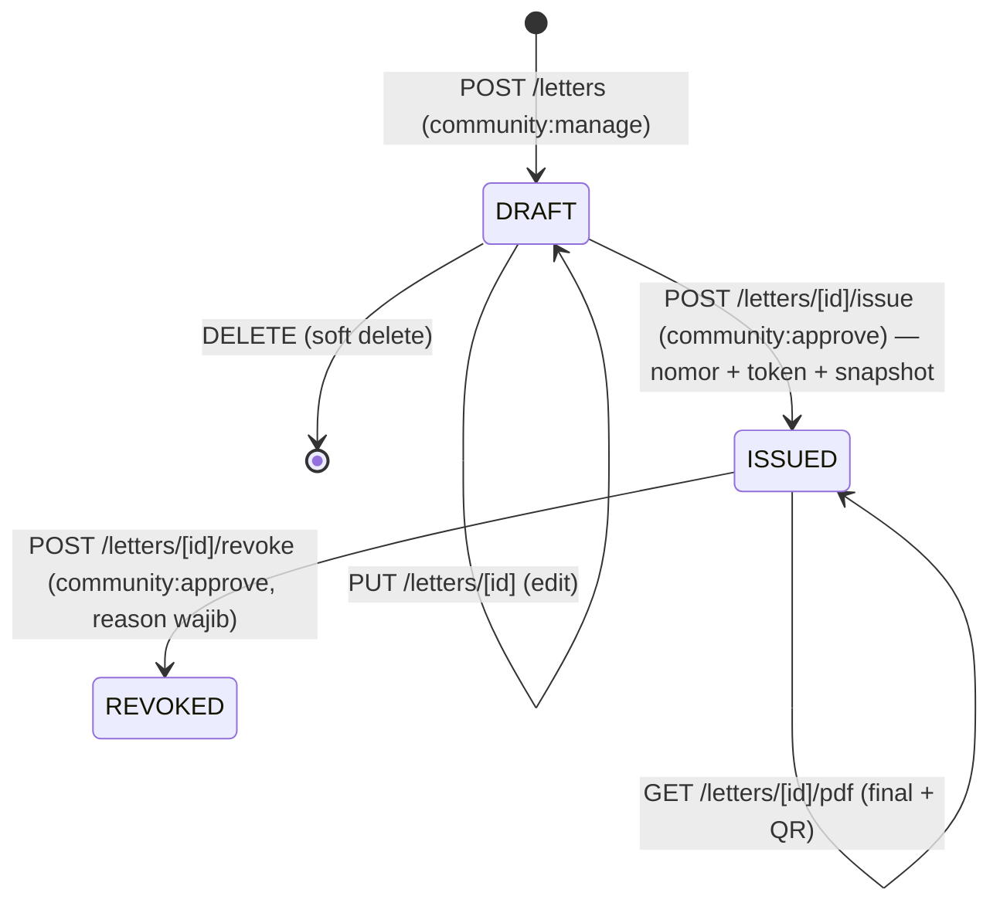
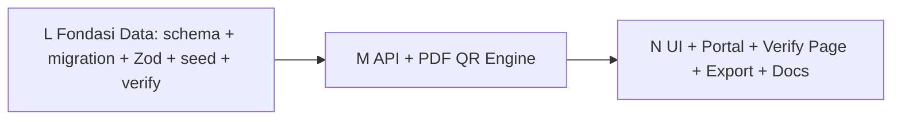

# Spec Implementasi Teknis — Fase 2: Modul Community (Surat Pengantar + Kegiatan)

> **Status:** Spec final untuk eksekusi subtask Code (L → M → N).
> **Basis arsitektur:** [`plans/community-gov-product-analysis.md`](plans/community-gov-product-analysis.md) §5.7 (roadmap Fase 2) + [`docs/COMMUNITY-MODULE.md`](docs/COMMUNITY-MODULE.md) (state Fase 1 production-ready, commit `4c743d9`).
> **Tanggal:** 13 Oktober 2026 (Session 73, Subtask K).
> **Aturan kerja:** Dokumen ini HANYA spec. Subtask Code (L/M/N) yang mengeksekusi. Setiap step WAJIB baca file target sebelum edit ([AGENT.md Rule 1](../AGENT.md)).
>
> **Do-Not-Touch (tetap berlaku dari Fase 1):** [`apps/web/lib/auth.ts`](apps/web/lib/auth.ts), [`apps/web/middleware.ts`](apps/web/middleware.ts), [`apps/web/lib/session.ts`](apps/web/lib/session.ts), [`apps/web/lib/audit.ts`](apps/web/lib/audit.ts), [`packages/permissions/**`](packages/permissions/src/permissions.ts) (TIDAK perlu perubahan — lihat §6), [`packages/industry-config/**`](packages/industry-config/src/packs/community.ts) (pack community sudah ada), [`apps/web/lib/auth.ts`](apps/web/lib/auth.ts).
> **Satu-satunya modifikasi model EXISTING yang diizinkan:** kolom opsional `eventId` di `CommunityCashTransaction` + field relasi reverse `events` di `CommunityAnnouncement` — keduanya additive/nullable, alasannya ada di §4.4.

---

## Daftar Isi

1. [Audit State & Reuse — Apa yang Sudah Ada](#1-audit-state--reuse--apa-yang-sudah-ada)
2. [Scope Fase 2 — IN / DEFER](#2-scope-fase-2--in--defer)
3. [Keputusan Desain](#3-keputusan-desain)
4. [Prisma Schema Design](#4-prisma-schema-design)
5. [API Contract](#5-api-contract)
6. [Role & Access Control](#6-role--access-control)
7. [UI / Pages](#7-ui--pages)
8. [Seed Data + Verify Script](#8-seed-data--verify-script)
9. [Zod Schemas](#9-zod-schemas)
10. [i18n Keys](#10-i18n-keys)
11. [Estimasi & Urutan Eksekusi (L → M → N)](#11-estimasi--urutan-eksekusi-l--m--n)
12. [Risiko & Regression Guard](#12-risiko--regression-guard)
13. [Definition of Done (Fase 2)](#13-definition-of-done-fase-2)

---

## 1. Audit State & Reuse — Apa yang Sudah Ada

> Dasar keputusan: jangan bangun ulang apa yang sudah jalan.

### 1.1 State Fase 1 (production-ready, commit `4c743d9`)

| Aset | Jumlah | Lokasi |
|------|--------|--------|
| Model Prisma community | 6 (`CommunityMember`, `CommunityDuesType`, `CommunityDuesBill`, `CommunityDuesPayment`, `CommunityCashTransaction`, `CommunityAnnouncement`) | [`packages/db/prisma/schema.prisma`](packages/db/prisma/schema.prisma:2994) baris 2994–3195 |
| API endpoint | 34 handler / 22 file route | [`apps/web/app/api/community/`](apps/web/app/api/community) |
| Halaman UI | 9 internal + 3 portal | [`apps/web/app/dashboard/community/`](apps/web/app/dashboard/community) |
| Permission keys | 5 (`community:view/manage/finance/approve/portal`) | [`packages/permissions/src/permissions.ts`](packages/permissions/src/permissions.ts:106) |
| Custom roles | KETUA / BENDAHARA / SEKRETARIS / WARGA (seed tenant `rt02-melati`) | [`apps/web/lib/seed-data/community.ts`](apps/web/lib/seed-data/community.ts) |
| Helper lib | [`apps/web/lib/community.ts`](apps/web/lib/community.ts) — `formatYmd`, `currentPeriod`, `periodBounds`, `dailyNumberPrefix`, `formatSeq3`, `resolvePortalMember`, `portalAnnouncementWhere`, `serializeCommunityMember` | idem |
| Verify/cleanup | `verify-community-seed.ts` (count eksak!), `cleanup-community-artifacts.ts`, `debug-bill-consistency.ts`, smoke `scripts/smoke-community-login.ps1` (8/8 PASS) | [`packages/db/scripts/`](packages/db/scripts) |

### 1.2 Library yang SUDAH terpasang (zero install baru)

| Kebutuhan | Library (sudah di [`apps/web/package.json`](apps/web/package.json)) | Status |
|-----------|------|--------|
| PDF server-side | `jspdf@^4.2.1` + `jspdf-autotable@^5.0.8` + `@types/jspdf` — pattern pemakaian ada di [`apps/web/lib/pdf-generator.ts`](apps/web/lib/pdf-generator.ts) (Invoice/Quotation/PO) | ✅ Reuse pattern |
| QR code | `qrcode@^1.5.4` + `@types/qrcode` — dipakai server-side (`QRCode.toDataURL()`) DAN client component [`apps/web/components/ui/qr-code.tsx`](apps/web/components/ui/qr-code.tsx) | ✅ Reuse langsung |
| Export/cetak | [`apps/web/lib/export.ts`](apps/web/lib/export.ts) — `exportToCSV`, `exportToExcel`, `printReport` (client-side download) | ✅ Reuse langsung |
| Enkripsi PII | [`apps/web/lib/encryption.ts`](apps/web/lib/encryption.ts) — `encrypt()`, `safeDecrypt()` (AES-256-GCM) | ✅ Reuse langsung |
| Numbering | `dailyNumberPrefix()` + `formatSeq3()` di [`apps/web/lib/community.ts`](apps/web/lib/community.ts) | ✅ Reuse langsung |
| Error/audit | `handleApiError()` ([`api-error.ts`](apps/web/lib/api-error.ts)), `logAudit()` ([`audit.ts`](apps/web/lib/audit.ts)), `MSG_*` ([`api-messages.ts`](apps/web/lib/api-messages.ts)) | ✅ Pola Fase 1 |
| Rate limit | [`apps/web/lib/rate-limit.ts`](apps/web/lib/rate-limit.ts) (Redis-backed + fallback) | ✅ Bisa dipanggil dari server component (lihat §7.4) |

### 1.3 Middleware — fakta kritis untuk fitur verifikasi publik

[`apps/web/middleware.ts`](apps/web/middleware.ts:170) `matcher` hanya mencakup `"/dashboard/:path*"`, `"/platform/:path*"`, `"/api/:path*"`. Konsekuensi:

- Halaman route di root (mis. `/verify/community-letter/[token]`) **TIDAK di-matcher → otomatis publik, tanpa edit middleware.** ✅
- API route `/api/community/letters/verify` (jika dibuat) **akan minta auth** (tidak di `PUBLIC_API_PATHS`) → **JANGAN buat API verify publik**; solusinya halaman server component (lihat Keputusan §3.3).

> **Aset inventaris (audit singkat):** modul Inventory (`Product`/`StockMovement`) existing bisa dipakai apa adanya untuk aset sederhana RT. **Fase 2 TIDAK membangun `CommunityAsset`** — melainkan menyalakan module toggle `inventory` di pack `community` sebagai "Aset Komunitas" (§2.1 item 4, opsional stretch).

---

## 2. Scope Fase 2 — IN / DEFER

### 2.1 IN Scope (di eksekusi Fase 2)

| # | Fitur | Ringkasan | Ukuran |
|---|-------|-----------|--------|
| 1 | **Surat Pengantar RT/RW (PDF + QR verifikasi)** | Model `CommunityLetter`; jenis: PENGANTAR, DOMISILI, SKTM, KETERANGAN_LAIN; alur DRAFT → ISSUED (oleh ketua) → REVOKED; nomor urut collision-safe; PDF server-side (jsPDF) berkop RT dengan blok identitas warga (NIK di-decrypt hanya di dalam PDF) + QR verifikasi; halaman verifikasi publik `/verify/community-letter/[token]` (tanpa auth, tanpa edit middleware) | **L** (inti Fase 2) |
| 2 | **Kegiatan (events/agenda warga)** | Model `CommunityEvent`: judul, kategori, waktu, lokasi, anggaran (`budgetAmount`), status PLANNED→ONGOING→DONE/CANCELLED; link opsional ke `CommunityAnnouncement`; link opsional `CommunityCashTransaction.eventId` untuk realisasi anggaran (rekap kas per kegiatan); portal agenda warga | **M** |
| 3 | **Export & cetak laporan** | Halaman Reports + Bills: tombol `exportToCSV` / `exportToExcel` / `printReport` (data skala RT ≤ ratusan baris → export client-side, **tanpa API baru**) | **S** |
| 4 | **Aset Komunitas via REUSE Inventory (stretch/opsional)** | Tambah `inventory: { enabled: true, label: 'Aset Komunitas' }` ke modules map pack `community` + smoke check UI. **Tanpa model/route baru.** Jika UX inventory ternyata tidak cocok (terlalu commerce), cukup dokumentasikan sebagai known limitation — JANGAN bangun `CommunityAsset` baru di Fase 2. | **S** |

**Playbook (tanpa kode): iuran khusus kegiatan.** Roadmap menyebut "iuran khusus kegiatan". Implementasi paling murah & paling konsisten: buat `CommunityDuesType` baru dengan `frequency: 'ONE_TIME'` (sudah didukung Fase 1) → Generate Tagihan → bayar via flow iuran existing. **Nol kode baru** — cukup didokumentasikan di [`docs/COMMUNITY-MODULE.md`](docs/COMMUNITY-MODULE.md) oleh subtask docs akhir.

### 2.2 DEFER eksplisit ke Fase 3 (JANGAN dikerjakan di Fase 2)

| Fitur | Fase | Alasan defer | Interface/hook yang disiapkan di Fase 2 |
|-------|------|--------------|------------------------------------------|
| **Desa/Kelurahan (fondasi organisasi)** | Fase 3 | Keputusan desain besar — lihat §3.1. Fase 2 harus ship; scope ini menyentuh semua model community | Spec §3.1 merekomendasikan arah (opsi a) + field `CommunityMember.rtRw` sudah ada sebagai masa transisi |
| **Multi-RT/RW konsolidasi (explicit tenant grant)** | Fase 3 | Butuh mekanisme grant lintas-tenant (pola delegation) — sentuhan ke core auth/tenant | — |
| **WA gateway (notifikasi surat/iuran)** | Fase 3 | Zero-dependency eksternal (filosofi founder) | Alur issue surat sudah bersih di 1 titik (`/letters/[id]/issue`) — hook notifikasi tinggal dipanggil di sana kelak |
| **Payment gateway / auto-debit iuran** | Fase 3 | Butuh integrasi eksternal (Xendit/Midtrans) + webhook | Kolom `CommunityDuesPayment.method` (String komentar enum) siap menerima channel baru; kolom `externalPaymentRef` akan ditambah additive di Fase 3 |
| **Mode akuntansi opsional (jurnal/COA community)** | Fase 3 | Cashbook-first terbukti di pilot; integrasi auto-journal = risiko regression finance | — |
| **Offline mode bendahara (IndexedDB sync)** | Fase 3 | Preseden pos-offline ada; scope sendiri yang besar | — |
| **Mobile RN bendahara** | Fase 3 | — | — |
| **Pendaftaran peserta kegiatan (registration table)** | Fase 3 | Manajemen pendaftaran RT umumnya via WA; tambah model tanpa demand pilot = scope creep | Field `maxCapacity` disediakan (informatif) |
| **`CommunityAsset` dedicated (lokasi/peminjaman/depresiasi)** | Fase 3 | REUSE inventory dulu (§2.1 item 4) | — |
| **Right-to-erasure UU PDP** | Fase 3 | — | — |
| **Pencarian NIK (deterministic encryption)** | Fase 3 | Sengaja dihindari sejak Fase 1 | — |

---

## 3. Keputusan Desain

> Setiap keputusan: konteks → alternatif → rekomendasi → implikasi kode.

### 3.1 Model organisasi Desa/Kelurahan — **DEFER penuh ke Fase 3; arah desain = opsi (a)**

**Konteks:** Founder mengarahkan "semua tingkat dalam satu sistem" (RT/RW → kelurahan → desa). Fase 2 harus ship tanpa semi-fitur.

| Opsi | Deskripsi | Nilai | Masalah |
|------|-----------|-------|---------|
| **(a) Satu tenant = satu desa/kelurahan**, dengan sub-struktur RT/RW sebagai entity dalam tenant (`CommunityUnit`: DESA > RW > RT; member punya `unitId`) | Isolasi bawaan; pricing jelas (satu organisasi = satu tenant = satu langganan); mentah-mentah mengikuti bentuk nyata pemerintahan desa; tidak ada data desa "terpecah" di banyak tenant → laporan desa gampang | Butuh model `CommunityUnit` + `unitId` di member/bill/surat → redesign relatif besar |
| **(b) Tenant tetap RT/RW, desa = agregasi multi-tenant** (SUPERADMIN melihat kumpulan tenant RT) | RT existing tidak berubah | Data desa terpecah; laporan desa = join lintas tenant (mahal, rapuh); cross-tenant read = zona berbahaya untuk aturan isolasi; pricing/rbac kabur |
| **(c) Tambah field desa di `Tenant`** (parentTenantId, orgType) | Paling murah | Hanya label — tidak menyelesaikan sub-struktur RT di dalam desa; semi-fitur yang justru bikin migrasi Fase 3 lebih mahal |

> **✅ REKOMENDASI: Opsi (a), diimplementasikan di Fase 3 (bukan Fase 2).**
> Alasan arsitektural: (1) **Tenant isolation** — desa adalah unit data & langganan alami; mengagregasi banyak tenant RT (opsi b) memaksa cross-tenant queries yang melanggar prinsip "setiap query filter tenantId"; (2) **Pricing** — RT Basic (gratis) vs Desa (penawaran khusus) maps 1:1 ke tenant/plan; (3) **Scope MVP** — opsi (a) penuh butuh `CommunityUnit` + sentuhan semua model community = tidak muat di Fase 2 yang harus ship surat+kegiatan.
>
> **Fase 2: TIDAK menambah field/model apapun untuk desa** (hindari semi-fitur setengah-setengah). Yang berlaku: field informatif `CommunityMember.rtRw` (sudah ada, "001/002") adalah masa transisi menuju `unitId` di Fase 3. Keputusan ini didokumentasikan di [`docs/DECISIONS.md`](docs/DECISIONS.md) oleh subtask docs akhir.

### 3.2 Permission Surat — **TANPA key baru; reuse `community:manage` + `community:approve`**

| Alternatif | Nilai | Masalah |
|-----------|-------|---------|
| Key baru `community:letters` | Granular | Fragmentasi model permission; Wajib update 4 seed role + dokumentasi + matriks; sekretaris yang dulu otomatis bisa surat kini butuh grant tambahan → regression UX |
| **Reuse `community:manage` (draft/CRUD) + `community:approve` (terbit/batal)** | Zero perubahan [`packages/permissions`](packages/permissions/src/permissions.ts); preseden SoD Fase 1 langsung terpakai; SEKRETARIS sudah punya `manage`, KETUA sudah punya `approve` | Granularitas kasar — dapat diterima (surat bukan domain terpisah, bagian dari administrasi) |

> **✅ REKOMENDASI: reuse.** Surat = administrasi (manage) + keputusan penerbitan (approve). Tidak ada perubahan satu karakter pun di `packages/permissions/**`.

### 3.3 Desain QR verifikasi surat — **URL ke halaman publik token-based, tanpa API publik, tanpa edit middleware**

**Rekomendasi (final):**

1. Saat ketua menerbitkan surat (`/issue`), server membuat `verifyToken = crypto.randomBytes(16).toString('hex')` (32 hex chars ≈ 128 bit — enumeration mustahil), disimpan di kolom `CommunityLetter.verifyToken` (`@unique`).
2. QR meng-encode URL: `` `${process.env.NEXTAUTH_URL}/verify/community-letter/${verifyToken}` `` (`NEXTAUTH_URL` = origin canonical repo ini — dipakai juga oleh NextAuth & cron).
3. PDF menyertakan QR (via `qrcode.toDataURL()` server-side → `doc.addImage`) + teks URL di bawahnya untuk fallback manual.
4. Halaman verifikasi = **server component** [`apps/web/app/verify/community-letter/[token]/page.tsx`](apps/web/app/verify/community-letter/[token]/page.tsx) yang query Prisma langsung — **bukan API route** (API route di bawah `/api/*` akan kena auth middleware dan butuh edit Do-Not-Touch `middleware.ts`). Halaman root tidak kena matcher → publik alami.
5. Respons halaman:
   - **Valid (ISSUED):** nomor surat, jenis, tanggal terbit, nama pemegang, instansi tujuan, status ✅. **TIDAK menampilkan NIK/NKK** (minimisasi PII — verifikasi cukup mencocokkan nama+nomor+jenis).
   - **Dibatalkan (REVOKED):** status DIBATALKAN + alasan pembatalan (tanpa PII lain).
   - **Tidak ditemukan / token malformed:** pesan generik "Surat tidak ditemukan atau tidak valid" — jangan echo token.
6. **Rate limiting:** di dalam page component, panggil helper rate-limit existing ([`apps/web/lib/rate-limit.ts`](apps/web/lib/rate-limit.ts)) — **inspek dulu dulu** (Rule 1) apakah API-nya cocok dipanggil dari server component; jika tidak kompatibel, cukup token 128-bit tanpa limiter (risiko diterima & dicatat di spec ini).

**Alternatif yang DITOLAK:**
- *QR berisi data ter-encode (JSON surat):* tidak bisa diverifikasi keasliannya (siapapun bisa fabricate QR); tanpa round-trip ke server = zero anti-tilang.
- *API publik `/api/community/letters/verify`:* butuh menambah `PUBLIC_API_PATHS` → edit `middleware.ts` (Do-Not-Touch) DAN membuka attack surface API publik baru.
- *Token sequential/nomor surat:* enumerable → bisa doxxing data warga.

### 3.4 Nomor surat — **`SRT/<kode jenis>/<YYYY>/<seq3>`, di-assign saat ISSUE (bukan saat draft)**

- Format: `SRT/PNG/2026-001` (PENGANTAR), `SRT/DOM/2026-001` (DOMISILI), `SRT/SKT/2026-001` (SKTM), `SRT/KTR/2026-001` (KETERANGAN_LAIN). Tahun = tahun penerbitan (APP_TIMEZONE).
- **Assign saat ISSUE**, bukan saat create draft → nomor tidak berlubang karena draft dibatalkan; DRAFT punya `letterNumber = null`.
- **Collision-safe (max+bump):** dalam `$transaction`, `SELECT letterNumber WHERE tenantId+LIKE 'SRT/PNG/2026/%' ORDER BY letterNumber DESC LIMIT 1` → parse seq → `+1` → update. `@@unique([tenantId, letterNumber])` sebagai jaring pengaman; pada P2002 retry 1× (pola Fase 1). (Postgres unique mengizinkan banyak NULL → aman untuk draft.)
- Nomor kegiatan: `KGT/YYYY-<seq3>` (contoh `KGT/2026-001`), **di-assign saat CREATE** (event selalu punya nomor), algoritma max+bump sama.

### 3.5 SoD surat & kegiatan — **Surat: approve-wajib, self-issue DIBOLEHKAN. Keuangan tetap SoD ketat.**

- **Surat bukan urusan keuangan** → aturan "bendahara catat ≠ ketua approve" (uang) tidak otomatis berlaku. Penerbitan surat tetap **wajib `community:approve`** (hanya KETUA); namun **creator ≠ issuer TIDAK dipaksa** — alasan: RT kecil dengan 1–2 akun pengurus nyata akan macet jika sekretaris=ketua dilarang menerbitkan sendiri. Sifat surat: administratif, dapat dibatalkan (REVOKED + alasan + audit trail) — bukan gerbang uang.
- **Keuangan tetap ketat:** realisasi anggaran kegiatan hanyalah `CommunityCashTransaction` biasa (status PENDING → approve oleh ketua, SoD creator≠approver **tetap berlaku** — tidak ada jalur baru mem-bypass approval kas).

### 3.6 Snapshot isi surat (immutability)

Saat ISSUE, server merender blok identitas dari `CommunityMember` (nama, NIK hasil `safeDecrypt`, alamat, `rtRw`) + data RT dari `Tenant` → **snapshot disimpan ke kolom `bodySnapshot Json`**. PDF selalu render dari snapshot (bukan re-derive dari data warga yang bisa berubah) → surat terbit = dokumen tetap; perubahan data warga belakangan tidak mengubah surat lama. NIK **hanya hidup di kolom terenkripsi dan di snapshot PDF; TIDAK PERNAH masuk response JSON API** (pola `serializeCommunityMember` — flag `nikStored` saja).

### 3.7 Kop surat — konfigurasi via `Tenant.settings.community` (Rule 7: configuration before customization)

```ts
// Tenant.settings.community (Json, opsional — default bila kosong)
{
  kelurahan: 'Melati',
  kecamatan: 'Cibinong',
  kabupaten: 'Bogor',
  provinsi: 'Jawa Barat',
  rwNumber: '005',
  kodePos: '16911',
  kopLine1: 'PEMERINTAH KABUPATEN BOGOR',   // opsional override baris 1
  kopLine2: 'KELURAHAN MELATI',             // opsional
}
```

Baris kop RT = `kopLine1` (default: nama tenant uppercase) / `kopLine2` (default: `KELURAHAN ${kelurahan}`) / `RT ${tenant.name-derived} / RW ${rwNumber}`. **Tidak ada hardcoded 'Melati' di code** — seed hanya mengisi settings. Hal ini mengikuti pola `Tenant.settings` yang sudah dipakai lock-policy.

### 3.8 Keputusan pendukung lain

| # | Keputusan | Rekomendasi |
|---|-----------|-------------|
| 1 | Permission GET kegiatan | `community:view` (semua pengurus boleh lihat agenda); mutasi `community:manage` |
| 2 | Jenis surat hardcoded di code vs config | Daftar jenis (label + kode nomor + template body) sebagai **konstanta typed** di [`apps/web/lib/community-letter.ts`](apps/web/lib/community-letter.ts) — 4 jenis umum; menambah jenis = edit code (bukan data). Alasan: teks surat resmi = kebijakan, bukan preferensi tenant. Jika kelak butuh per-tenant, pindahkan ke `Tenant.settings` (additive, tanpa migrasi) |
| 3 | PDF engine | **File BARU** [`apps/web/lib/community-letter-pdf.ts`](apps/web/lib/community-letter-pdf.ts) — JANGAN tambah fungsi surat ke [`pdf-generator.ts`](apps/web/lib/pdf-generator.ts) (file finance, sentuh = risiko regression invoice/PO). Pola jsPDF di-copy dari pdf-generator |
| 4 | Watermark DRAFT | PDF DRAFT legal diunduh (preview sekretaris) dengan teks "DRAF — BUKAN DOKUMEN RESMI" di header. PDF untuk REVOKED → **tolak** `400 LETTER_REVOKED` (surat batal tidak layak dicetak ulang) |
| 5 | Portal surat warga | Warga melihat **daftar riwayat surat miliknya sendiri** (own-only via `resolvePortalMember`) + status; tautan verifikasi; **tanpa** preview PDF penuh (PDF = aksi pengurus) |
| 6 | Kegiatan CANCELLED dengan transaksi | Delete/revoke event = soft delete + block hard-delete bila ada `CommunityCashTransaction.eventId` aktif (data kas tidak boleh kehilangan referensi) |

---

## 4. Prisma Schema Design

### 4.1 Konvensi (identik Fase 1 — WAJIB)

`id String @id @default(cuid())` · `tenantId` + relasi `Tenant` + `@@index([tenantId])` · uang `Decimal @db.Decimal(19, 4)` · status `String @default(...)` + comment enum (BUKAN Prisma enum) · business key `@@unique([tenantId, <key>])` · soft delete `deletedAt/deletedBy` (master & transaksi) · `createdBy String?` tanpa FK · semua model baru ditaruh di **bagian paling bawah** schema di bawah comment `// ─── Community Module (Fase 2: Surat & Kegiatan) ───`. **WAJIB** mengikuti konvensi ini (inspek block Fase 1 di schema sebelum menulis — Rule 1).

### 4.2 Kode `.prisma` siap tempel (ADDITIVE — 2 model baru)

```prisma
// ─── Community Module (Fase 2: Surat & Kegiatan) ─────────────────────────────
// Referensi: plans/community-phase2-implementation.md
// Surat pengantar RT/RW (PDF+QR verifikasi) + agenda kegiatan warga.

model CommunityLetter {
  id          String    @id @default(cuid())
  tenantId    String
  tenant      Tenant    @relation(fields: [tenantId], references: [id])

  // Dokumen
  letterNumber String?  // Di-assign saat ISSUE: "SRT/<PNG|DOM|SKT|KTR>/<YYYY>-<seq3>" — NULL saat DRAFT
  letterType  String    // PENGANTAR, DOMISILI, SKTM, KETERANGAN_LAIN (kode+template di lib/community-letter.ts)
  memberId    String
  member      CommunityMember @relation(fields: [memberId], references: [id])
  purpose     String    // Keperluan surat, e.g. "Pengajuan paspor"
  destination String?   // Instansi tujuan, e.g. "Imigrasi Kelas I Cibinong"
  notes       String?

  // Status & penerbitan
  status      String    @default("DRAFT") // DRAFT, ISSUED, REVOKED
  bodySnapshot Json?    // Snapshot isi surat saat ISSUE (nama, nik plain di PDF-saja, alamat, kop RT) — immutability dokumen
  issuedAt    DateTime?
  signedBy    String?   // User id ketua penerbit
  signedByName String?  // Snapshot nama ketua penerbit
  revokedAt   DateTime?
  revokedBy   String?
  revokeReason String?

  // Verifikasi publik (QR)
  verifyToken String?   @unique // crypto.randomBytes(16).toString('hex') — dibuat saat ISSUE; QR → /verify/community-letter/<token>

  createdBy   String?
  createdAt   DateTime  @default(now())
  updatedAt   DateTime  @updatedAt
  deletedAt   DateTime?
  deletedBy   String?

  @@unique([tenantId, letterNumber]) // NULL (draft) diizinkan ganda oleh Postgres
  @@index([tenantId, status])
  @@index([tenantId, memberId])
  @@index([tenantId])
}

model CommunityEvent {
  id          String    @id @default(cuid())
  tenantId    String
  tenant      Tenant    @relation(fields: [tenantId], references: [id])

  eventNumber String    // Di-assign saat CREATE: "KGT/<YYYY>-<seq3>", unik per tenant
  title       String
  description String?
  category    String?   // RAPAT, KERJA_BAKTI, PERAYAAN, SOSIAL, LAINNYA (label bebas terkontrol)
  startsAt    DateTime
  endsAt      DateTime?
  location    String?
  maxCapacity Int?      // Informatif (pendaftaran peserta = Fase 3)
  budgetAmount Decimal? @db.Decimal(19, 4) // Anggaran rencana (opsional) — realisasi = agregat CommunityCashTransaction.eventId
  status      String    @default("PLANNED") // PLANNED, ONGOING, DONE, CANCELLED
  publishedAt DateTime? // Waktu tayang di portal warga (null = draft internal)

  // Relasi opsional (tanpa FK hard-delete guard — pola userId)
  announcementId String? // Link opsional ke pengumuman terkait

  createdBy   String?
  createdAt   DateTime  @default(now())
  updatedAt   DateTime  @updatedAt
  deletedAt   DateTime?
  deletedBy   String?

  transactions CommunityCashTransaction[] // Realisasi anggaran per kegiatan

  @@unique([tenantId, eventNumber])
  @@index([tenantId, status])
  @@index([tenantId, startsAt])
  @@index([tenantId])
}
```

### 4.3 Relasi reverse di model EXISTING (wajib agar Prisma valid — additive, tanpa kolom baru di sisi existing)

| Model existing | Tambahkan | Sifat |
|----------------|-----------|-------|
| `CommunityMember` | `letters CommunityLetter[]` | Field relasi reverse saja — **tanpa kolom** |
| `CommunityAnnouncement` | `events CommunityEvent[]` | Field relasi reverse saja — **tanpa kolom** |

### 4.4 SATU modifikasi kolom existing yang diizinkan: `CommunityCashTransaction.eventId`

```prisma
// Di dalam model CommunityCashTransaction — tambahkan 2 baris field + 1 baris relasi:
  eventId       String?        // Fase 2: relasi opsional ke kegiatan (realisasi anggaran) — NULL untuk kas umum
  event         CommunityEvent? @relation(fields: [eventId], references: [id])
```

**Alasan (dicatat di sini agar Code tidak ragu):** kolom `String?` nullable, tanpa default, tanpa backfill → **tidak mempengaruhi baris/jumlah/query existing apa pun** (100% backward compatible; semua read Fase 1 tidak menyebut field ini). Tanpa relasi ini, "rekap realisasi anggaran kegiatan" harus berbasis filter teks deskripsi = rapuh. Mengikuti mandat "relasi opsional tambahan yang aman".

### 4.5 Migration

```bash
cd packages/db
npx prisma migrate dev --name community_phase2_surat_kegiatan   # additive: 2 tabel baru + 1 kolom nullable + 3 relasi
npx prisma generate                                              # lalu RESTART dev server (Lesson 14.2)
bash scripts/check-drift.sh                                      # WAJIB lulus
```

---

## 5. API Contract

### 5.1 Daftar endpoint baru (15 handler / 9 file route)

Semua mengikuti pola Fase 1: `getServerSession` → `requirePermissionForRoute(req)` → `hasPermission(session, '<key>')` → tenant auto-inject → Zod (mutasi) → `logAudit()` → `handleApiError()` di catch. Response memakai `MSG_*` constants.

| # | Method | Path | Permission | Deskripsi |
|---|--------|------|------------|-----------|
| 1 | GET | `/api/community/letters` | `community:manage` | List surat; filter `?status=&letterType=&memberId=&q=` (q = nomor/purpose), include `member { fullName, code, address }` — **tanpa NIK plain** |
| 2 | POST | `/api/community/letters` | `community:manage` | Buat DRAFT (`createCommunityLetterSchema`) |
| 3 | GET | `/api/community/letters/[id]` | `community:manage` | Detail surat (+member snapshot, flag `nikStored`) |
| 4 | PUT | `/api/community/letters/[id]` | `community:manage` | Update — **hanya DRAFT**; selain itu `400 LETTER_NOT_DRAFT` |
| 5 | DELETE | `/api/community/letters/[id]` | `community:manage` | Soft delete — **hanya DRAFT** |
| 6 | POST | `/api/community/letters/[id]/issue` | `community:approve` | DRAFT → ISSUED: assign nomor (max+bump §3.4), buat `verifyToken`, render `bodySnapshot`, set `issuedAt/signedBy/signedByName`. Self-issue **dibolehkan** (§3.5). Sudah ISSUED → `400 LETTER_ALREADY_ISSUED` |
| 7 | POST | `/api/community/letters/[id]/revoke` | `community:approve` | ISSUED → REVOKED (`revokeReason` wajib). REVOKED tidak bisa di-revoke lagi |
| 8 | GET | `/api/community/letters/[id]/pdf` | `community:manage` | Render PDF (jsPDF + QR). DRAFT → PDF watermark DRAF; REVOKED → `400 LETTER_REVOKED`; ISSUED → final. Header `Content-Type: application/pdf`, `Content-Disposition: inline; filename="<letterNumber>.pdf"`. Route export `runtime = 'nodejs'` eksplisit |
| 9 | GET | `/api/community/portal/letters` | `community:portal` | Riwayat surat warga login (own-only via `resolvePortalMember`; tanpa bodySnapshot) |
| 10 | GET | `/api/community/events` | `community:view` | List kegiatan; filter `?status=&year=`; include `_count.transactions` |
| 11 | POST | `/api/community/events` | `community:manage` | Buat kegiatan (`createCommunityEventSchema`, nomor `KGT/` di-assign) |
| 12 | GET | `/api/community/events/[id]` | `community:view` | Detail + daftar `transactions` ter-link (status APPROVED + PENDING, amount `Number()`) |
| 13 | PUT | `/api/community/events/[id]` | `community:manage` | Update (DONE/CANCELLED boleh; nomor tidak berubah) |
| 14 | DELETE | `/api/community/events/[id]` | `community:manage` | Soft delete — **block** bila ada `transactions` ter-link aktif → `409 EVENT_HAS_TRANSACTIONS` |
| 15 | GET | `/api/community/portal/events` | `community:portal` | Agenda warga: `publishedAt <= now`, bukan CANCELLED tampil berlabel; include event selesai 30 hari terakhir |

### 5.2 ROUTE_PERMISSIONS (additive — [`apps/web/lib/route-permissions.ts`](apps/web/lib/route-permissions.ts))

**Inspek dulu** gaya entri community Fase 1 (exact vs prefix), lalu tambahkan konsisten (perkiraan — sesuaikan gaya existing):

```
/api/community/letters              → community:manage  (GET, POST)
/api/community/letters/[id]         → community:manage
/api/community/letters/[id]/issue   → community:approve
/api/community/letters/[id]/revoke  → community:approve
/api/community/letters/[id]/pdf     → community:manage
/api/community/portal/letters       → community:portal
/api/community/events               → community:view    (GET) + community:manage (POST) — ikuti gaya penanganan method-split yang sudah ada di file
/api/community/events/[id]          → community:view    (+ manage untuk PUT/DELETE — ikuti cara Fase 1)
/api/community/portal/events        → community:portal
```

> **TIDAK ada perubahan [`packages/permissions/src/permissions.ts`](packages/permissions/src/permissions.ts)** — semua key sudah ada (§3.2).

### 5.3 `api-messages.ts` (additive)

Tambah 2 grup konstanta (pola `MSG_COMMUNITY_*` Fase 1): `MSG_COMMUNITY_LETTERS` (LETTER_CREATED/UPDATED/DELETED/ISSUED/REVOKED/NOT_FOUND/NOT_DRAFT/ALREADY_ISSUED/REVOKED_NO_PDF/INVALID_TRANSITION) dan `MSG_COMMUNITY_EVENTS` (EVENT_CREATED/UPDATED/DELETED/NOT_FOUND/EVENT_HAS_TRANSACTIONS/INVALID_DATE).

### 5.4 Lib baru

| File | Isi | Reuse |
|------|-----|-------|
| [`apps/web/lib/community-letter.ts`](apps/web/lib/community-letter.ts) | `LETTER_TYPES` (konstanta typed: `{ type, labelId, labelEn, numberCode, bodyTemplate }` untuk PENGANTAR/DOMISILI/SKTM/KETERANGAN_LAIN); `generateVerifyToken()`; `nextLetterNumber(tx, tenantId, type, year)` (max+bump + retry-once P2002 caller-side); `nextEventNumber(tx, tenantId, year)`; `buildLetterSnapshot(member, tenant, type, purpose, destination)`; `letterVerifyUrl(token)` | `dailyNumberPrefix`/`formatSeq3`/`formatYmd` dari [`community.ts`](apps/web/lib/community.ts) |
| [`apps/web/lib/community-letter-pdf.ts`](apps/web/lib/community-letter-pdf.ts) | `renderCommunityLetterPdf(letter, member, tenant, opts): Uint8Array` — jsPDF A4: kop 3 baris + garis ganda, judul surat (centered, underlined), nomor+tanggal, paragraf pembuka ("Yang bertanda tangan di bawah ini Ketua RT … dengan ini menerangkan bahwa:"), blok identitas (Nama, NIK hasil `safeDecrypt` **hanya di memori render**, Alamat/Rumah, rtRw), paragraf keperluan, penutup, blok tanda tangan kanan (signedByName, tanggal terbit), footer QR 3cm (`qrcode.toDataURL`) + teks URL verifikasi + nomor dokumen; watermark "DRAF — BUKAN DOKUMEN RESMI" bila `opts.draft` | Pola jsPDF dari [`pdf-generator.ts`](apps/web/lib/pdf-generator.ts) (di-COPY, bukan import silang); `qrcode` server-side |

**Aturan keamanan PDF:** `safeDecrypt(nikEncrypted)` dipanggil **hanya** di dalam `renderCommunityLetterPdf`/`buildLetterSnapshot`; nilai plain tidak pernah masuk variabel response JSON; `bodySnapshot.nik` tidak pernah di-serialize ke client (endpoint detail mengembalikan `hasNik: boolean` saja).

### 5.5 Alur penerbitan (SoD & state machine)



---

## 6. Role & Access Control

### 6.1 Matriks aksi × role (custom role existing — TANPA perubahan permission)

| Aksi | KETUA (`view,manage,finance,approve`) | BENDAHARA (`view,finance`) | SEKRETARIS (`view,manage`) | WARGA (`portal`) | ADMIN sistem (RBAC_STRICT) |
|------|:-:|:-:|:-:|:-:|:-:|
| List/detail/buat/edit/hapus DRAFT surat | ✅ | ❌ 403 | ✅ | ❌ | ❌ 403 (tanpa grant eksplisit) |
| **Issue / Revoke surat** | ✅ | ❌ 403 | ❌ 403 | ❌ | ❌ 403 |
| Download PDF surat | ✅ | ❌ | ✅ | ❌ | ❌ |
| Lihat/buat/edit/hapus kegiatan | ✅ | ❌ (view ✅ bila `community:view` — bendahara punya view ✅ lihat catatan) | ✅ | ❌ | ❌ |
| Portal riwayat surat saya | ❌ | ❌ | ❌ | ✅ (own-only) | ❌ |
| Portal agenda | ❌ | ❌ | ❌ | ✅ | ❌ |

> Catatan: GET kegiatan memakai `community:view` → KETUA **dan** BENDAHARA bisa melihat agenda (berguna rapat anggaran); mutasi tetap `community:manage` (KETUA+SEKRETARIS).

### 6.2 Defense-in-depth (3 lapis — pola Fase 1)

1. **Middleware** — path `/dashboard/community/*` sudah ter-gate auth+flag; halaman `/verify/*` sengaja di luar matcher (publik by design, minimisasi data).
2. **API** — `requirePermissionForRoute` + in-route `hasPermission` (terutama `issue`/`revoke`: explicit check `community:approve`, mengulang pelajaran Fase 1 "route [id]/approve jatuh ke base prefix").
3. **UI** — tombol Issue/Revoke hanya dirender bila `hasPermission('community:approve')` (server layout guard + client conditional).

---

## 7. UI / Pages

Lokasi: [`apps/web/app/dashboard/community/`](apps/web/app/dashboard/community). Semua mengikuti pola Fase 1: **dual layout** (mobile cards ≤768px + desktop table), `loading.tsx`/`error.tsx` di setiap section, empty state, toast, confirm dialog, permission-conditional buttons, i18n id+en, Lucide icons.

### 7.1 Halaman BARU (6) + EDIT (4)

| # | Halaman | Path | Fitur |
|---|---------|------|-------|
| 1 | Letters list | `(internal)/letters/page.tsx` (+`loading.tsx`,`error.tsx`) | Tabel/kartu: nomor (— bila DRAFT), jenis, warga, keperluan, status, tanggal; filter status/jenis; tombol **Buat Surat** (form dialog — ikuti pola form dialog members page Fase 1); row click → detail |
| 2 | Letter detail | `(internal)/letters/[id]/page.tsx` (+loading/error) | Info surat + blok warga (NIK masked/flag `nikStored`); **tombol Issue** (konfirmasi dialog) / **Revoke** (wajib isi alasan) sesuai permission; **Download PDF**; preview QR verifikasi via komponen [`qr-code.tsx`](apps/web/components/ui/qr-code.tsx) (client) untuk ISSUED; riwayat status; **tanpa** menampilkan isi `bodySnapshot` (hanya lewat PDF) |
| 3 | Events list | `(internal)/events/page.tsx` (+loading/error) | Daftar kegiatan: nomor, judul, kategori, tanggal, lokasi, anggaran vs realisasi (dari `_count`/summary), status; filter status/tahun; form dialog Buat Kegiatan |
| 4 | Event detail | `(internal)/events/[id]/page.tsx` (+loading/error) | Detail + tabel transaksi kas ter-link (badge status approval) + anggaran vs realisasi; edit/hapus (block bila ada transaksi) |
| 5 | Portal riwayat surat | `portal/letters/page.tsx` (+loading/error) | Surat milik sendiri (own-only): nomor, jenis, status, tanggal terbit; tautan salin URL verifikasi. Tanpa PDF preview |
| 6 | Portal agenda | `portal/events/page.tsx` (+loading/error) | Agenda warga (published): datang & selesai; badge CANCELLED |

### 7.2 Halaman EDIT (additive — jangan ubah perilaku lama)

| # | Halaman | Perubahan |
|---|---------|-----------|
| 7 | `(internal)/page.tsx` (Overview) | +2 kartu mini: "Surat bulan ini" (count ISSUED periode berjalan) & "Kegiatan mendatang" (count PLANNED) — data dari `/api/community/overview` **yang di-extend** (tambah 2 agregat kecil, respons lama tidak berubah) |
| 8 | `(internal)/reports/page.tsx` | Tombol **Export CSV / Excel / Cetak PDF** via [`export.ts`](apps/web/lib/export.ts) (`exportToCSV`, `exportToExcel`, `printReport`) untuk ringkasan iuran + kas + tunggakan — **client-side, tanpa API baru** |
| 9 | `(internal)/bills/page.tsx` | Tombol **Export CSV** daftar tagihan (client-side, filter yang sedang aktif) |
| 10 | [`sidebar.tsx`](apps/web/components/layout/sidebar.tsx) | 2 menu baru di group Community: **Surat** (`community:manage`) & **Kegiatan** (`community:view`), gated flag `COMMUNITY_MODULE` + `isMounted` (hindari hydration warning — pola adminOnly) |

### 7.3 Halaman verifikasi PUBLIK (root — bukan di bawah dashboard)

| # | Halaman | Path | Catatan |
|---|---------|------|---------|
| 11 | Verify letter | [`app/verify/community-letter/[token]/page.tsx`](apps/web/app/verify/community-letter/[token]/page.tsx) (+`loading.tsx`) | Server component publik; query `findFirst({ where: { verifyToken } })` (**tanpa tenantId** — token global unik & random; ini satu-satunya query lintas-tenant yang disengaja & terbatas token; catat di komentar kode); render hasil §3.3 point 5; status 200 selalu (UI membedakan valid/invalid — jangan gunakan 404 page bawaan agar respons konsisten); rate-limit best-effort §3.3 point 6; **tanpa NIK**; footer "Diverifikasi via Qalcuity" |

### 7.4 Catatan implementasi UI

- Semua angka `Decimal` → `Number()` sebelum render (Lesson Fase 1).
- Tanggal format id/en via helper i18n existing.
- Form dialog surat: select warga (fetch `/api/community/members?q=`, reuse komponen select yang ada — **inspek dulu** pola pencarian warga di bills page), select jenis surat (4 opsi dari i18n), input keperluan (wajib), tujuan (opsional).
- Portal: gunakan `resolvePortalMember` result (404 PORTAL_MEMBER_NOT_FOUND bila tidak ada — pola portal Fase 1).

---

## 8. Seed Data + Verify Script

### 8.1 Seed additions — [`apps/web/lib/seed-data/community.ts`](apps/web/lib/seed-data/community.ts) (edit additive, tenant `rt02-melati` saja)

Deterministik (mulberry32 + anchor `2026-10-10`), idempotent (upsert by business key), ASCII-safe, NIK/NKK tetap hanya ter-encrypt.

| Entity | Volume | Spesifikasi deterministik |
|--------|--------|---------------------------|
| `CommunityLetter` | 5 | 3 **ISSUED** (`SRT/PNG/2026-001` pengajar warga W-003 keperluan "Pengurusan paspor", `SRT/DOM/2026-001` domisili W-007, `SRT/SKT/2026-001` SKTM W-012) — `verifyToken` deterministik: `'seed' + padStart n` → format hex 32 valid (mis. token berbasis `mulberry32` hex, PASTIKAN unique & 32-char); 1 **DRAFT** (PENGANTAR, W-015, `letterNumber: null`); 1 **REVOKED** (`SRT/PNG/2026-002`, W-019, `revokeReason: 'Dicabut — keperluan batal'`). `signedBy`/`signedByName` → ketua; `bodySnapshot` diisi konsisten (nik plain di snapshot = hasil decrypt NIK seed — hanya untuk PDF, bukan API) |
| `CommunityEvent` | 3 | `KGT/2026-001` "Kerja Bakti Bersih Saluran Air" (DONE, `publishedAt` lampau, anggaran Rp 750.000), `KGT/2026-002` "Rapat Bulanan RT" (PLANNED, mendatang, anggaran null), `KGT/2026-003` "Posyandu Balita" (CANCELLED, `publishedAt` null) |
| `CommunityCashTransaction` | **+2 (EXPENSE, APPROVED)** | Keduanya ter-link `eventId → KGT/2026-001` (realisasi kerja bakti: Rp 300.000 "Konsumsi kerja bakti" + Rp 180.000 "Perkakas"), `createdBy` bendahara, `approvedBy` ketua (SoD konsisten), nomor `KAS/` collision-safe lanjutan dari urutan existing |

**KONTRAK BARU jumlah eksak (menggantikan angka lama — update di waktu yang sama!):**

| Model | Lama | Baru |
|-------|------|------|
| Cash transactions total | 10 | **12** |
| INCOME / EXPENSE | 4 / 6 | 4 / **8** |
| Letters | — | 5 (ISSUED 3, DRAFT 1, REVOKED 1) |
| Events | — | 3 (DONE 1, PLANNED 1, CANCELLED 1) |

### 8.2 Verify script — [`packages/db/scripts/verify-community-seed.ts`](packages/db/scripts/verify-community-seed.ts) (edit additive)

Checklist BARU (di samping semua check lama yang tetap berjalan):

1. Letters: total 5, mix status benar; semua ISSUED punya `letterNumber` unique + `verifyToken` 32-char unique; semua DRAFT punya `letterNumber: null`; semua REVOKED punya `revokeReason`.
2. Invarian: `bodySnapshot` terisi IFF status ISSUED/REVOKED (DRAFT → null).
3. Events: total 3, mix status benar; `eventNumber` unique; CANCELLED tanpa `publishedAt`.
4. Realisasi: `Σ CommunityCashTransaction.amount WHERE eventId=KGT/2026-001 APPROVED` = 480.000; tidak ada tx ber-`eventId` yang PENDING/REJECTED pada seed (semua APPROVED agar angka deterministik).
5. **Check lama yang HARUS di-update angkanya:** total cash tx `10 → 12`; EXPENSE `6 → 8` (jangan lupa — kalau tidak, verify gagal palsu, Lesson 14.3).
6. Isolasi: tidak ada letter/event di tenant selain `rt02-melati` (khususnya `qalcuity-demo` bersih).
7. Reverse-relation aman: cash tx LAMA (10 baris seed Fase 1) semuanya `eventId = NULL` (tidak ada backfill salah sasaran).

### 8.3 Cleanup script — [`cleanup-community-artifacts.ts`](packages/db/scripts/cleanup-community-artifacts.ts) (edit kecil)

Tambah target cleanup: smoke **letter** (purpose/description prefix `"Smoke test surat"`) & smoke **event** (title prefix `"Smoke test kegiatan"`) agar smoke matrix Fase 2 tidak merusak count-exak verify (Lesson 14.3).

---

## 9. Zod Schemas

Tambah di [`apps/web/lib/validation-schemas.ts`](apps/web/lib/validation-schemas.ts) — **pola aman anti gotcha `.partial()` + `.refine()` (Lesson 14.1): WAJIB base object tanpa refine**:

```ts
// ─── Community Phase 2 (Surat & Kegiatan) ─────────────────────────────────────

// Surat: tanpa cross-field refine → create schema boleh langsung object
const communityLetterBase = z.object({
  letterType: z.enum(['PENGANTAR', 'DOMISILI', 'SKTM', 'KETERANGAN_LAIN']),
  memberId: z.string().min(1),
  purpose: z.string().trim().min(3).max(500),
  destination: z.string().trim().max(200).optional(),
  notes: z.string().trim().max(1000).optional(),
});
export const createCommunityLetterSchema = communityLetterBase;
export const updateCommunityLetterSchema = communityLetterBase.partial(); // ✅ aman (base tanpa refine)

export const revokeCommunityLetterSchema = z.object({
  reason: z.string().trim().min(3).max(500),
});

// Kegiatan: ADA cross-field refine (endsAt > startsAt) → split base
const communityEventBase = z.object({
  title: z.string().trim().min(3).max(200),
  description: z.string().trim().max(2000).optional(),
  category: z.enum(['RAPAT', 'KERJA_BAKTI', 'PERAYAAN', 'SOSIAL', 'LAINNYA']).optional(),
  startsAt: z.coerce.date(),
  endsAt: z.coerce.date().optional(),
  location: z.string().trim().max(200).optional(),
  maxCapacity: z.number().int().positive().max(10000).optional(),
  budgetAmount: z.number().nonnegative().max(1_000_000_000).optional(),
  publishedAt: z.coerce.date().optional(),
});
export const createCommunityEventSchema = communityEventBase.refine(
  (d) => !d.endsAt || d.endsAt >= d.startsAt,
  { message: 'EVENT_INVALID_DATE', path: ['endsAt'] }
);
export const updateCommunityEventSchema = communityEventBase
  .partial()
  .refine(
    (d) => !d.startsAt || !d.endsAt || d.endsAt >= d.startsAt,
    { message: 'EVENT_INVALID_DATE', path: ['endsAt'] }
  );
```

> Aturan: **`.refine()` selalu diakhiri rantai** (tidak ada `.partial()` setelah `.refine()`). `budgetAmount` diterima sebagai `number` → `Decimal` conversion di route (pola expenses).

---

## 10. i18n Keys

Namespace (tambah ke [`apps/web/messages/id.json`](apps/web/messages/id.json) + [`apps/web/messages/en.json`](apps/web/messages/en.json); cek dulu apakah Fase 1 juga menulis ke [`packages/i18n/messages/`](packages/i18n) — ikuti pola yang sama):

| Namespace | Key inti (≈65–80 key total) |
|-----------|------------------------------|
| `community.letters.*` | title, subtitle, create, edit, draft, issued, revoked, letterNumber, letterType.{pengantar,domisili,sktm,keteranganLain}, purpose, destination, issue, revoke, revokeReason, downloadPdf, verifyQr, verifyUrl, statusLabel, emptyState, confirmIssue, confirmRevoke, toast.{created,updated,deleted,issued,revoked}, watermarkDraft, errors.{notDraft,alreadyIssued,revokedNoPdf} |
| `community.events.*` | title, subtitle, create, edit, eventNumber, category.{rapat,kerjaBakti,perayaan,sosial,lainnya}, startsAt, endsAt, location, maxCapacity, budgetAmount, actualAmount, status.{planned,ongoing,done,cancelled}, published, linkedTransactions, emptyState, confirmDelete, toast.{created,updated,deleted}, errors.hasTransactions |
| `community.verify.*` | heading, valid, revoked, notFound, letterOf, issuedOn, status, signedBy, footer, hint |
| `community.reports.export*` | exportCsv, exportExcel, printPdf |
| `community.overview.*` | (tambahan) lettersThisMonth, upcomingEvents |

---

## 11. Estimasi & Urutan Eksekusi (L → M → N)

> **Strict berurutan** — tiap subtask meninggalkan codebase konsisten (schema→seed→API→UI). Ukuran: S/M/L.



| Subtask | Isi | File utama | Ukuran | Dependency |
|---------|-----|-----------|--------|------------|
| **L — Fondasi data** | 2 model baru + 3 field relasi reverse + `eventId` di cash tx (§4) → `prisma migrate dev --name community_phase2_surat_kegiatan` → `prisma generate` → **restart dev server** → `check-drift.sh` lulus → Zod schemas (§9) → seed additions + kontrak angka baru (§8.1) → update verify-community-seed + cleanup script (§8.2–8.3) → jalankan seed ulang → verify LOLOS → `npx tsc --noEmit` bersih | [`schema.prisma`](packages/db/prisma/schema.prisma), [`validation-schemas.ts`](apps/web/lib/validation-schemas.ts), [`seed-data/community.ts`](apps/web/lib/seed-data/community.ts), [`verify-community-seed.ts`](packages/db/scripts/verify-community-seed.ts) | **M** | — |
| **M — API + engine PDF/QR** | `community-letter.ts` + `community-letter-pdf.ts` (§5.4) → 9 route files (15 handler, §5.1) → ROUTE_PERMISSIONS entries (§5.2) → `MSG_COMMUNITY_LETTERS/EVENTS` → extend `/api/community/overview` (2 agregat) → smoke API via curl/PowerShell (issue→pdf→verify page 200; bendahara 403 issue; portal own-only) → `tsc --noEmit` | `apps/web/lib/community-letter*.ts`, `app/api/community/letters/**`, `app/api/community/events/**`, `app/api/community/portal/{letters,events}/**`, [`route-permissions.ts`](apps/web/lib/route-permissions.ts), [`api-messages.ts`](apps/web/lib/api-messages.ts) | **L** | L |
| **N — UI + portal + verify + docs** | 6 halaman baru + 4 edit (§7) — pecah bila perlu N1 (internal letters+events) / N2 (portal+verify+export+sidebar) → i18n lengkap id+en → smoke matrix extension (§12.3) + jalankan smoke lama 8/8 + verify script → `tsc --noEmit` + e2e existing → update [`docs/COMMUNITY-MODULE.md`](docs/COMMUNITY-MODULE.md) (endpoint, model, angka), [`CURRENT.md`](CURRENT.md), [`FEATURES.md`](FEATURES.md), [`docs/DECISIONS.md`](docs/DECISIONS.md) (keputusan §3.1 desa) → commit bertahap per subtask | `app/dashboard/community/**`, `app/verify/**`, [`sidebar.tsx`](apps/web/components/layout/sidebar.tsx), messages | **L** | M |

**Total Fase 2: L** (dominasi M & N). Tidak ada subtask yang boleh dimulai sebelum dependency-nya selesai & `tsc --noEmit` bersih.

---

## 12. Risiko & Regression Guard

### 12.1 Risiko teknis & mitigasi

| # | Risiko | Severity | Mitigasi |
|---|--------|----------|----------|
| 1 | **Seed count Fase 1 rusak** — verify mengecek eksak 10 cash tx; smoke Fase 2 menambah data baru | 🔴 High | Kontrak angka baru (§8.1) + update verify & cleanup **di subtask L yang sama**; smoke matrix Fase 2 pakai prefix "Smoke test surat/kegiatan" + cleanup step (Lesson 14.3) |
| 2 | **Query verify token lintas-tenant** — satu-satunya `findFirst({ verifyToken })` tanpa `tenantId` | 🟠 Med | Token 128-bit random (enumeration mustahil) + return minimal field (tanpa NIK) + komentar eksplisit di route + best-effort rate limit. TIDAK dipakai untuk resource lain |
| 3 | **PII bocor via PDF/snapshot** (NIK plain di JSON) | 🔴 High | NIK hanya di-decrypt di lib PDF; endpoint detail return `hasNik` flag; portal letters tanpa snapshot; code review fokus di response builders |
| 4 | Zod `.partial()` setelah `.refine()` → cascade 500 | 🔴 High | Pola base-object §9 — persis Lesson 14.1 |
| 5 | Route `issue`/`revoke` bocor ke prefix `[id]` → non-ketua bisa terbitkan surat | 🔴 High | In-route explicit `hasPermission('community:approve')` + smoke negatif bendahara 403 (pola Fase 1 yang terbukti) |
| 6 | jsPDF/`qrcode` di route handler (Node runtime) gagal/kasar di build | 🟠 Med | Route pdf `export const runtime = 'nodejs'` (eksplisit); render murni server (jangan import komponen client); pastikan tidak ter-`use client` |
| 7 | Migration drift / Prisma `--no-engine` caveat | 🟠 Med | `check-drift.sh` di subtask L; `prisma generate` + restart dev server (Lesson 14.2); jangan tulis SQL migrasi manual — biarkan generator Prisma |
| 8 | `CommunityCashTransaction.eventId` mengganggu query kas existing | 🟡 Low | Kolom nullable tanpa default/backfill; read Fase 1 tak menyentuhnya; smoke kas Fase 1 8/8 dijalankan ulang di N |
| 9 | Hydration warning sidebar/overview baru | 🟡 Low | Gate `isMounted` pola adminOnly |
| 10 | `Decimal` tidak serializable | 🟡 Low | `Number()` semua amount di response (pola expenses) |
| 11 | Nama surat/nomor tabrakan dengan fitur lain | 🟡 Low | Prefix unik `SRT/` & `KGT/` (mirip `TAG/`, `BYR/`, `KAS/`); unique per tenant |
| 12 | Halaman `/verify` jadi pintu scraping data warga | 🟡 Low | Token acak 128-bit = capability URL (sama seperti link reset password); tanpa listing/enumeration endpoint |

### 12.2 Guard regresi modul Fase 1 (wajib dijalankan di subtask N)

| Modul terancam | Guard |
|----------------|-------|
| Iuran/bills/payments (modul inti) | `npx tsx scripts/verify-community-seed.ts` lulus (dengan kontrak angka baru) + happy path manual: generate tagihan idempoten, bayar parsial |
| Approval kas + SoD | Smoke `scripts/smoke-community-login.ps1` tetap **8/8 PASS** (jangan sentuh step [4]–[6]) |
| Portal warga | Smoke portal bills own-only + portal letters own-only (baru) |
| RBAC strict | Smoke negatif: ADMIN sistem GET letters → 403; bendahara POST issue → 403; sekretaris POST issue → 403 |
| e2e & types | `npx tsc --noEmit` + `npx tsx __tests__/e2e-test.ts` |

### 12.3 Smoke matrix extension (tambahan assertion — subtask N)

```
[S1] Sekretaris POST /api/community/letters            → 201 DRAFT (letterNumber null)
[S2] Sekretaris POST /letters/[id]/issue              → 403 (tanpa community:approve)
[S3] Ketua POST /letters/[id]/issue                   → 200 ISSUED (SRT/PNG/2026-00X + verifyToken)
[S4] GET /letters/[id]/pdf                            → 200 application/pdf (ber-QR)
[S5] GET (publik) /verify/community-letter/<token>     → 200 "valid"
[S6] Ketua POST /letters/[id]/revoke {reason}          → 200 REVOKED; verify page → "dibatalkan"
[S7] Bendahara POST /api/community/events              → 403; Sekretaris → 201 KGT/2026-00X
[S8] Warga GET /api/community/portal/letters           → 200 own-only; portal/events → 200
```

Artefak smoke → dibersihkan `cleanup-community-artifacts.ts` (extended) sebelum verify count (Lesson 14.3).

---

## 13. Definition of Done (Fase 2)

- [ ] 2 model live (`CommunityLetter`, `CommunityEvent`) + 1 kolom opsional `eventId`; migration **additive-only**; `check-drift.sh` lulus; `prisma migrate status` clean
- [ ] 15 endpoint baru + 2 portal berfungsi; terdaftar di ROUTE_PERMISSIONS (strict-safe); issue/revoke punya in-route permission check
- [ ] Alur surat DRAFT→ISSUED→REVOKED; nomor `SRT/...` collision-safe (uji klik issue 2× di 2 tab = nomor tidak dobel); self-issue ketua dibolehkan
- [ ] PDF berkop RT + QR ter-embed; NIK hanya hidup di PDF/snapshot — **tidak ada** response JSON yang memuat NIK plain atau `bodySnapshot.nik`
- [ ] Halaman `/verify/community-letter/[token]` publik berfungsi: valid / dibatalkan / tidak ditemukan; tanpa edit `middleware.ts`
- [ ] Kegiatan CRUD + realisasi anggaran ter-link (approved cash tx); delete blocked bila ada transaksi
- [ ] Export CSV/Excel/Cetak di Reports + Bills berfungsi (client-side)
- [ ] Portal: riwayat surat own-only + agenda; WARGA tidak bisa akses internal
- [ ] Seed deterministik/idempotent (run ke-2 = created 0); `verify-community-seed.ts` (kontrak angka baru) lulus; tenant `qalcuity-demo` tetap bersih dari data community
- [ ] Smoke lama 8/8 PASS + extension S1–S8 PASS; cleanup script menangani artefak smoke baru
- [ ] i18n id+en lengkap (semua key §10); dual layout; loading/error di semua halaman baru; sidebar tanpa hydration warning
- [ ] `npx tsc --noEmit` bersih; e2e existing lulus; dokumentasi [`docs/COMMUNITY-MODULE.md`](docs/COMMUNITY-MODULE.md), [`CURRENT.md`](CURRENT.md), [`FEATURES.md`](FEATURES.md), [`docs/DECISIONS.md`](docs/DECISIONS.md) ter-update
- [ ] Commit bertahap per subtask (L: schema+seed+verify · M: API+PDF · N: UI+docs) dengan message deskriptif

---

**Spec ini dieksekusi tanpa asumsi tambahan.** Pertanyaan yang mungkin muncul sudah dijawab eksplisit: permission surat (§3.2 tanpa key baru), desain QR + halaman publik tanpa edit middleware (§3.3), penomoran (§3.4), SoD surat vs keuangan (§3.5), snapshot immutability (§3.6), kop configurable (§3.7), satu-satunya modifikasi model existing (§4.4), kontrak angka seed baru (§8.1), dan pola Zod aman (§9).
