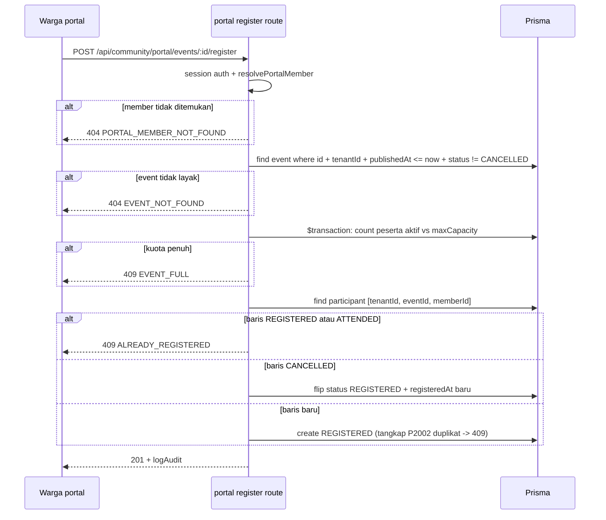
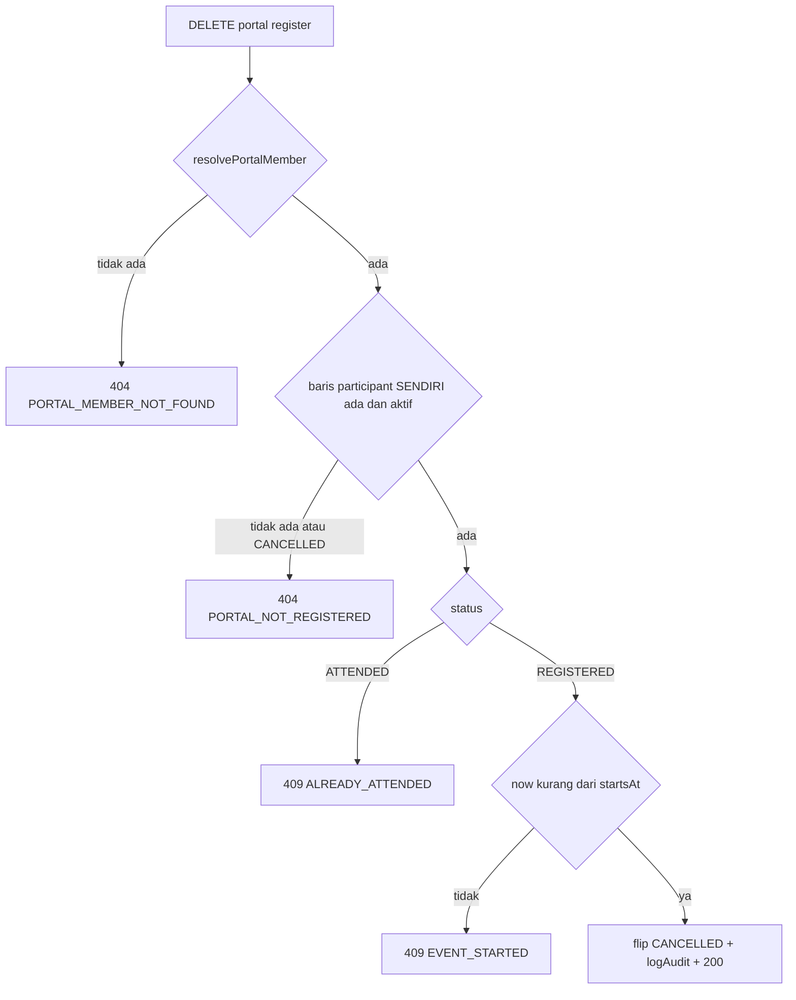

# Community Phase 3 — Implementation Plan

> **Modul:** Community Governance (RT/RW) — `apps/web/app/dashboard/community`
> **Predecessor:** [`plans/community-phase2-implementation.md`](community-phase2-implementation.md) (Fase 2, commit `d5303a2`)
> **Mode:** Architect spec — dokumen ini adalah kontrak untuk subtask Code berikutnya.
> **Session:** 74

---

## 1. Tujuan & Scope

### 1.1 Tujuan

Menutup deviasi Fase 2 yang tertunda, memperbaiki test suite workflow engine yang usang, dan membangun fitur utama Fase 3: **Pendaftaran Peserta Kegiatan** end-to-end (model → API → UI → seed → verifikasi → smoke), plus keputusan jujur soal aset komunitas.

### 1.2 Scope IN

| # | Item | Ringkas |
|---|------|---------|
| T1 | Diagnosa + fix vitest workflow engine | Test-only fix (bukan engine bug) — lihat §2.1 |
| T2 | Filter `eventId` server-side cash-transactions | Menutup DEVIATION di [`COMMUNITY-MODULE.md`](../docs/COMMUNITY-MODULE.md) §15 |
| T3 | Fitur Peserta Kegiatan (pendaftaran) | Model `CommunityEventParticipant`, 6 endpoint, UI internal + portal, seed, verify, i18n, smoke |
| T4 | Analisis aset komunitas | Keputusan: DEFER ke Fase 4 — lihat §2.2 |

### 1.3 Scope OUT / DEFER (tetap)

- CommunityAsset (model dedicated) → **Fase 4**
- Desa/Kelurahan hierarchy
- Multi-RT/RW → **OPEN QUESTION founder** (lihat §2.2)
- WhatsApp / Payment Gateway integration
- Offline mode bendahara
- Mobile React Native
- Auto-debit iuran
- Mode akuntansi opsional

---

## 2. Keputusan Produk

### 2.1 T1 — Vitest Workflow Engine: **TEST BUG** (bukan engine bug)

> **Kesimpulan diagnosa:** Test `engine.test.ts` usang — engine `@qalcuity/workflow` **tidak disentuh**. BUKAN P0 untuk engine. Engine tetap Do-Not-Touch (AGENT.md Rule 5).

**Catatan metode:** Architect mode tidak memiliki akses eksekusi terminal, sehingga diagnosa di bawah berbasis **analisis statis** dengan confidence tinggi. **Step 0 subtask Code (P1)** wajib menjalankan vitest dan mem-quote output runtime aktual sebelum mengedit apa pun — "jangan berasumsi".

**Bukti statis:**

1. [`packages/workflow/src/definitions.ts`](../packages/workflow/src/definitions.ts) baris 112–117 — PAYROLL `states` **SUDAH** termasuk `'REJECTED'`:

   ```ts
   PAYROLL: {
       states: ['DRAFT', 'PENDING_APPROVAL', 'APPROVED', 'REJECTED', 'PROCESSED', 'PAID', 'CANCELLED'],
       finalStates: ['PAID', 'REJECTED', 'CANCELLED'],
       // ...
   }
   ```

2. [`packages/workflow/src/__tests__/engine.test.ts`](../packages/workflow/src/__tests__/engine.test.ts) baris 357–376 — test masih mendeklarasikan `knownIssues` usang dan **mengassert sebaliknya**:

   ```ts
   it('should have all default workflows pass validation', () => {
       // Known issue: PAYROLL workflow has REJECTED in transitions but missing from states.
       const knownIssues: Record<string, string[]> = {
           PAYROLL: ['REJECTED state missing from states array'],
       };
       for (const [name, workflow] of Object.entries(DEFAULT_WORKFLOWS)) {
           const result = WorkflowEngine.validateWorkflow(workflow);
           if (knownIssues[name]) {
               expect(result.valid).toBe(false);          // ← GAGAL: engine kini return true
               expect(result.errors.length).toBeGreaterThan(0);
           } else {
               expect(result.valid).toBe(true);
               expect(result.errors).toEqual([]);
           }
       }
   });
   ```

3. [`packages/workflow/src/engine.ts`](../packages/workflow/src/engine.ts) `validateWorkflow` (baris 318–425) hanya cross-check `states` ↔ `transitions` ↔ `initialState`/`finalStates` (dead-end, unreachable, duplikat). Dengan `REJECTED` sudah ada di `states`, tidak ada error yang dihasilkan → `valid: true` → assertion `toBe(false)` pada test PAYROLL **fail**.

4. Git forensics: commit `fc71147` meng-commit **bersamaan** definitions.ts yang sudah diperbaiki DAN test yang stale — inkonsistensi lahir bersamaan (test tidak pernah disinkronkan saat fix definitions masuk).

**Kesalahan test vs engine — ringkas:**

| Asesmen | Verdict |
|---------|---------|
| Test salah (stale assertion)? | **YA** — `knownIssues` mendeklarasikan isu yang sudah tidak ada |
| Engine salah (bug nyata)? | TIDAK — definisi dan validasi konsisten |
| Severity | Test hygiene — bukan P0 engine |

**Rencana fix (test-only):**

| Langkah | Detail |
|---------|--------|
| 0 | **Runtime check (WAJIB):** `npx vitest run packages/workflow/src/__tests__/engine.test.ts` — capture output aktual (nama test gagal + diff assertion). Jika hasil TIDAK sesuai diagnosis statis (mis. error lain muncul), **STOP** dan eskalasi — jangan sentuh engine. |
| 1 | [`engine.test.ts`](../packages/workflow/src/__tests__/engine.test.ts) baris 357–376: hapus map `knownIssues` → expect `valid === true` + `errors` kosong untuk **semua** 6 default workflows. |
| 2 | Tambah assertion positif pengunci kontrak: `expect(DEFAULT_WORKFLOWS.PAYROLL.states).toContain('REJECTED')`. |
| 3 | Regresi: `npx vitest run` (package workflow penuh) + `npx tsc --noEmit`. |

**Blast radius jika diagnosis salah:** 6 runtime consumer `@qalcuity/workflow` di apps/web — [`lib/controls/workflow-control.ts`](../apps/web/lib/controls/workflow-control.ts), [`lib/workflow.ts`](../apps/web/lib/workflow.ts), [`app/api/workflow/transition/route.ts`](../apps/web/app/api/workflow/transition/route.ts), [`app/api/admin/seed-workflows/route.ts`](../apps/web/app/api/admin/seed-workflows/route.ts), [`app/api/crm/deals/route.ts`](../apps/web/app/api/crm/deals/route.ts), [`app/api/crm/deals/[id]/route.ts`](../apps/web/app/api/crm/deals/[id]/route.ts). Dengan fix test-only → **nol impact runtime**.

### 2.2 T4 — Aset Komunitas: **DEFER ke Fase 4** (model dedicated `CommunityAsset`)

Fase 2 menyebut "aset via inventory reuse" tapi tidak pernah diimplementasikan — dan itu keputusan yang tepat. Analisis jujur:

**Opsi A — Reuse inventory apa adanya (`Product` + `StockMovement` + `Warehouse`):**

- Yang tersedia: `Product` (sku, unit, price, cost, stock, minStock, categoryId, warehouseId), `StockMovement` (type IN/OUT/ADJUSTMENT, quantity, reference), `Warehouse`.
- Yang **kurang** untuk aset: tanggal perolehan, nomor aset inventaris, kondisi (BAIK/RUSAK/PERLU_PERBAIKAN), lokasi spesifik (balai RT, gudang, gardu), penanggung jawab (custodian = `CommunityMember`), riwayat peminjaman/handover, penyusutan.
- **Custom-field engine `@qalcuity/industry-config` tidak cukup** — [`plans/community-gov-product-analysis.md`](community-gov-product-analysis.md) §4: *"Terbatas — field FLAT, tanpa relasi. Tidak cukup untuk ... aset punya relasi + lifecycle."* Aset butuh relasi (asset → member custodian, asset → lokasi) + state lifecycle; custom fields hanya menempel key-value flat.
- Semantik `StockMovement` (mutasi kuantitas IN/OUT) tidak match lifecycle aset (akuisisi 1×, handover antar-custodian tanpa mutasi stok, kondisi berubah tanpa quantity change).
- Risiko produk: aset RT bercampur dengan stok dagang di modul inventory → laporan inventory kotor, pencatatan ganda.

**Opsi B — Defer ke Fase 4, bangun `CommunityAsset` dedicated:**

- Domain aset itu **relational** — mengikuti kesimpulan hybrid product-analysis: dedicated model untuk domain relational, industry pack hanya untuk konfigurasi.
- Rule 7 AGENT.md (*Configuration Before Customization*) + anti over-engineering: RT 02 Melati ≈ 30 warga, aset lingkungan mungkin 10–30 item (kursi, sound system, tenda, gerobak sampah). Belum ada tekanan pengguna nyata.
- Saat dibangun (Fase 4), model dirancang benar sekali: `CommunityAsset` (code, name, category, acquisitionDate, acquisitionCost, condition, location, custodianMemberId, status ACTIVE/LOANED/MAINTENANCE/RETIRED) + `CommunityAssetMovement` (riwayat handover).
- Fase 2 sudah memutuskan "jangan half-build" — konsisten: aset tidak masuk scope Fase 3.

**Rekomendasi: DEFER (Opsi B).** Alasan produk: (1) belum ada permintaan nyata dari persona demo; (2) setengah jalan pakai Product = data bercampur; (3) desain dedicated di Fase 4 bisa tepat sejak awal; (4) hemat scope Fase 3 untuk fitur pendaftaran yang langsung terasa manfaatnya.

**OPEN QUESTION untuk Founder:**

> **1 tenant = 1 desa/kelurahan, atau 1 RT?** Saat ini asumsi operasional 1 tenant = 1 RT (seed: "RT 02 Melati"). Keputusan ini menentukan arah Multi-RT/RW di Fase 4: cukup grouping RT dalam 1 tenant, atau butuh hierarki desa → RT baru (model + migrasi lebih besar).

---

## 3. Prisma Schema

### 3.1 Model baru: `CommunityEventParticipant`

```prisma
model CommunityEventParticipant {
  id           String   @id @default(cuid())
  tenantId     String
  tenant       Tenant   @relation(fields: [tenantId], references: [id])

  eventId      String
  event        CommunityEvent      @relation(fields: [eventId], references: [id])
  memberId     String
  member       CommunityMember     @relation(fields: [memberId], references: [id])

  status       String   @default("REGISTERED") // REGISTERED, ATTENDED, CANCELLED
  note         String?
  registeredAt DateTime @default(now())

  createdBy    String?
  createdAt    DateTime @default(now())
  updatedAt    DateTime @updatedAt

  // Satu baris per warga per kegiatan. Cancel = flip status in-place (bukan insert
  // baru) agar unique terjaga; reaktivasi setelah cancel = flip kembali REGISTERED.
  @@unique([tenantId, eventId, memberId])
  @@index([tenantId, eventId])
  @@index([tenantId, memberId])
  @@index([tenantId, status])
  @@index([tenantId])
}
```

**Catatan desain (konvensi block Community):**

- Tanpa `@@map` — konsisten dengan model Community lain.
- `tenantId String` tanpa `@db.Uuid` — konsisten (lihat `CommunityEvent` baris 3250).
- **Tanpa soft-delete** (`deletedAt`) di sini — cancel adalah transisi status yang dicatat `logAudit`; baris dipertahankan untuk riwayat + menopang unique constraint.
- Relasi many-to-one **dengan FK** (bukan pola `createdBy` tanpa FK) — participant wajib menunjuk event & member valid dalam tenant yang sama; validasi dilakukan di route sebelum create.

### 3.2 Relasi ditambah ke model existing

```prisma
// CommunityEvent — tambah 1 baris di daftar relasi:
  participants CommunityEventParticipant[]

// CommunityMember — tambah 1 baris di daftar relasi:
  eventParticipations CommunityEventParticipant[]
```

### 3.3 `maxCapacity` — field SUDAH ADA, keputusan: **ENFORCE sebagai kuota**

[`schema.prisma`](../packages/db/prisma/schema.prisma) baris 3260 sudah punya:

```prisma
maxCapacity Int?      // Informatif (pendaftaran peserta = Fase 3)
```

Tidak perlu kolom baru. **Keputusan: enforcement penuh di Fase 3** — justifikasi: komentar field itu sendiri menanti Fase 3; event dengan kapasitas fisik (balai warga ≈ 40 kursi) butuh proteksi terhadap over-register; `null` = tanpa batas (kompatibel mundur).

- Kuota menghitung peserta **aktif** = `status IN (REGISTERED, ATTENDED)`; `CANCELLED` membebaskan slot.
- Dilanggar → `409 EVENT_FULL`.

### 3.4 TIDAK ada perubahan lain

`CommunityCashTransaction.eventId` + `@@index([tenantId, eventId])` sudah ada sejak Fase 2 — tidak diubah.

### 3.5 Migration

```bash
cd packages/db && npx prisma migrate dev --name community_event_participants
cd packages/db && npx prisma generate
```

---

## 4. API Contract

Semua response mengikuti bentuk standar: `{ success: boolean, data?: T, total?: number, error?: { code, message } }`.

### 4.1 T2 — `GET /api/community/cash-transactions` (MODIFIKASI)

Query params: `period`, `type`, `status`, `page`, `limit` (existing) + **`eventId` (BARU)**.

| Request | Response |
|---------|----------|
| `?eventId=<uuid-valid, milik tenant>` | `200 { success, data: CashTx[], total }` — hanya transaksi dengan `eventId` itu |
| `?eventId=<uuid tidak ada / tenant lain>` | `404 { success: false, error: { code: 'EVENT_NOT_FOUND', message } }` |
| `?eventId=<bukan uuid>` | `400 { success: false, error: { code: 'INVALID_EVENT_ID', message } }` |
| tanpa `eventId` | `200` semua (perilaku existing TIDAK berubah) |

Logika route ([`cash-transactions/route.ts`](../apps/web/app/api/community/cash-transactions/route.ts) GET, baris 45–102): parse `URLSearchParams` → validasi format UUID → `prisma.communityEvent.findFirst({ where: { id, tenantId } })` → 404 bila tidak ada → tambahkan `eventId` ke `where` query transaksi. Selalu filter `tenantId`.

### 4.2 T3 — Internal Participants (BARU)

Base path: `/api/community/events/[id]/participants`

| Endpoint | Body | Success | Error |
|----------|------|---------|-------|
| `GET /events/[id]/participants` | — | `200 { success, data: ParticipantRow[], total }` — include `member: { code, fullName, phone }`, urut `registeredAt` | `404 EVENT_NOT_FOUND` |
| `POST /events/[id]/participants` | `{ memberId, note? }` | `201 { success, data: row }` — status selalu `REGISTERED` | `400` Zod · `404 EVENT_NOT_FOUND` · `404 MEMBER_NOT_FOUND` · `409 ALREADY_REGISTERED` · `409 EVENT_FULL` |
| `PATCH /events/[id]/participants/[pid]` | `{ status?, note? }` | `200 { success, data: row }` — tandai `ATTENDED` / ubah catatan | `404 EVENT_NOT_FOUND` · `404 PARTICIPANT_NOT_FOUND` · `400` Zod |
| `DELETE /events/[id]/participants/[pid]` | — | `200 { success, data: { ...row, status: 'CANCELLED' } }` — **soft-cancel in-place** | `404 EVENT_NOT_FOUND` · `404 PARTICIPANT_NOT_FOUND` |

Aturan transisi status (internal/PATCH):

```
REGISTERED → ATTENDED   ✅  (tandai hadir)
REGISTERED → CANCELLED  ✅  (sama dengan DELETE)
CANCELLED  → REGISTERED ✅  (aktivasi ulang — sama dengan POST member yang sama)
ATTENDED   → *          ❌  (kehadiran tercatat final; 400 INVALID_STATUS_TRANSITION)
```

`POST` dengan `memberId` yang barisnya berstatus `CANCELLED` → **reaktivasi** (flip ke `REGISTERED`, update `registeredAt`), bukan 409 — agar pendaftaran ulang setelah batal mulus.

### 4.3 T3 — Portal Warga (BARU)

Base path: `/api/community/portal/events/[id]` — memberId resolver dari session portal via `resolvePortalMember` (pola [`lib/community.ts`](../apps/web/lib/community.ts)).

| Endpoint | Body | Success | Error |
|----------|------|---------|-------|
| `POST .../register` | tanpa body (mencegah mass-assignment) | `201 { success, data: { id, eventId, status: 'REGISTERED', registeredAt } }` | `404 PORTAL_MEMBER_NOT_FOUND` · `404 EVENT_NOT_FOUND` · `409 ALREADY_REGISTERED` · `409 EVENT_FULL` |
| `DELETE .../register` | — | `200 { success, data: { ...row, status: 'CANCELLED' } }` — batalkan diri sendiri | `404 PORTAL_MEMBER_NOT_FOUND` · `404 PORTAL_NOT_REGISTERED` · `409 ALREADY_ATTENDED` · `409 EVENT_STARTED` |

Syarat event layak daftar (portal): ada di tenant, `publishedAt != null && publishedAt <= now`, `status != 'CANCELLED'`. Tidak layak → **404 `EVENT_NOT_FOUND`** (bukan 403 — jangan bocorkan eksistensi event draft ke warga).

Syarat batal mandiri: baris milik sendiri berstatus `REGISTERED` **dan** `now < startsAt`. Baris `CANCELLED` yang di-DELETE lagi → `404 PORTAL_NOT_REGISTERED` (dianggap belum terdaftar).

**Own-only secara struktural:** endpoint portal hanya menyentuh baris yang `memberId`-nya berasal dari session — membatalkan pendaftaran orang lain secara struktural mustahil; smoke (§11 S18) membuktikan baris member lain tidak berubah.

### 4.4 Optional — `GET /api/community/portal/events/[id]/participants/count`

`200 { success, data: { registered, attended, maxCapacity, remaining } }` — untuk badge kapasitas di portal. `remaining = null` bila `maxCapacity` null.

---

## 5. RBAC Matrix

**ZERO permission baru** — reuse `community:view`, `community:manage`, `community:portal` (cash-transactions tetap `community:finance`).

| Route | Method | Permission | Fallback | Catatan |
|-------|--------|------------|----------|---------|
| `/api/community/events/[id]/participants` | GET | `community:view` | MEMBER | BENDAHARA boleh lihat daftar |
| `/api/community/events/[id]/participants` | POST | `community:manage` | ADMIN | KETUA / SEKRETARIS |
| `/api/community/events/[id]/participants/[pid]` | PATCH | `community:manage` | ADMIN | tandai hadir |
| `/api/community/events/[id]/participants/[pid]` | DELETE | `community:manage` | ADMIN | cancel |
| `/api/community/portal/events/[id]/register` | POST/DELETE | `community:portal` | VIEWER | own-only via `resolvePortalMember` |
| `/api/community/cash-transactions` (+ `eventId`) | GET | `community:finance` (existing) | ADMIN | tidak berubah |

Entri baru di [`route-permissions.ts`](../apps/web/lib/route-permissions.ts) (pola method-qualified, mengikuti baris 417–423):

```ts
// Peserta kegiatan: GET = community:view, mutasi = community:manage
'/api/community/events/[id]/participants': { permission: 'community:manage', fallbackRole: 'ADMIN' },
'GET /api/community/events/[id]/participants': { permission: 'community:view', method: 'GET', fallbackRole: 'MEMBER' },
// Portal warga — pendaftaran sendiri
'/api/community/portal/events/[id]/register': { permission: 'community:portal', fallbackRole: 'VIEWER' },
```

3 lapisan: middleware (prefix `/dashboard/community` sudah gated) → route (`requirePermissionForRoute` + `hasPermission` / `resolvePortalMember`) → UI (`canManage` / status portal).

---

## 6. Alur

### 6.1 Pendaftaran portal



### 6.2 Batalkan mandiri (portal)



### 6.3 Kapasitas

- Peserta aktif = `count(where status IN [REGISTERED, ATTENDED])`.
- `maxCapacity != null && aktif >= maxCapacity` → `409 EVENT_FULL`.
- Check kuota berada **di dalam `$transaction`** untuk meredam race dua pendaftaran bersamaan; lapisan kedua: tangkap P2002 (unique violation `[tenantId, eventId, memberId]`) → `409 ALREADY_REGISTERED`.

---

## 7. UI per Halaman

### 7.1 [`events/[id]/page.tsx`](../apps/web/app/dashboard/community/(internal)/events/[id]/page.tsx) (internal) — MODIFIKASI

**(a) T2 — hapus client-side filter:**

- `fetchAll` (baris 120–154): ganti `?limit=100` → `?eventId=${id}&limit=200`.
- Hapus `.filter((r) => r.eventId === id)` **dan** komentar `// DEVIASI Fase 2` (baris 126–127).
- `budgetUsagePct` (baris 171–174) + bar persentase (baris 517–530, threshold ≥90 merah / ≥70 amber / else hijau) **TIDAK berubah** — sudah benar sejak Fase 2; realisasi kini datang tersaring server-side.

**(b) T3 — section "Peserta Kegiatan" baru** (antar info card & realisasi kas):

- Header: judul + badge `{n} terdaftar` · `{m} hadir` · `dari {maxCapacity} slot` (bila kuota ada) + tombol **Tambah Peserta** (gate `canManage`).
- Dual layout konvensi: mobile cards (≤768px) + desktop table.
- Kolom: kode warga, nama, status badge (REGISTERED biru / ATTENDED hijau / CANCELLED abu-abu), catatan, terdaftar pada, aksi.
- Aksi baris (canManage): **Tandai Hadir** (ikon `UserCheck`, muncul hanya utk REGISTERED), **Batalkan** (ikon `UserX` + `ConfirmDialog`).
- Modal **Tambah Peserta**: select member (dropdown member `ACTIVE`, exclude yang sudah REGISTERED/ATTENDED pada kegiatan ini) + textarea catatan.
- State: empty state (`EmptyState`), skeleton saat loading, `error.tsx` per section — ikuti pola section kas yang sudah ada. Toast sukses/gagal.

### 7.2 [`portal/events/page.tsx`](../apps/web/app/dashboard/community/portal/events/page.tsx) — MODIFIKASI

- `PortalEventRow` tambah field: `participantStatus: 'REGISTERED' | 'ATTENDED' | 'CANCELLED' | null` — di-embed saat GET list (route portal list existing di-update untuk join participant milik member session).
- Aksi per kartu/tabel:
  - Belum daftar + event layak (published, bukan CANCELLED, sekarang < startsAt, kuota tersedia): tombol **Daftar**.
  - `REGISTERED` + sebelum mulai: tombol **Batalkan** (+ `ConfirmDialog`).
  - `ATTENDED`: badge **Hadir** tanpa tombol.
  - Event tidak layak / kuota penuh: sembunyikan tombol atau disabled + teks "Kuota penuh".
- Toast `successRegister` / `successCancel`; refresh list setelah aksi.
- Loading/empty state existing dipertahankan.

### 7.3 `loading.tsx` / `error.tsx`

Kedua halaman **sudah memiliki** file loading/error — tidak ada file baru; pastikan skeleton section participant mengikuti yang ada.

---

## 8. Seed + Verify Contract

### 8.1 Seed — [`apps/web/lib/seed-data/community.ts`](../apps/web/lib/seed-data/community.ts)

Dataset baru (deterministik, **TANPA RNG** — keputusan sadar):

```ts
export interface CommunityEventParticipantSpec {
    eventNumber: string;   // business key ke COMMUNITY_EVENTS
    memberCode: string;    // business key ke member seed (W-xxx)
    status: 'REGISTERED' | 'ATTENDED' | 'CANCELLED';
    note?: string;
}

export const COMMUNITY_EVENT_PARTICIPANTS: CommunityEventParticipantSpec[] = [
    // KGT/2026-001 (DONE, published 2026-09-20) — 5 baris
    { eventNumber: 'KGT/2026-001', memberCode: 'W-001', status: 'ATTENDED' },
    { eventNumber: 'KGT/2026-001', memberCode: 'W-002', status: 'REGISTERED' },
    { eventNumber: 'KGT/2026-001', memberCode: 'W-003', status: 'REGISTERED' },
    { eventNumber: 'KGT/2026-001', memberCode: 'W-004', status: 'CANCELLED', note: 'Berhalangan' },
    { eventNumber: 'KGT/2026-001', memberCode: 'W-005', status: 'REGISTERED' },
    // KGT/2026-002 (PLANNED, published 2026-10-17) — 3 REGISTERED
    { eventNumber: 'KGT/2026-002', memberCode: 'W-001', status: 'REGISTERED' },
    { eventNumber: 'KGT/2026-002', memberCode: 'W-006', status: 'REGISTERED' },
    { eventNumber: 'KGT/2026-002', memberCode: 'W-007', status: 'REGISTERED' },
    // KGT/2026-003 (CANCELLED, unpublished): sengaja 0 peserta
];
```

Total **8 baris** (7 aktif + 1 CANCELLED).

**Idempotency:** `findUnique` by `tenantId_eventId_memberId` → skip bila ada. Lookup event/member via map `eventNumber→id` dan `memberCode→id` yang sudah ada dari seeding sebelumnya.

**Disiplin RNG — keputusan sadar:** pemilihan peserta memakai **kode member fixed**, sehingga loop ini **tidak mengkonsumsi RNG sama sekali** — kelas bug orphan-data (rng desync akibat skip bercabang, pelajaran Phase 1/2) secara struktural mustahil terjadi di sini. Aturan lama tetap berlaku bila suatu saat dataset perlu acak: **SEMUA `rng()` di-hoist sebelum loop idempoten** (pola `rngPhase2` anchor `20261013` di baris 977).

**`maxCapacity` seed:** tambahkan field opsional ke `CommunityEventSpec` dan ganti hardcode `maxCapacity: null` (baris 1122) → `spec.maxCapacity ?? null`; set `10` untuk KGT/2026-001 dan `30` untuk KGT/2026-002 (kuota demo terlihat di UI). DB existing tidak terpengaruh (idempotent skip).

**`SeedCommunityResult`** — tambah kunci `participants` di **kedua** `counts` dan `created`:

```ts
counts:  { ..., participants: number }  // total dalam tenant — db.communityEventParticipant.count({ where: { tenantId } })
created: { ..., participants: number }  // baris baru run ini
```

### 8.2 [`verify-community-seed.ts`](../packages/db/scripts/verify-community-seed.ts) — section (k) BARU

```
(k) Participants:
  - Total participant rt02-melati = 8
  - KGT/2026-001: 5 baris (REGISTERED 3, ATTENDED 1, CANCELLED 1)
  - KGT/2026-002: 3 baris (semua REGISTERED)
  - KGT/2026-003: 0 baris (event CANCELLED tanpa peserta)
  - Unik [tenantId, eventId, memberId] — tidak ada duplikat (query groupBy having count > 1)
  - Kuota terpenuhi: aktif KGT/2026-001 (4) <= maxCapacity (10); KGT/2026-002 (3) <= 30
  - registeredAt <= now untuk semua baris
  - Isolasi: tenant qalcuity-demo memiliki 0 participant
```

Contract (a)–(j) Fase 2 **tidak berubah**.

---

## 9. Zod Schemas

Safe pattern konvensi (**base object TANPA `.refine()`** → `create = base.refine()` → `update = base.partial().refine()` — `.partial()` setelah `.refine()` melempar di module evaluation Zod v4 → cascade 500):

```ts
// apps/web/lib/validation-schemas.ts

const communityEventParticipantBase = z.object({
    memberId: z.string().uuid('memberId harus UUID'),
    status: z.enum(['REGISTERED', 'ATTENDED', 'CANCELLED']).optional(),
    note: z.string().trim().max(500).optional(),
});

// POST internal — status selalu REGISTERED di server (jangan percaya body)
export const createCommunityEventParticipantSchema = communityEventParticipantBase
    .omit({ status: true })
    .refine((d) => d.memberId.length > 0, { message: 'memberId wajib diisi' });

// PATCH internal
export const updateCommunityEventParticipantSchema = communityEventParticipantBase
    .partial()
    .refine(() => true, { message: 'minimal satu field diisi' });
```

- Path params `[id]` / `[participantId]`: `z.string().uuid()` — invalid → `400`.
- Portal register: **tanpa body schema** — memberId berasal dari session (anti mass-assignment).

---

## 10. i18n Keys Outline

### 10.1 Backend — [`api-messages.ts`](../apps/web/lib/api-messages.ts) (English)

Cek dulu apakah `EVENT_NOT_FOUND` sudah ada di `MSG_COMMUNITY_EVENTS` (kemungkinan besar ada dari Fase 2) — **jangan duplikat**; sisanya di blok baru:

```ts
export const MSG_COMMUNITY_PARTICIPANTS = {
    REGISTERED: 'Participant registered',
    ALREADY_REGISTERED: 'Member is already registered for this event',
    EVENT_FULL: 'Event quota is full',
    MEMBER_NOT_FOUND: 'Member not found',
    PARTICIPANT_NOT_FOUND: 'Participant not found',
    MARKED_ATTENDED: 'Participant marked as attended',
    CANCELLED: 'Participant registration cancelled',
    PORTAL_MEMBER_NOT_FOUND: 'No community member linked to this account',
    PORTAL_NOT_REGISTERED: 'You are not registered for this event',
    ALREADY_ATTENDED: 'Cannot cancel — attendance already recorded',
    EVENT_STARTED: 'Cannot cancel — event has already started',
    INVALID_STATUS_TRANSITION: 'Invalid status transition',
} as const;
```

### 10.2 Frontend — `messages/id.json` + `messages/en.json`

```
community.events.participants.title / subtitle
community.events.participants.count           "{n} terdaftar"
community.events.participants.attendedCount   "{n} hadir"
community.events.participants.capacity        "Kuota {n}"
community.events.participants.capacityFull    "Kuota penuh"
community.events.participants.empty
community.events.participants.add / addTitle
community.events.participants.member / note
community.events.participants.status.registered / attended / cancelled
community.events.participants.markAttended
community.events.participants.cancel / cancelConfirm
community.events.participants.registeredAt
community.events.participants.actions

community.portal.participants.register
community.portal.participants.cancel
community.portal.participants.badgeRegistered  "Terdaftar"
community.portal.participants.badgeAttended    "Hadir"
community.portal.participants.full             "Kuota penuh"
community.portal.participants.successRegister
community.portal.participants.successCancel
community.portal.participants.confirmCancel
```

---

## 11. Smoke Matrix (S-Series Extension)

Server aux `:3001` (pola Fase 2). Dua aktor: **ketua** (internal) + **warga** (portal, user ter-link member W-001).

| # | Skenario | Expect |
|---|----------|--------|
| S9 | Ketua `GET cash-transactions?eventId=<id KGT/2026-001>` | 200, hanya 2 tx seed (300.000 + 180.000), `total=2` |
| S10 | `GET cash-transactions?eventId=<uuid acak>` | 404 `EVENT_NOT_FOUND` |
| S11 | `GET cash-transactions?eventId=<event tenant lain>` | 404 `EVENT_NOT_FOUND` (isolasi tenant) |
| S12 | Warga `POST portal register` KGT/2026-002 (belum terdaftar) | 201 `REGISTERED` |
| S13 | Warga `POST register` ulang event sama | 409 `ALREADY_REGISTERED` |
| S14 | Warga `POST register` KGT/2026-003 (CANCELLED/unpublished) | 404 `EVENT_NOT_FOUND` |
| S15 | Warga `DELETE register` sebelum `startsAt` | 200 status `CANCELLED` |
| S16 | Warga `DELETE register` lagi (baris sudah CANCELLED) | 404 `PORTAL_NOT_REGISTERED` |
| S17 | Warga A batalkan → baris warga B **tidak berubah** (cek via GET internal) | baris B tetap `REGISTERED` |
| S18 | `POST register` oleh akun portal tanpa link member | 404 `PORTAL_MEMBER_NOT_FOUND` |
| S19 | Ketua `GET events/[id]/participants` KGT/2026-001 | 200, 5 baris |
| S20 | Ketua `POST participants` member sudah REGISTERED | 409 `ALREADY_REGISTERED` |
| S21 | Ketua `POST participants` memberId tenant lain | 404 `MEMBER_NOT_FOUND` |
| S22 | WARGA (role portal) `POST` endpoint internal | 403 |
| S23 | Event `maxCapacity=1`: register kedua | 409 `EVENT_FULL` |
| S24 | Warga register ulang **setelah cancel** (reaktivasi) | 201 `REGISTERED`, baris sama di-flip |
| S25 | Ketua `PATCH` tandai hadir → `GET` | 200 `ATTENDED`; count hadir naik |
| S26 | Warga `DELETE register` setelah ATTENDED | 409 `ALREADY_ATTENDED` |
| S27 | Warga `DELETE register` setelah `startsAt` lewat | 409 `EVENT_STARTED` |
| S28 | Regresi: list cash transactions tanpa `eventId` | 200, perilaku Fase 2 tidak berubah |

---

## 12. Risiko & Mitigasi

| # | Risiko | Sev | Mitigasi |
|---|--------|-----|----------|
| R1 | Diagnosis vitest ternyata salah (engine bug nyata) | Medium | Step 0 runtime check WAJIB sebelum edit; bila hasil tidak sesuai → STOP, eskalasi founder; engine Do-Not-Touch tanpa approval |
| R2 | Race dua pendaftaran bersamaan melewati kuota | Medium | Kuota check di dalam `$transaction` + lapisan P2002 → 409; smoke S23 |
| R3 | Eksistensi event draft bocor ke warga | Low | Event tidak layak → 404 (bukan 403) |
| R4 | Perubahan `maxCapacity` seed membuat count smoke mismatch | Low | Idempotent skip — DB existing tidak diubah; contract verify memakai angka konsisten |
| R5 | Reaktivasi setelah cancel menabrak unique constraint | Low | Desain in-place flip status (bukan insert baru) — unique terjaga |
| R6 | Over-fetch kas berkurang (limit lama 100 client-filter) | Low | `?eventId` + `limit=200`; kas RT per kegiatan jarang > 200 |
| R7 | Regresi workflow engine | Low | Fix test-only; `npx vitest run` penuh + `npx tsc --noEmit` |
| R8 | Portal list route existing rusak oleh embed participantStatus | Low | Join hanya menambah field — response bentuk lama tetap kompatibel; smoke S12–S18 |

---

## 13. Definition of Done

- [ ] **Step 0:** vitest dijalankan, output runtime aktual (nama test + assertion diff) di-quote di laporan
- [ ] Test `engine.test.ts` diperbaiki (test-only) — semua 6 default workflow `valid: true` + assertion `REJECTED ∈ PAYROLL.states`
- [ ] `npx vitest run` package workflow GREEN; `npx tsc --noEmit` tanpa error
- [ ] Migration `community_event_participants` applied + `prisma generate`
- [ ] GET cash-transactions `?eventId=` berfungsi; 404 tenant-safe; tanpa `eventId` = perilaku lama
- [ ] Events detail: client filter + komentar DEVIASI dihapus; budget bar tetap akurat
- [ ] Model `CommunityEventParticipant` + relasi Event/Member sesuai §3
- [ ] 4 endpoint internal + 2 endpoint portal + 1 count endpoint berfungsi, RBAC 3 lapisan
- [ ] Entri `route-permissions.ts` added (3 entries)
- [ ] Zod safe pattern (base tanpa refine) — tidak ada `.partial()` setelah `.refine()`
- [ ] Tenant isolation: semua query filter `tenantId`; portal own-only structural
- [ ] Seed 8 participant deterministik; run ke-2 `created.participants = 0` (idempoten)
- [ ] `verify-community-seed.ts` section (k) PASS; contract (a)–(j) tetap PASS
- [ ] UI internal: section Peserta (dual layout, badge hitung, modal tambah, ConfirmDialog, empty/loading/error)
- [ ] UI portal: tombol Daftar/Batalkan + badge status sendiri; disabled saat tidak layak
- [ ] i18n id + en lengkap (§10) — tidak ada hardcoded string
- [ ] Smoke S9–S28 PASS di aux server `:3001`
- [ ] `maxCapacity` enforcement terbukti (S23 `EVENT_FULL`)
- [ ] Docs: `COMMUNITY-MODULE.md` — deviation §15 ditutup + roadmap §16 update; `CURRENT.md` bump versi; `FEATURES.md` status Fase 3

---

## Lampiran A — Urutan Subtask (untuk Orkestrator)

| Subtask | Isi | Output utama |
|---------|-----|--------------|
| **P1** | T1 vitest: Step 0 runtime → fix test-only → regresi vitest + tsc | `engine.test.ts` green |
| **Q** | T2: `eventId` param di GET cash-transactions + bersih-bersih events detail page + smoke S9–S11, S28 | deviasi §15 tertutup |
| **R** | T3 backend: migration + model + relasi + 4+2+1 route + route-permissions + Zod + api-messages | API participant live |
| **S** | T3 frontend: section internal + tombol portal + i18n id/en | UI participant live |
| **T** | T3 data + QA: seed + verify (k) + smoke S12–S27 + docs (COMMUNITY-MODULE, CURRENT, FEATURES) | kontrak seed & dokumentasi |

Dependency: P1 dan Q independen; R → S → T berantai. Tidak ada subtask yang menyentuh file Do-Not-Touch ([`auth.ts`](../apps/web/lib/auth.ts), [`middleware.ts`](../apps/web/middleware.ts), [`session.ts`](../apps/web/lib/session.ts), [`audit.ts`](../apps/web/lib/audit.ts), `packages/permissions/**`, engine workflow).

---

**Last Updated:** Session 74 — 13 Oktober 2026
**Maintainer:** Qalcuity AI Team — Architect mode
