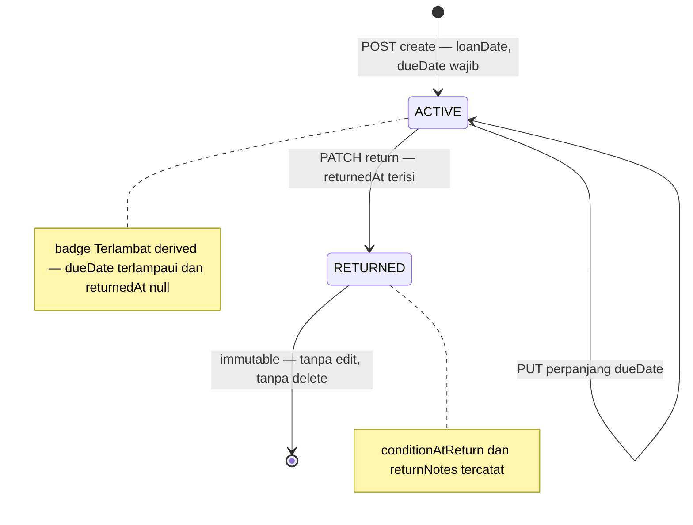

# Community Phase 4B — Implementation Plan (Peminjaman Aset + Depresiasi Informatif)

> **Modul:** Community Governance (RT/RW) — `apps/web/app/dashboard/community`
> **Predecessor:** [`plans/community-phase4-aset-implementation.md`](community-phase4-aset-implementation.md) (Fase 4A, commit `6f89951`)
> **Mode:** Architect spec — dokumen ini adalah kontrak untuk subtask Code berikutnya.
> **Session:** 76

---

## 1. Tujuan, Scope & Keputusan Produk

### 1.1 Tujuan

Menambahkan **siklus hidup peminjaman aset** (`CommunityAssetLoan`: pinjam → jatuh tempo → kembali) dan **depresiasi informatif** (nilai buku estimasi straight-line, tanpa jurnal) ke modul Community Fase 1–4A yang sudah production. Pengurus mendapat ledger pinjaman yang pertanggungjawaban; warga mendapat transparansi read-only atas pinjaman sendiri; laporan pengurus memperoleh angka nilai buku estimasi per aset & agregat.

### 1.2 Scope IN

| # | Item | Ringkas |
|---|------|---------|
| T1 | Model `CommunityAssetLoan` + migration ADDITIVE | 1 model baru — `prisma migrate dev --name community_asset_loans` (total 53 → **54**) |
| T2 | CRUD pinjaman internal | `GET/POST /api/community/loans`, `PUT /api/community/loans/[id]` (perpanjang), `PATCH /api/community/loans/[id]/return` |
| T3 | Enforcement satu-active-loan + eligibility | Transaction + row-lock `FOR UPDATE` — 409 `ASSET_ALREADY_ON_LOAN` / `ASSET_NOT_AVAILABLE` |
| T4 | Portal "Pinjaman Saya" read-only | `GET /api/community/portal/loans` — projection 8 field non-sensitif |
| T5 | Depresiasi informatif (book value) | Helper straight-line on-the-fly + integrasi asset detail + summary |
| T6 | UI internal tab "Peminjaman" | Halaman `loans/page.tsx` dual-layout + badge "Dipinjam" di halaman aset |
| T7 | UI portal `portal/loans` | Card list read-only pinjaman milik warga sendiri |
| T8 | i18n id/en | `community.loans.*` + `community.portal.loans.*` + 1 tab key — paritas struktural |
| T9 | Seed deterministik 3 loan + verify section (m) + cleanup | Idempoten (run#2 `loans: 0`), text ASCII-safe |
| T10 | Smoke S45–S57 | Assertions lanjutan dari [44] (Fase 4A) — total target **57/57** |
| T11 | Docs | ADR-025 → **ACCEPTED**, ADR-026 baru, `COMMUNITY-MODULE.md` §18, CURRENT v11.68.0, FEATURES 34.7 |

### 1.3 Scope OUT / DEFER (dengan alasan — lihat §13.4)

- **Self-service request/approve peminjaman oleh warga** → DEFER (YAGNI: permintaan pinjaman RT terselesaikan offline via WA/telepon; request/approve workflow = surface baru + notifikasi + edge cases cancel/approve — bangun saat demand terbukti).
- Notifikasi jatuh tempo (cron + WA/email) → DEFER (butuh kanal notifikasi; ledger overdue sudah cukup untuk Fase 4B).
- Log perawatan/service aset → Fase 4C.
- Relasi loan ↔ kegiatan (`eventId` pada loan) → DEFER (kebutuhan belum nyata; kolom bisa ditambahkan additive kelak).
- Soft-delete loan → TIDAK ADA (riwayat pertanggungjawaban bersifat immutable — §2.1).
- Multi-RT/RW (`CommunityUnit`) → di luar scope (ADR-025 Option A diratifikasi — §12.2).

### 1.4 Keputusan Produk (Q1–Q8 — NON-NEGOTIABLE)

#### Q1 — Model & status pattern: **kolom `status` ACTIVE|RETURNED tersimpan + OVERDUE derived**

- `status` String `@default("ACTIVE")` dengan nilai **hanya** `ACTIVE` | `RETURNED`. Nilai disimpan karena melekat pada fakta data (`returnedAt` terisi ⇔ RETURNED) — bukan state yang berubah sendiri.
- **`OVERDUE` TIDAK pernah disimpan sebagai status.** Overdue adalah fungsi waktu: `returnedAt == null && formatYmd(dueDate) < formatYmd(now)` (perbandingan string `YYYY-MM-DD` dalam `APP_TIMEZONE` — reuse helper [`formatYmd()`](apps/web/lib/community.ts)). Filter `?status=overdue` di list diterjemahkan menjadi where `returnedAt: null` + `dueDate <` start-of-today (APP_TZ).
- **Rationale:** (a) status tersimpan ganda (ACTIVE/OVERDUE) menuntut scheduled job untuk flip saat tengah malam — padahal spec melarang job baru untuk kasus ini (pola depresiasi §5 juga on-the-fly); (b) derived = selalu konsisten dengan waktu, tanpa race antara kolom & jam; (c) query list & badge UX tetap murah — 1 where clause tambahan + 1 komputasi per baris.
- **`dueDate` WAJIB** (bukan opsional). Tanpa jatuh tempo, OVERDUE tidak bisa derive dan pinjaman kehilangan disiplin pengembalian; UI memberi default `loanDate + 14 hari` sehingga isian hampir selalu satu klik. Pinjaman "open-ended" tetap mungkin dengan dueDate jauh (mis. 1 tahun) — tetapi tetap tercatat.
- **`conditionAtLoan` = snapshot SERVER-SIDE** dari `asset.condition` saat CREATE (bukan input user) — akurat, satu kurang isian form. **`conditionAtReturn`** diisi opsional saat return (vocabulary sama: `BAIK|PERLU_PERBAIKAN|RUSAK_RINGAN|RUSAK_BERAT`), default di UI = `conditionAtLoan`.

#### Q2 — Enforcement satu-active-loan-per-asset: **application-level + row-lock `FOR UPDATE` (TANPA partial unique index)**

- **Ditolak: partial unique index** `CREATE UNIQUE INDEX ... ON "CommunityAssetLoan"("tenantId","assetId") WHERE "returnedAt" IS NULL`. Alasan: (1) Prisma 5.15 **tidak bisa mengekspresikan filtered index** di `schema.prisma` → guard [`check-drift.sh`](packages/db/scripts/check-drift.sh) (replay migrasi + `prisma migrate diff`) akan melaporkan drift karena index ada di DB tapi tidak di schema; (2) codebase **tidak punya satu pun** pola `CREATE UNIQUE INDEX ... WHERE` di 53 migrasi (audit Session 76) — memperkenalkannya demi 1 constraint melanggar konsistensi.
- **Diterima: cek di dalam `prisma.$transaction` interaktif dengan row-lock:**
  1. `SELECT id FROM "CommunityAsset" WHERE id = $1 AND "tenantId" = $2 FOR UPDATE` via `$queryRaw` — meng-serialize dua request create-loan bersamaan untuk aset yang sama (Postgres row lock).
  2. Eligibility check (Q3) → 409 `ASSET_NOT_AVAILABLE`.
  3. Active-loan check `findFirst({ assetId, tenantId, returnedAt: null })` → 409 `ASSET_ALREADY_ON_LOAN`.
  4. `create` loan dalam transaksi yang sama.
- **Rationale:** race window tertutup penuh tanpa migrasi raw-SQL di luar ekspresi Prisma; pesan error spesifik per kasus (konsisten pola `EVENT_FULL`/`ALREADY_REGISTERED` Fase 3 yang juga check-in-transaction — [`participants/route.ts`](apps/web/app/api/community/events/[id]/participants/route.ts)).

#### Q3 — Eligibility pinjam: **hanya aset `status = AKTIF` DAN `condition ≠ RUSAK_BERAT`**

| Kondisi aset | Boleh dipinjam? | Rationale |
|--------------|-----------------|-----------|
| `status = AKTIF` + `condition ∈ {BAIK, PERLU_PERBAIKAN, RUSAK_RINGAN}` | ✅ Ya | Aset operasional; PERLU_PERBAIKAN/RUSAK_RINGAN masih layak pakai (mis. kursi goyang tetap bisa dipakai acara) |
| `status = PERAWATAN` | ❌ Tidak | Sedang diperbaiki/dipelihara — dipinjam = mengganggu proses perawatan & berisiko rusak tambahan |
| `status = TIDAK_AKTIF` | ❌ Tidak | Sudah tidak layak beroperasi |
| `condition = RUSAK_BERAT` | ❌ Tidak | Risiko kehilangan/kerusakan total saat dipakai di luar; rapikan dulu |
- Error: **409 `ASSET_NOT_AVAILABLE`** (konflik dengan state saat ini — konsisten family 409 Fase 3). Soft-deleted asset otomatis gugur (`deletedAt: null` di where).

#### Q4 — API surface: **5 handler; perpanjaman = YA (scope minimal); tanpa DELETE**

| Path | Method | Permission | Keputusan |
|------|--------|------------|-----------|
| `/api/community/loans` | GET | `community:view` | List + filter `?status=active\|returned\|overdue`, `?assetId=`, `?memberId=`, `?search=` (nama peminjam/nama aset, ILIKE), pagination standar |
| `/api/community/loans` | POST | `community:manage` | Create — borrower + tanggal + jatuh tempo |
| `/api/community/loans/[id]` | PUT | `community:manage` | **Perpanjangan** — terbatas `dueDate` + `notes`, hanya loan `ACTIVE`, `dueDate >= loanDate` |
| `/api/community/loans/[id]/return` | PATCH | `community:manage` | Pengembalian — set `returnedAt` + `status=RETURNED` + `conditionAtReturn?` + `returnNotes?` + `returnedBy` |
| `/api/community/portal/loans` | GET | `community:portal` | Read-only pinjaman milik warga sendiri |

- **Perpanjangan YA (bukan YAGNI):** kebutuhan nyata RT — kegiatan mundur, pinjaman diperpanjang. Tanpa endpoint ini pengurus tergoda membuat "return palsu + pinjam ulang" yang merusak data (loanDate/conditionAtReturn salah). Scope sengaja minimal (2 field, hanya ACTIVE) — bukan update umum.
- **DELETE loan TIDAK ADA:** pinjaman = riwayat pertanggungjawaban; salah catat → lakukan return (audit trail utuh). Konsisten dengan filosofi audit-trail modul.
- **Method PATCH untuk return** — konsisten pola transisi status Fase 3 ([`[pid]/route.ts`](apps/web/app/api/community/events/[id]/participants/[pid]/route.ts) memakai PATCH).

#### Q5 — Portal: **read-only "Pinjaman Saya"; TANPA self-service request/approve**

- Portal **HANYA** menampilkan pinjaman milik member yang ter-resolve dari session ([`resolvePortalMember()`](apps/web/lib/community.ts)) — read-only.
- **Tidak ada** endpoint ajukan/perpanjang/pengembalian oleh warga. **Rationale:** (a) kebijakan transparansi founder (Session 76) = portal menampilkan field minimum non-sensitif — read-only konsisten dengan aset (strict 5-field); (b) request/approve workflow = scope produk baru (status machine tambahan, aturan siapa boleh approve, notifikasi, cancel semantics) — nilai pengurus lebih besar dari ledger yang akurat daripada formulir permintaan; (b) skala RT: warga meminta langsung ke pengurus, pengurus mencatat di sini. Defer sampai demand terbukti (§13.4).
- Warga **belum ter-pair** ke member (resolver null) → `200` + `data: []` + `member: null` (konsisten portal overview pola Fase 1 — bukan 404).

#### Q6 — Integrasi aset: **TANPA denormalisasi; derive via relasi + attach filtered `_count`**

- `CommunityAsset` **tidak mendapat kolom baru** (`currentlyOnLoan` dsb.). Status "sedang dipinjam" = `exists loan { assetId, returnedAt: null }`.
- List aset internal menyertakan `_count: { select: { loans: { where: { returnedAt: null } } } }` (Prisma filtered `_count` — pola attach `_count` kontekstual sudah dipakai Fase 2 untuk events) → serializer mengekspos `activeLoanCount` → UI badge "Dipinjam". Nol kolom, nol job, satu query.
- **Rationale hindari denormalisasi:** inkonsistensi dua sumber kebenaran (kolom vs relasi) tanpa keuntungan skala berarti (RT = 10–30 aset); invariant dijaga di create/return dalam transaksi.

#### Q7 — Depresiasi: **(b) straight-line informatif per kategori, ON-THE-FLY, tanpa kolom & tanpa job**

- **Ditolak (a)** — `acquisitionCost` saja: pengurus butuh gambaran "sisa umur pakai" untuk perencanaan penggantian (mis. sound system usia 3,5 tahun dari 5 — mulai anggarkan penggantian).
- **Ditolak (c)** — full depreciation schedule (tabel per periode): over-engineering; RT tidak butuh jadwal penyusutan per bulan/tahun — hanya angka saat ini.
- **Diterima (b)** — lihat §5 untuk formula, useful-life table & integration point. **INFORMATIF, BUKAN pengganti akuntansi** — ditegaskan di UI (caption) dan ADR-026.

#### Q8 — ADR-026: **YA — buat, status ACCEPTED**

Keputusan "depresiasi informatif straight-line tanpa journal, tanpa kolom tersimpan, on-the-fly" layak jadi ADR singkat: mencegah pertanyaan berulang "kenapa tidak ada jurnal penyusutan?" dan mengunci boundary (community ≠ modul akuntansi). Isi & lokasi: §12.3.

---

## 2. Desain Data

### 2.1 Model baru `CommunityAssetLoan` (schema.prisma)

Ditaruh **setelah** `CommunityAsset` (akhir file, pola Fase 4A):

```prisma
// ─── Community Module (Fase 4B: Pinjaman Aset) ────────────────────────────────
// Referensi: plans/community-phase4b-loan-depreciation-implementation.md §2
// Ledger pinjaman aset RT/RW. Riwayat IMMUTABLE — tanpa soft-delete, tanpa
// endpoint hapus. OVERDUE derived dari dueDate (bukan kolom status).

model CommunityAssetLoan {
  id         String   @id @default(cuid())
  tenantId   String
  tenant     Tenant   @relation(fields: [tenantId], references: [id])

  // Relasi — RESTRICT: pinjaman = pertanggungjawaban; riwayat tidak boleh
  // kehilangan relasi. Delete aset hanya soft-delete (tidak menyentuh FK);
  // hard delete hanya di cleanup — urutan: loans dulu, baru assets.
  assetId    String
  asset      CommunityAsset    @relation(fields: [assetId], references: [id], onDelete: Restrict)
  memberId   String            // borrower
  member     CommunityMember   @relation(fields: [memberId], references: [id], onDelete: Restrict)

  // Tanggal
  loanDate   DateTime          // tanggal pinjam (wajib)
  dueDate    DateTime          // jatuh tempo (WAJIB — Q1); UI default loanDate + 14 hari
  returnedAt DateTime?         // null = masih dipinjam; terisi ⇔ status RETURNED

  // Snapshot kondisi (vocabulary sama dengan CommunityAsset.condition)
  conditionAtLoan   String  @default("BAIK") // server-side snapshot dari asset.condition saat CREATE
  conditionAtReturn String?                  // diisi opsional saat return

  // State — ACTIVE | RETURNED saja. OVERDUE = derived (formatYmd compare, APP_TZ).
  status     String   @default("ACTIVE")

  notes       String?  // catatan saat peminjaman
  returnNotes String?  // catatan saat pengembalian

  // Meta
  createdBy   String?
  returnedBy  String?  // userId yang mencatat pengembalian
  createdAt   DateTime @default(now())
  updatedAt   DateTime @updatedAt

  @@index([tenantId, assetId])    // list per aset + active-loan check
  @@index([tenantId, memberId])   // pinjaman saya / per warga
  @@index([tenantId, status])     // filter status
  @@index([tenantId, dueDate])    // scan jatuh tempo / overdue
}
```

**Field-by-field — keputusan FK & default:**

| Field | Tipe | Default | Keputusan |
|-------|------|---------|-----------|
| `assetId` | String FK → `CommunityAsset` | — | **`onDelete: Restrict`** — loan tanpa aset = riwayat yatim; soft-delete aset (operasi normal) tidak menyentuh FK, jadi Restrict tidak menghalangi delete aset sama sekali |
| `memberId` | String FK → `CommunityMember` | — | **`onDelete: Restrict`** — berbeda dengan `custodianMemberId` (SetNull, 4A): borrower adalah pihak yang *bertanggung jawab atas pinjaman* — loan tanpa borrower tidak bermakna. Member keluar = soft-delete (deletedAt) → riwayat pinjaman tetap utuh & nama bisa di-join |
| `loanDate` | DateTime | — | Wajib; disimpan apa adanya (date input → UTC midnight oleh `z.coerce.date()`) |
| `dueDate` | DateTime | — | **Wajib** (Q1); validasi `dueDate >= loanDate` di Zod |
| `returnedAt` | DateTime? | `null` | Satu-satunya penanda "masih dipinjam" — dipakai invariant & derive |
| `conditionAtLoan` | String | `"BAIK"` | Server overwrite dengan `asset.condition` saat create — default hanya fallback schema |
| `conditionAtReturn` | String? | `null` | Opsional; enum Zod yang sama dengan kondisi aset |
| `status` | String | `"ACTIVE"` | `ACTIVE\|RETURNED` — invariant: `status === 'RETURNED' ⇔ returnedAt != null` dijaga di handler return |
| `notes` / `returnNotes` | String? | `null` | Maks 500 char (Zod) |
| `returnedBy` | String? | `null` | userId snapshot (pola `createdBy` — tanpa FK) |
| *(tidak ada)* | — | — | **Tanpa `deletedAt`/`deletedBy`** — riwayat immutable (keputusan Q4) |

**Relasi reverse (tambahan pada model existing — satu-satunya perubahan schema selain model baru):**

```prisma
// di CommunityAsset — setelah custodian:
  loans       CommunityAssetLoan[] // Fase 4B: riwayat peminjaman

// di CommunityMember — setelah custodiedAssets:
  borrowedAssets   CommunityAssetLoan[] // Fase 4B: riwayat sebagai peminjam
```

### 2.2 Migration SQL outline

Jalankan `npx prisma migrate dev --name community_asset_loans` (dari `packages/db`) — Prisma generate SQL; perkiraan isi:

```sql
-- CreateTable
CREATE TABLE "CommunityAssetLoan" (
    "id" TEXT NOT NULL,
    "tenantId" TEXT NOT NULL,
    "assetId" TEXT NOT NULL,
    "memberId" TEXT NOT NULL,
    "loanDate" TIMESTAMP(3) NOT NULL,
    "dueDate" TIMESTAMP(3) NOT NULL,
    "returnedAt" TIMESTAMP(3),
    "conditionAtLoan" TEXT NOT NULL DEFAULT 'BAIK',
    "conditionAtReturn" TEXT,
    "status" TEXT NOT NULL DEFAULT 'ACTIVE',
    "notes" TEXT,
    "returnNotes" TEXT,
    "createdBy" TEXT,
    "returnedBy" TEXT,
    "createdAt" TIMESTAMP(3) NOT NULL DEFAULT CURRENT_TIMESTAMP,
    "updatedAt" TIMESTAMP(3) NOT NULL,
    CONSTRAINT "CommunityAssetLoan_pkey" PRIMARY KEY ("id")
);

-- CreateIndex (4 entry — tanpa unique turunan, tanpa partial index: Q2)
CREATE INDEX "CommunityAssetLoan_tenantId_assetId_idx" ON "CommunityAssetLoan"("tenantId", "assetId");
CREATE INDEX "CommunityAssetLoan_tenantId_memberId_idx" ON "CommunityAssetLoan"("tenantId", "memberId");
CREATE INDEX "CommunityAssetLoan_tenantId_status_idx" ON "CommunityAssetLoan"("tenantId", "status");
CREATE INDEX "CommunityAssetLoan_tenantId_dueDate_idx" ON "CommunityAssetLoan"("tenantId", "dueDate");

-- AddForeignKey (3 — tenant/asset/member; onDelete sesuai §2.1; tenant = Restrict bawaan Prisma)
```

**Migrasi ADDITIVE saja** — tanpa perubahan tabel existing (relasi reverse Prisma tidak menghasilkan SQL untuk tabel lama). Target total **54 folder migrasi** (dokumentasi Session 75 mencatat 53 — Code subtask memverifikasi count aktual folder sebelum & sesudah).

### 2.3 Lifecycle state machine



---

## 3. API Contract

Pola umum WAJIB sama dengan Fase 4A ([`assets/route.ts`](apps/web/app/api/community/assets/route.ts)): rate-limit per IP → `requirePermissionForRoute()` → `hasPermission(session, ...)` **custom-role resolver** (JANGAN `session.user.role === 'ADMIN'`) → Zod `safeParse` → query selalu `tenantId` dari `auth` → response `{ success, data, total?, ... }` → `catch → handleApiError()`. Semua mutasi `logAudit` + `sanitizeObject` body.

### 3.1 `GET /api/community/loans` — list pinjaman (`community:view`)

- **Query:** `?status=active|returned|overdue` (dinormalisasi lowercase; `overdue` → where `returnedAt: null` + `dueDate: { lt: startOfTodayAppTz }`), `?assetId=`, `?memberId=`, `?search=` (OR: `member.fullName` ILIKE / `asset.name` ILIKE / `asset.assetCode` ILIKE), `?page=`, `?limit=` (default 20, maks 100).
- **Select:** `LOAN_LIST_SELECT` (§4.2) — embed ringkas `asset { assetCode, name, condition }` + `member { code, fullName }`.
- **Response:** `{ success, data: [serializedLoan...], total, page, limit, totalPages }` — tiap baris memuat `isOverdue` (boolean derived).
- **OrderBy:** `createdAt: 'desc'`.

### 3.2 `POST /api/community/loans` — buat pinjaman (`community:manage`)

- **Request:** `{ assetId, memberId, loanDate, dueDate, notes? }` — Zod `createCommunityLoanSchema` (§4.1).
- **Alur (dalam `prisma.$transaction` interaktif — §2 Q2):** lock aset `FOR UPDATE` → load aset (`deletedAt: null`) → 404 `ASSET_NOT_FOUND` bila tidak ada → eligibility (§3.6) → active-loan check → `create` dengan `conditionAtLoan = asset.condition`.
- **Validasi cross-ref:** `memberId` wajib `CommunityMember` tenant sama + `deletedAt: null` → 404 reuse `MSG_COMMUNITY.MEMBER_NOT_FOUND` (pola custodian 4A — smoke [39]).
- **Response 201:** `{ success: true, data: serializedLoan }` + message `MSG_COMMUNITY_LOANS.LOAN_CREATED`.
- **Errors:** `400` Zod · `404` ASSET_NOT_FOUND / MEMBER_NOT_FOUND · `409` ASSET_ALREADY_ON_LOAN / ASSET_NOT_AVAILABLE · `403` manage · `429` rate-limit (`community-loans-create:{ip}`, 30/menit — pola asset create).

### 3.3 `PUT /api/community/loans/[id]` — perpanjangan (`community:manage`)

- **Request:** `{ dueDate?, notes? }` — Zod `updateCommunityLoanSchema` (pick 2 field, `.partial().refine(min-1)`).
- **Scope:** loan `tenantId` sama + `deletedAt` tidak ada (model tanpa soft-delete — where `{ id, tenantId }`) → 404 `LOAN_NOT_FOUND`; hanya `status === 'ACTIVE'` → 409 `LOAN_ALREADY_RETURNED`; `dueDate >= loanDate` → 400 Zod refine.
- **Response 200:** `{ success: true, data: serializedLoan }` + `LOAN_UPDATED`. `logAudit` dengan diff dueDate (`diffValues` pola 4A).

### 3.4 `PATCH /api/community/loans/[id]/return` — pengembalian (`community:manage`)

- **Request:** `{ conditionAtReturn?, returnNotes? }` — Zod `returnCommunityLoanSchema` (opsional semua, TANPA `.partial()` — schema murni object opsional = pola aman Zod v4).
- **Logic (transaction):** lock aset `FOR UPDATE` (serialize dengan create bersamaan) → load loan → 404 `LOAN_NOT_FOUND` → `status === 'RETURNED'` → **409 `LOAN_ALREADY_RETURNED`** (return dua kali) → update `{ returnedAt: now, status: 'RETURNED', conditionAtReturn: input ?? loan.conditionAtLoan, returnNotes, returnedBy: userId }`.
- **Response 200:** serializedLoan + `LOAN_RETURNED`.

### 3.5 `GET /api/community/portal/loans` — pinjaman saya (`community:portal`)

- **Alur:** `resolvePortalMember(tenantId, userId)` → null → `{ success: true, data: [], member: null, total: 0 }` (empty state UI).
- **Query:** `where: { tenantId, memberId: member.id }`, `orderBy: { createdAt: 'desc' }`, tanpa pagination (pola portal assets — list ringkas penuh; pinjaman per warga puluhan maks).
- **Projection STRICT 8 field (server-side drop):** `{ assetCode, assetName, loanDate, dueDate, returnedAt, isOverdue, conditionAtLoan, conditionAtReturn }`. **TIDAK** dipublikasikan: `notes`, `returnNotes`, `status` (redundan), `memberId` (otomatis sendiri), `createdBy`/`returnedBy` (nama pengurus = internal), `asset.location`?, boleh — tapi tidak perlu; `acquisitionCost`/`bookValue` **tidak pernah** (kebijakan transparansi Fase 4A + ratifikasi Session 76).

### 3.6 Enforcement — eligibility & conflict mapping (ringkas)

| Kondisi | Status | Message constant |
|---------|--------|------------------|
| Aset tidak ada / soft-deleted / tenant lain | 404 | `MSG_COMMUNITY_ASSETS.ASSET_NOT_FOUND` |
| Member tidak ada / deleted / tenant lain | 404 | `MSG_COMMUNITY.MEMBER_NOT_FOUND` (reuse) |
| `asset.status ≠ 'AKTIF'` atau `asset.condition === 'RUSAK_BERAT'` | 409 | `MSG_COMMUNITY_LOANS.ASSET_NOT_AVAILABLE` (baru) |
| Sudah ada loan `returnedAt: null` untuk aset | 409 | `MSG_COMMUNITY_LOANS.ASSET_ALREADY_ON_LOAN` (baru) |
| Return/perpanjang loan yang sudah RETURNED | 409 | `MSG_COMMUNITY_LOANS.LOAN_ALREADY_RETURNED` (baru) |
| Loan tidak ada / tenant lain | 404 | `MSG_COMMUNITY_LOANS.LOAN_NOT_FOUND` (baru) |

**Race handling:** semua cek konflik create/return berada di dalam `prisma.$transaction` interaktif **setelah** row-lock `FOR UPDATE` pada baris aset — dua POST create-loan untuk aset sama di-serialize Postgres; yang kedua melihat loan aktif milik yang pertama → 409 deterministik.

---

## 4. Validation, Select & Message Constants

### 4.1 Zod (di [`validation-schemas.ts`](apps/web/lib/validation-schemas.ts) — pola aman Zod v4, ditaruh dekat `communityAssetBase`)

```ts
// Base object TANPA refine — pola anti-cascade-500 (HARD RULE Zod v4).
const communityLoanBase = z.object({
    assetId: z.string().trim().min(1, 'Aset wajib dipilih').max(100, 'Aset tidak valid'),
    memberId: z.string().trim().min(1, 'Peminjam wajib dipilih').max(100, 'Peminjam tidak valid'),
    loanDate: z.coerce.date({ message: 'Tanggal pinjam tidak valid' }),
    dueDate: z.coerce.date({ message: 'Tanggal jatuh tempo tidak valid' }),
    notes: z.string().trim().max(500, 'Catatan maksimal 500 karakter').optional(),
});

export const createCommunityLoanSchema = communityLoanBase.refine(
    (d) => d.dueDate.getTime() >= d.loanDate.getTime(),
    { message: 'Jatuh tempo tidak boleh sebelum tanggal pinjam', path: ['dueDate'] }
);

// Perpanjangan: pick 2 field → partial → refine min-1 (aman: refine di ekspor akhir).
export const updateCommunityLoanSchema = communityLoanBase
    .pick({ dueDate: true, notes: true })
    .partial()
    .refine((d) => Object.keys(d).length > 0, {
        message: 'Minimal satu field harus diupdate',
    });

// Return: object opsional murni — TANPA refine/partial sama sekali.
export const returnCommunityLoanSchema = z.object({
    conditionAtReturn: z
        .enum(['BAIK', 'PERLU_PERBAIKAN', 'RUSAK_RINGAN', 'RUSAK_BERAT'], {
            message: 'Kondisi tidak valid',
        })
        .optional(),
    returnNotes: z.string().trim().max(500, 'Catatan maksimal 500 karakter').optional(),
});
```

### 4.2 Select & serializer (di [`community.ts`](apps/web/lib/community.ts) — blok baru "Pinjaman aset (Fase 4B)")

```ts
export const LOAN_LIST_SELECT = {
    id: true, assetId: true, memberId: true,
    loanDate: true, dueDate: true, returnedAt: true,
    conditionAtLoan: true, conditionAtReturn: true,
    status: true, notes: true, returnNotes: true,
    createdBy: true, returnedBy: true, createdAt: true, updatedAt: true,
    asset: { select: { assetCode: true, name: true, condition: true } },
    member: { select: { code: true, fullName: true } },
} as const;

/** Serialize loan + derive isOverdue (formatYmd APP_TZ — string compare YYYY-MM-DD). */
export function serializeCommunityAssetLoan(row: Record<string, unknown>): Record<string, unknown> {
    // isOverdue = !returnedAt && formatYmd(dueDate) < formatYmd(new Date())
    // tanggal Date → biarkan (JSON ISO); tidak ada Decimal di model ini.
}
```

**`ASSET_LIST_SELECT` existing DITAMBAH** 1 key (perubahan non-breaking):

```ts
    _count: { select: { loans: { where: { returnedAt: null } } } },
```

Serializer aset mengekspos `activeLoanCount: row._count?.loans ?? 0`.

### 4.3 Message constants (di [`api-messages.ts`](apps/web/lib/api-messages.ts) — group BARU, setelah `MSG_COMMUNITY_ASSETS`)

```ts
/**
 * Pesan API Community Fase 4B — Pinjaman Aset (loans).
 * Referensi: plans/community-phase4b-loan-depreciation-implementation.md §4.3.
 * `MEMBER_NOT_FOUND` & `PERMISSION_DENIED` → reuse MSG_COMMUNITY (tanpa duplikat).
 */
export const MSG_COMMUNITY_LOANS = {
    LOAN_CREATED: 'Loan created',
    LOAN_UPDATED: 'Loan updated',
    LOAN_RETURNED: 'Loan returned',
    LOAN_NOT_FOUND: 'Loan not found',
    ASSET_ALREADY_ON_LOAN: 'Asset is already on loan',
    ASSET_NOT_AVAILABLE: 'Asset is not available for loan',
    LOAN_ALREADY_RETURNED: 'Loan has already been returned',
} as const;
```

**Keputusan: group baru `MSG_COMMUNITY_LOANS`** (bukan menambah `MSG_COMMUNITY_ASSETS`) — domain terpisah (aset vs pinjaman), pola per-fase per-group (Fase 3 = `MSG_COMMUNITY_PARTICIPANTS`).

---

## 5. Depresiasi Informatif

> ⚠️ **INFORMATIF — bukan akuntansi.** Community module tidak punya fixed-asset accounting / journal entry. Angka di bawah adalah **estimasi nilai buku** untuk laporan pengurus & perencanaan penggantian — **bukan** pengganti pembukuan, tidak menghasilkan jurnal, tidak masuk GL.

### 5.1 Formula (straight-line, granularitas BULAN, on-the-fly)

```
usefulLifeYears  = ASSET_USEFUL_LIFE_YEARS[category] ?? 5        // LAINNYA fallback
totalMonths      = usefulLifeYears * 12
elapsedMonths    = max(0, (yNow - yAcq) * 12 + (mNow - mAcq))     // year/month dalam APP_TZ
usedMonths       = min(elapsedMonths, totalMonths)
bookValue        = max(0, round(acquisitionCost * (1 - usedMonths / totalMonths)))   // integer rupiah
```

- `acquisitionCost == null` ATAU `acquisitionDate == null` → **`bookValue = null`** (tidak bisa dihitung — UI menampilkan "—").
- Granularitas bulan (bukan hari) → deterministik & sederhana; `round` ke integer rupiah (IDR tanpa desimal).
- **TANPA kolom tersimpan, TANPA scheduled job** — dihitung saat response dibentuk.

### 5.2 Useful-life table (konstanta di [`community.ts`](apps/web/lib/community.ts))

```ts
/** Umur pakai informatif (tahun) per kategori aset — Fase 4B depresiasi INFORMATIF. */
export const ASSET_USEFUL_LIFE_YEARS: Record<string, number> = {
    ELEKTRONIK: 5,
    PERABOT: 10,
    KENDARAAN: 5,
    ALAT: 8,
    BANGUNAN: 20,
    LAINNYA: 5, // fallback untuk kategori tak dikenal
};

/** Hitung nilai buku informatif — null bila tanpa biaya/tanggal perolehan. */
export function computeAssetBookValue(asset: {
    category: string;
    acquisitionCost: unknown;       // Decimal | number | null
    acquisitionDate: Date | null;
}): { bookValue: number | null; usefulLifeYears: number } { ... }
```

**Lokasi konstanta: `apps/web/lib/community.ts`** (bukan `packages/config`) — useful-life ini khusus domain aset komunitas, berdampingan dengan `ASSET_LIST_SELECT`/`nextAssetNumber`; menaruhnya di package global menyiratkan berlaku lintas modul (belum benar).

### 5.3 Integration point

| Lokasi | Penambahan | Catatan |
|--------|-----------|---------|
| `GET /api/community/assets/[id]` ([`[id]/route.ts`](apps/web/app/api/community/assets/[id]/route.ts)) | field `bookValue` + `usefulLifeYears` disisipkan ke `data` setelah serialize | Detail = tempat pengurus melihat angka per aset |
| `GET /api/community/assets/summary` ([`summary/route.ts`](apps/web/app/api/community/assets/summary/route.ts)) | `data.totalBookValue` + `data.byCategory[].totalBookValue` | Tambah satu `findMany` select minimal `(category, acquisitionCost, acquisitionDate)` → agregasi JS (RT ≤ puluhan aset — trivial); **pertahankan** groupBy count/kondisi/status yang ada |
| `GET /api/community/assets` (list) | ❌ TIDAK ditambahkan | Payload 20 baris tidak butuh book value; badge cukup `activeLoanCount` |
| Portal | ❌ TIDAK pernah | Angka finansial = internal (kebijakan transparansi) |

### 5.4 ADR-026 (YA — buat, ACCEPTED) — ringkas isi

**"Depresiasi Informatif Community = straight-line on-the-fly, tanpa journal, tanpa kolom tersimpan."** Terima (b); tolak (a) karena pengurus butuh sisa umur pakai; tolak (c) karena over-engineering. Non-goals: jurnal/GL, skedul penyusutan, disposal/sale, perubahan estimasi. Konsekuensi: angka bersifat estimasi (UI caption "Estimasi informatif — bukan laporan akuntansi"), formula deterministic per bulan, useful-life di kode (bukan tenant-configurable — defer). Teks lengkap: §12.3.

---

## 6. UI Plan

### 6.1 Internal — halaman TERPISAH `/dashboard/community/(internal)/loans`

**Keputusan: halaman sendiri** (bukan tab di dalam halaman aset) — konsisten pola letters/events: tiap domain dengan lifecycle sendiri mendapat halaman sendiri; aset tetap fokus inventaris. Ditambah **1 tab baru** di [`internalTabs`](apps/web/app/dashboard/community/layout.tsx):

```ts
{ href: `${BASE}/loans`, labelKey: 'community.layout.tabs.loans', icon: ArrowLeftRight },  // setelah assets
```

Struktur halaman (pola `assets/page.tsx`):

- **Stat cards:** `Dipinjam` (status ACTIVE, semua) · `Terlambat` (derived overdue) · `Dikembalikan bulan ini` (opsional, hitung returnedAt di bulan berjalan) · Total riwayat.
- **Filter bar:** `status` select (Semua / Dipinjam / Terlambat / Dikembalikan) · `assetId` select (opsional) · `memberId` select (opsional) · search (peminjam/aset).
- **Dual layout (WAJIB):** mobile cards ≤768px + desktop table. Kolom desktop: **Aset** (code + nama) · **Peminjam** (code + nama) · **Pinjam** · **Jatuh Tempo** · **Kembali** (tanggal / "—") · **Badge** · **Aksi**. Card mobile memuat semua kolom yang sama.
- **Badge status:** `Dipinjam` (biru) — ACTIVE & belum overdue · `Terlambat` (merah) — derived `isOverdue` · `Kembali` (hijau) — RETURNED.
- **Aksi per baris:**
  - `Tandai Kembali` (hanya ACTIVE) → modal: dropdown `conditionAtReturn` (default kondisi pinjam) + textarea `returnNotes` → PATCH return → toast.
  - `Perpanjang` (hanya ACTIVE) → modal: date picker `dueDate` (> loanDate) → PUT → toast.
- **Tombol `+ Pinjam Aset`** → modal create: select aset (hanya `status AKTIF` & `condition ≠ RUSAK_BERAT`; baris sedang dipinjam tampil disabled + label "Sedang dipinjam") · select peminjam (member ACTIVE) · `loanDate` default hari ini · `dueDate` default +14 hari · notes → POST → toast.
- **Empty state, loading.tsx, error.tsx** — pola halaman community lain. `logAudit` setiap mutasi (server-side, sudah pola route).

### 6.2 Internal — halaman aset (modifikasi kecil)

- [`assets/page.tsx`](apps/web/app/dashboard/community/(internal)/assets/page.tsx): badge **"Dipinjam"** (kuning/oranye) pada card & baris tabel saat `activeLoanCount > 0`. Tanpa perubahan lain; stat cards & summary panel tetap (panel ringkasan kini menampilkan kartu tambahan **"Nilai Buku (estimasi)"** dari `totalBookValue` + caption informatif §5).

### 6.3 Portal — `/dashboard/community/portal/loans` (read-only)

- Tab baru di [`portalTabs`](apps/web/app/dashboard/community/layout.tsx): `{ href: `${BASE}/portal/loans`, labelKey: 'community.layout.tabs.loans', icon: ArrowLeftRight }` (setelah portal/assets).
- **Card list read-only** (single layout — pola portal assets tanpa tabel): kode+nama aset · tanggal pinjam · jatuh tempo · dikembalikan (tanggal/—"Belum") · badge Dipinjam/Terlambat/Kembali · kondisi saat pinjam/kembali (bila ada).
- **Kebijakan transparansi (field-level, §3.5):** hanya 8 field projection; caption kecil "Data pinjaman pribadi Anda" — tanpa angka finansial, tanpa catatan internal, tanpa identitas pengurus.
- Empty state ganda: `member: null` → "Akun Anda belum terhubung dengan data warga — hubungi pengurus RT"; `data: []` → "Belum ada pinjaman atas nama Anda".

---

## 7. Route-Permissions Entries (persis — method-aware, LONGEST-PREFIX aware)

Tambah di [`route-permissions.ts`](apps/web/lib/route-permissions.ts) setelah blok Fase 4A:

```ts
    // ─── Community Module (Fase 4B: Pinjaman Aset) ───────────────────────────
    // Loans: GET = community:view (BENDAHARA boleh lihat riwayat), mutasi
    // (create/perpanjang/return) = community:manage. Return entry eksplisit
    // meski prefix [id] sudah manage — dokumentatif + guard perubahan masa depan.
    '/api/community/loans': { permission: 'community:manage', fallbackRole: 'ADMIN' },
    'GET /api/community/loans': { permission: 'community:view', method: 'GET', fallbackRole: 'MEMBER' },
    '/api/community/loans/[id]': { permission: 'community:manage', fallbackRole: 'ADMIN' },
    '/api/community/loans/[id]/return': { permission: 'community:manage', fallbackRole: 'ADMIN' },
    // Portal warga — pinjaman sendiri, read-only (di bawah prefix portal).
    '/api/community/portal/loans': { permission: 'community:portal', fallbackRole: 'VIEWER' },
```

- **Tidak ada `GET /api/community/loans/[id]`** — list dengan filter `?id` tidak perlu; detail tercakup list (YAGNI). Entri `'/api/community/loans/[id]'` tanpa method menaungi PUT (manage) — konsisten.
- Route assets **tidak berubah** (summary GET entry Fase 4A sudah ada; book value menumpang di handler yang sama — tidak ada path baru).

---

## 8. Seed, Verify, Cleanup

### 8.1 Seed — 3 loan deterministik (tanpa RNG, ASCII-safe, idempoten)

Tambah di [`apps/web/lib/seed-data/community.ts`](apps/web/lib/seed-data/community.ts) + loop di [`seed.ts`](packages/db/prisma/seed.ts) (pola loop `COMMUNITY_ASSETS` Fase 4A — `findUnique` guard → skip bila sudah ada; **idempotency guard: `findFirst({ tenantId, assetId, loanDate, memberId })`** karena loan tanpa business key).

| # | Aset | Borrower | loanDate | dueDate | returnedAt | Skenario |
|---|------|----------|----------|---------|------------|----------|
| L1 | `AST/2026-004` (Tenda) | `W-009` | 2026-10-01 | 2026-10-05 | 2026-10-04 | **RETURNED** — `conditionAtReturn: 'BAIK'`, `returnNotes` ASCII ("Kembali dalam kondisi baik") |
| L2 | `AST/2026-002` (Sound System) | `W-005` | 2026-10-08 | 2026-10-12 | — | **ACTIVE + OVERDUE turunan** (dueDate terlampaui sejak 2026-10-13 — verifikasi stabil untuk semua tanggal ≥ 2026-10-15) |
| L3 | `AST/2026-009` (Kotak Amal) | member yang terpasang `userId`-nya dengan akun warga pada smoke (lihat catatan §8.4) | 2026-10-14 | 2026-12-31 | — | **ACTIVE** — borrower = warga smoke → portal "Pinjaman Saya" punya isi |

- `conditionAtLoan` = kondisi seed aset masing-masing (BAIK semua).
- Print contract seed: `loans: 3` (idempoten run#2: `loans: 0`).
- **Catatan stabilitas waktu:** verifikasi/smoke HANYA mengasumsikan: 1 baris `returnedAt != null` (L1), 1 baris overdue turunan (L2 — selamanya), 2 baris `status = 'ACTIVE'`. **Tidak ada** asersi "ACTIVE belum overdue" (L3 akan berubah derived-overdue setelah 2026-12-31 — status kolomnya tetap ACTIVE, invariant tetap utuh).

### 8.2 Verify — section `(m) Pinjaman Aset` (di [`verify-community-seed.ts`](packages/db/scripts/verify-community-seed.ts), setelah section (l), sebelum ringkasan akhir)

Assertion checklist:

1. Jumlah loan = 3 (tenant rt02, tanpa filter deletedAt — model memang tanpa soft-delete).
2. Tepat 1 `RETURNED` (L1) — `returnedAt` + `conditionAtReturn` terisi; `returnNotes` ASCII non-kosong.
3. Tepat 2 `status = 'ACTIVE'` (L2, L3).
4. Tepat 1 overdue-turunan saat runtime: `returnedAt == null && dueDate < today(APP_TZ)` = L2 (`AST/2026-002`).
5. **Invariant satu-active-loan:** `groupBy(assetId)` pada `returnedAt: null` — semua `_count ≤ 1` (bukti langsung properti bisnis).
6. Borrower semua `CommunityMember` ACTIVE milik rt02-melati (join `member`).
7. `assetId` semua menunjuk `CommunityAsset` `deletedAt: null` rt02-melati.
8. Pasangan (assetId, memberId, loanDate) unik (bukti idempotensi seed).
9. **Cross-tenant:** tenant lain punya **0** loan (pola loop `otherTenants` section (l)).
10. Footer tetap `🎉 SEMUA VERIFIKASI COMMUNITY LOLOS` (section (m) menambah `check()` sebelum ringkasan).

### 8.3 Cleanup (smoke step 6 + reset artefak)

- Smoke loans dibuat runtime memakai prefix nama **"Smoke test pinjaman"** (notes) → cleanup hard-delete `communityAssetLoan` where `notes startsWith 'Smoke test pinjaman'` (atau `createdBy` akun smoke) **sebelum** langkah hapus aset — FK `onDelete: Restrict` menuntut urutan **loans → assets**.
- Seed loans (L1–L3) TIDAK di-cleanup smoke (bagian seed); hard delete hanya pada reset penuh bila ada — dokumentasikan urutan di komentar cleanup script.

### 8.4 Catatan pairing warga smoke

Portal smoke membutuhkan borrower L3 = member yang ter-resolve oleh akun `warga` smoke. **Code subtask:** identifikasi kode member dari seed Fase 1 yang terpasang `userId`/email-nya dengan akun warga smoke (query `communityMember.findFirst({ where: { tenantId, userId: { not: null } } })` saat menguji, atau telusuri seed pairing) — gunakan kode itu untuk L3; bila ternyata tidak ada pasangan eksplisit, fallback: smoke [53] menerima `data: []` + `member != null` ATAU isi L3 dengan borrower hasil `resolvePortalMember` runtime. **Jangan hardcode kode member sebelum diverifikasi.**

---

## 9. Smoke Plan — S45–S57 (lanjutan dari [44]; target total **57/57 PASS**)

File [`scripts/smoke-community-login.ps1`](scripts/smoke-community-login.ps1) — tambahkan blok setelah [44] + baris ringkasan `--- Fase 4B: Pinjaman & Depresiasi ---`. Pola assertion identik [37]–[44] (`$okNN`, status + regex body, skip-bila-dependency-hilang).

| # | Aksi (akun) | Expectasi |
|---|-------------|-----------|
| [45] | ketua fetch `GET /api/community/members?limit=1` → ambil `data[0].id` sebagai `memberId` runtime; `POST /api/community/loans` `{ assetId: <AST/2026-004 id dari [37]-style list>, memberId, loanDate: today, dueDate: +14d }` | **201** — `status: ACTIVE`, `isOverdue: false`, `conditionAtLoan` terisi (BAIK), simpan `$smokeLoanId` |
| [46] | ketua POST loan lagi **aset sama** | **409** body-match `already on loan` |
| [47] | ketua POST loan aset `AST/2026-003` (PERAWATAN) | **409** body-match `not available` (eligibility) |
| [48] | ketua POST loan `memberId: cm_smoke_ghost_x` | **404** body-match `not found` (reuse MEMBER_NOT_FOUND) |
| [49] | ketua `PATCH /api/community/loans/$smokeLoanId/return` `{ conditionAtReturn: 'BAIK', returnNotes: 'Smoke return ok' }` | **200** — `status: RETURNED`, `returnedAt` terisi |
| [50] | ketua PATCH return lagi loan yang sama | **409** body-match `already been returned` |
| [51] | ketua `GET /api/community/loans?status=active` → `total ≥ 2` (seed L2+L3) & `$smokeLoanId` TIDAK ada; `GET /api/community/loans?status=overdue` → `total ≥ 1` | kedua assertion True |
| [52] | ketua POST loan baru aset `AST/2026-007` (Meja, AKTIF, tanpa custodian) → `PUT /api/community/loans/$id2` extend dueDate `+7d` → 200; PUT extend loan `[45]` (RETURNED) → **409** | dua assertion True |
| [53] | warga `GET /api/community/portal/loans` | **200**; whitelist field: body TIDAK match `returnNotes`, `createdBy`, `acquisitionCost`; bila `member != null` → minimal 1 baris miliknya (L3) |
| [54] | bendahara `POST /api/community/loans` | **403** (manage tidak dimiliki BENDAHARA — resolver custom-role) |
| [55] | warga (session portal) `POST /api/community/loans` internal | **403** |
| [56] | admin tenant lain `GET /api/community/loans` | **403/404** + no leak (body tidak match `AST/2026-` / `"assetId"`) |
| [57] | ketua `GET /api/community/assets/AST-2026-012-id` → `bookValue` terisi, `0 < bookValue < 700000`, `usefulLifeYears = 10`; ketua `GET /api/community/assets/summary` → `totalBookValue` terisi & `≤ totalAcquisitionCost` | dua assertion True (angka runtime — jangan hardcode) |

**Catatan pelaksanaan:** server aux **:3001 sudah berjalan — JANGAN restart**; pnpm tidak di PATH → `npx`; shell `cmd.exe` untuk CLI, PowerShell untuk smoke.

---

## 10. i18n Keys Plan

| Namespace | Isi perkiraan | Jumlah ≈ |
|-----------|---------------|----------|
| `community.loans.*` | title, description, tabs, stat cards (dipinjam/terlambat/dikembalikan), filter labels+options (semua/aktif/terlambat/kembali), table headers (aset/peminjam/pinjam/jatuh tempo/kembali/badge/aksi), form create (asset/member/loanDate/dueDate/notes + defaults + validation), modal return (kondisi/catatan/judul/submit), modal extend (dueDate/judul/submit), badges (dipinjam/terlambat/kembali), toasts, empty state, caption informatif depresiasi | ~48–55 |
| `community.portal.loans.*` | title, description, card labels, badges, empty states (2 varian), caption transparansi | ~12–15 |
| `community.layout.tabs.loans` | label tab ("Peminjaman" / "Loans") | 1 |
| `community.assets.*` (tambahan) | badge "Dipinjam", label "Nilai Buku (estimasi)", caption | ~3–4 |
| **Total leaf keys baru** | | **≈ 64–75** |

- File: [`apps/web/messages/id.json`](apps/web/messages/id.json) + [`en.json`](apps/web/messages/en.json) — **paritas struktural identik** (jumlah leaf key id = en; gate parity dijalankan).
- Pola pengerjaan: script add-keys (pola [`add-session73-community-i18n.js`](apps/web/scripts/add-session73-community-i18n.js)) atau edit manual — semua string UI via `t()`, tanpa hardcode.

---

## 11. Verification Gates & Urutan Kerja Code Subtask

### 11.1 Definition-of-Done gates (berurutan — semua WAJIB LOLOS)

1. **Schema & migration:** `npx prisma migrate dev --name community_asset_loans` (dari `packages/db`) — additive only; `npx prisma generate` (EPERM saat generate = non-fatal, retry/abaikan bila client sudah ter-update); `npx prisma migrate status` bersih; count folder migrasi = 54.
2. **TypeScript:** `npx tsc --noEmit` di `apps/web` **0 errors**; `npx tsc --noEmit` di `packages/db` **0 errors** (IDE diagnostics stale — CLI otoritatif).
3. **Unit test depresiasi (baru, kecil):** `apps/web/__tests__/unit/lib/community-depreciation.test.ts` — kasus: tanpa cost → null; tanpa tanggal → null; melewati useful life → 0; mid-life (mis. karpet 34/120 bulan) → nilai sesuai formula; kategori tak dikenal → fallback LAINNYA. Jalankan `npx vitest run __tests__/unit/lib/community-depreciation.test.ts` (apps/web).
4. **Regression vitest workflow:** `npx vitest run` di `packages/workflow` → **367/367** (suite HIJAU — `packages/workflow/**` Do-Not-Touch).
5. **Seed:** `npx prisma db seed` run#1 → contract `loans: 3` (+ `assets: 12` tidak berubah); run#2 → `loans: 0` (idempoten).
6. **Verify script:** `npx tsx packages/db/scripts/verify-community-seed.ts` — semua section (a)–(l) lama LOLOS + **section (m) Pinjaman Aset LOLOS** → footer `🎉 SEMUA VERIFIKASI COMMUNITY LOLOS`.
7. **Smoke:** `powershell -NoProfile -ExecutionPolicy Bypass -File scripts/smoke-community-login.ps1` (aux :3001, server berjalan — jangan restart) → **57/57 PASS**; artefak smoke dibersihkan step 6 (urutan loans → assets).
8. **i18n parity:** jumlah leaf key id = en (cek manual/script count).
9. **Docs update** (§12) — sebelum commit.

### 11.2 Work order (langkah Code, berurutan)

| Step | Kerja |
|------|-------|
| **U** | Schema: model `CommunityAssetLoan` + 2 relasi reverse → `prisma migrate dev --name community_asset_loans` → generate → cek status |
| **V** | Lib: `community.ts` (`LOAN_LIST_SELECT`, `serializeCommunityAssetLoan`, `ASSET_USEFUL_LIFE_YEARS`, `computeAssetBookValue`, `ASSET_LIST_SELECT` + filtered `_count`) · `validation-schemas.ts` (3 schema pola aman) · `api-messages.ts` (`MSG_COMMUNITY_LOANS`) · `route-permissions.ts` (5 entries §7) |
| **W** | API: 5 file route baru (`loans/route.ts` GET+POST, `loans/[id]/route.ts` PUT, `loans/[id]/return/route.ts` PATCH, `portal/loans/route.ts` GET) + modifikasi 2 handler assets (detail `+bookValue`, summary `+totalBookValue`/per-kategori) |
| **X** | Seed: `COMMUNITY_ASSETS`-style spec `COMMUNITY_ASSET_LOANS` (L1–L3, guard idempoten) + loop di `seed.ts` + print contract + verify section (m) + perbaikan cleanup ordering |
| **Y** | UI internal: `loans/page.tsx` + `loading.tsx` + `error.tsx` + tab di layout + badge `activeLoanCount` & panel nilai buku di `assets/page.tsx` |
| **Z** | UI portal: `portal/loans/page.tsx` + tab portal |
| **AA** | i18n: tambah ≈70 keys id+en + parity check |
| **AB** | Gates 1–8 (tsc, vitest, seed idempoten, verify, smoke S45–57, cleanup) |
| **AC** | Docs (§12) → commit + push (message pola fase sebelumnya) |

---

## 12. Docs Update Plan

### 12.1 [`docs/COMMUNITY-MODULE.md`](docs/COMMUNITY-MODULE.md) — §18 Fase 4B + renumber roadmap → §19

- Header: session 76, docs version **3.2**, status baris Fase 4B DONE.
- **§18 Fase 4B — Pinjaman Aset & Depresiasi Informatif:** subsection setara §17: 18.1 model+field table · 18.2 API (5 handler + 2 assets yang dimodifikasi) · 18.3 UI (loans page + badge + portal) · 18.4 seed/verify/smoke/i18n gates · 18.5 deviations · 18.6 tooling notes (row-lock, derived overdue).
- Roadmap: jadikan **§19**; pindahkan "Peminjaman & Depresiasi Aset" ke kolom Selesai (DONE Session 76); Multi-RT/RW baris diperbarui → **"ADR-025 ACCEPTED (Option A) — Multi-RT/RW DEFERRED sampai demand terbukti"**.

### 12.2 [`docs/DECISIONS.md`](docs/DECISIONS.md) — ADR-025 DRAFT → **ACCEPTED**

- Judul: `## ADR-025: Multi-RT/RW Tenancy Model (ACCEPTED — Option A)`; Status: 🟢 **ACCEPTED**; **Ratifikasi: founder, 15 Okt 2026** (persetujuan eksplisit).
- Tambah bagian **Ratification & Rationale**: Option A (1 tenant = 1 komunitas operasional RT) dipilih; `CommunityUnit` (hierarki DESA/RW/RT) TETAP jalur evolusi masa depan bila demand Multi-RT/RW terbukti — di luar scope sampai saat itu. TOC anchor diperbarui.

### 12.3 [`docs/DECISIONS.md`](docs/DECISIONS.md) — **ADR-026 baru: Depresiasi Informatif Community (ACCEPTED)**

Struktur ADR singkat (~30 baris): Status ACCEPTED · Date 2026-10-15 (Session 76) · Decision: depresiasi community = straight-line informatif per kategori, dihitung on-the-fly, tanpa journal, tanpa kolom tersimpan, tanpa scheduled job · Context: community ≠ modul akuntansi; pengurus butuh estimasi sisa umur pakai · Options: (a) tanpa depresiasi — ditolak (informasi berguna hilang), (b) straight-line informatif — diterima, (c) full schedule + jurnal — ditolak (over-engineering, mencemari boundary akuntansi) · Consequences: angka estimasi (caption UI), useful-life konstanta di kode, book value hanya internal (detail+summary), non-goals: jurnal/GL/disposal/konfigurasi per tenant · Founder ratifikasi 15 Okt 2026. Tambah ke TOC.

### 12.4 [`CURRENT.md`](CURRENT.md) → **v11.68.0** & [`FEATURES.md`](FEATURES.md) → **34.7**

- CURRENT: header Session 76 — Community Fase 4B (1 model `CommunityAssetLoan` + migrasi ke-54 + 5 API handlers + depresiasi informatif + portal pinjaman-saya + seed 3 loan + smoke target 57/57 + ADR-025 ACCEPTED + ADR-026); checklist hasil gaya sesi 75.
- FEATURES: Document Version **34.7** — ringkasan Fase 4B di entry Community.

---

## 13. Deviations yang Diprediksi & Risiko

### 13.1 Deviations yang akan muncul (terdokumentasi saat implementasi)

1. **Enforcement one-active-loan = row-lock `$queryRaw ... FOR UPDATE`**, bukan partial unique index — Prisma 5 tidak mengekspresikan filtered index & [`check-drift.sh`](packages/db/scripts/check-drift.sh) akan gagal (Q2).
2. **`OVERDUE` derived**, bukan nilai `status` tersimpan — tanpa job flip harian (Q1).
3. **`dueDate` wajib** — tanpa jatuh tempo fitur overdue tidak bernilai; default +14 hari di UI (Q1).
4. **`conditionAtLoan` di-set server-side** — bukan input form (Q1).
5. **Tanpa endpoint DELETE loan** — riwayat immutable; salah catat → return (Q4).
6. **Seed L3 bisa berubah derived-overdue setelah 2026-12-31** — verifikasi/smoke sengaja TIDAK mengasumsikan "ACTIVE belum overdue"; hanya kolom status & aritmetika dueDate (§8.1).
7. **Smoke [45] mem-fetch `memberId` runtime** dari `GET /api/community/members` — `memberId` = FK id, bukan kode `W-xxx` (FK literal tidak diketahui smoke).
8. **Portal `member: null` → 200 `data: []`** (bukan 404) — konsisten pola portal overview Fase 1 (Q5).
9. **Book value di-round integer rupiah** — IDR tanpa desimal (§5.1).
10. **Summary book value via `findMany` + agregasi JS** (bukan SQL groupBy) — skala RT trivial (§5.3).
11. **Borrower L3 seed diverifikasi runtime** dari pairing warga Fase 1 — jangan hardcode sebelum dicek (§8.4).
12. **Count migrasi**: dokumentasi = 53 → 54; bila count aktual berbeda karena kondisi lokal, yang diikuti count aktual + catatan (verifikasi gate 1).

### 13.2 Risiko & mitigasi

| Risiko | Mitigasi |
|--------|----------|
| Race dua create-loan bersamaan | Row-lock `FOR UPDATE` + cek dalam satu transaction (§3.6) |
| Boundary overdue meleset karena timezone | Derive via `formatYmd` APP_TIMEZONE (helper existing) — bukan perbandingan Date mentah |
| Cleanup script melanggar FK RESTRICT | Urutan wajib **loans → assets** di dokumentasikan & diterapkan (§8.3) |
| Drift guard & raw SQL | Tanpa partial index — semua ekspresi via schema Prisma biasa |
| Regresi suite workflow (367) | `packages/workflow/**` tidak disentuh; gate vitest tetap dijalankan |
| i18n parity failure | Gate parity struktural id/en sebelum commit |
| Server dev :3000/:3001 berjalan | Jangan restart; smoke ke :3001; prisma EPERM non-fatal |
| Zod v4 cascade-500 | Pola base-tanpa-refine → create/update export; return schema murni opsional (§4.1) |

### 13.3 Do-Not-Touch (ditegaskan ulang untuk subtask Code)

`apps/web/lib/auth.ts`, `middleware.ts`, `lib/session.ts`, `lib/audit.ts`, `packages/permissions/**`, `packages/industry-config/**`, `apps/web/lib/pdf-generator.ts`, **`packages/workflow/**`**, migration ter-apply, seed existing (hanya TAMBAH L1–L3 in-scope).

### 13.4 Aspek yang sengaja DEFER (dengan alasan)

| Item | Alasan defer |
|------|--------------|
| Self-service request/approve pinjaman (portal) | YAGNI — permintaan RT terselesaikan offline; approval workflow = surface + notifikasi + edge cases baru; bangun saat demand terbukti (Q5) |
| Notifikasi jatuh tempo (cron/WA/email) | Ledger overdue sudah cukup; integrasi notifikasi = dependensi kanal terpisah |
| Relasi loan ↔ kegiatan (`eventId`) | Kebutuhan belum nyata; kolom additive mudah ditambahkan kelak |
| Log perawatan aset | Fase 4C bersama kemungkinan maintenance workflow |
| Useful-life tenant-configurable | Konstanta kode cukup untuk RT; config engine berlebihan saat ini |
| Foto bukti pengembalian | Pola upload siap bila perlu — belum ada permintaan |

---

**Last Updated:** 15 Oktober 2026 (Session 76 — Architect spec Fase 4B)
**Maintainer:** Qalcuity AI Team
**Document Version:** 1.0 — kontrak untuk subtask Code
