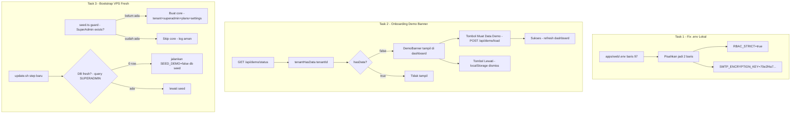

# Plan — RBAC_STRICT Production + Fresh VPS + Onboarding Demo Opt-in

> **Tanggal:** 15 Okt 2026 (Session 78)
> **Status:** ✅ COMPLETE — semua task terimplementasi & terverifikasi (v11.70.0)
> **Scope:** 3 kerja: (1) fix bug `.env` lokal RBAC_STRICT, (2) onboarding "Muat Data Demo", (3) bootstrap VPS fresh (seed core idempoten-safe + checklist docs)

> **Revisi Task 2 (Rule 2 Reuse):** Rencana awal membuat `DemoBanner` baru + `GET /api/demo/status` route baru + tombol di `DashboardLayout`. Implementasi final: **enhance [`OnboardingModal`](apps/web/components/ui/onboarding-modal.tsx) yang sudah ada** (sudah mounted di [`dashboard/layout.tsx:16`](apps/web/app/dashboard/layout.tsx)) — tambah auto-show logic (fetch `/api/demo/status` saat role ADMIN/SUPERADMIN + tenant kosong + belum dismiss), tanpa komponen banner baru. Route GET `/api/demo/status` digabung ke [`api/demo/load/route.ts`](apps/web/app/api/demo/load/route.ts) (bukan route terpisah). Hasil: 1 komponen, 0 duplikasi.

---

## Konteks & Temuan Investigasi

### Fakta 1 — RBAC_STRICT

| File | Nilai | Status |
|------|-------|--------|
| `apps/web/.env.production:130` | `RBAC_STRICT=true` | ✅ Production sudah ON — **PERTAHANKAN** |
| `apps/web/.env.example:184` | `RBAC_STRICT=true` | ✅ |
| `apps/web/.env.production.example:130` | `RBAC_STRICT=true` | ✅ |
| `apps/web/.env:97` | `RBAC_STRICT=trueSMTP_ENCRYPTION_KEY=70e2f4a7…` | 🔴 **BUG** — 2 entry menyatu 1 baris |

Dampak bug: dotenv mem-parse `RBAC_STRICT` sebagai literal panjang ≠ `'true'` → [`requirePermissionForRoute()`](apps/web/lib/session.ts:219) (`process.env.RBAC_STRICT === 'true'`) → strict mode **MATI di local dev**. Dev tidak mencerminkan production. Production aman (`.env.production` bersih).

Keputusan: **`RBAC_STRICT=true` TETAP di production** — fail-closed (route tak terdaftar → 403), tanpa role-hierarchy fallback; dependensi keamanan modul Community (comment di `community/letters/route.ts:33`); audit Session 69: 278 entry RBAC sudah cover semua route.

### Fakta 2 — Registrasi sudah menghasilkan tenant KOSONG

[`register/route.ts:103`](apps/web/app/api/auth/register/route.ts) — `$transaction` hanya membuat `Tenant` + `User` (role selalu ADMIN). Tidak ada seed data. Sudah sesuai keinginan.

### Fakta 3 — Demo opt-in sudah ada (API + UI + CLI)

- Runtime: [`POST /api/demo/load`](apps/web/app/api/demo/load/route.ts) — ADMIN-only, rate limit 5/5min, guard `tenantHasData` (409 jika sudah ada data), flag `force`.
- UI: tombol "Muat Data Demo" + confirm dialog di [`settings/page.tsx:437`](apps/web/app/dashboard/settings/page.tsx). **Sudah ada hook `?demo=true`** (baris 33-38) untuk auto-open dari onboarding.
- CLI: [`packages/db/prisma/seed.ts:22`](packages/db/prisma/seed.ts) — default `CORE ONLY`; demo hanya jika `SEED_DEMO=true`.
- [`tenantHasData()`](apps/web/lib/seed-data/demo.ts:418) exported — cek count Contact/Product/Invoice.

### Fakta 4 — 🔴 GAP: VPS fresh tidak punya bootstrap seed

Grep `prisma db seed|SEED_DEMO` di semua `*.sh` → **0 hasil**. [`update.sh`](update.sh) hanya: preflight → backup → pull → install → prisma generate → migrate deploy → build → restart → health check. **Tanpa seed.** Akibatnya VPS fresh (migrate deploy ke DB kosong) = tidak ada SuperAdmin, tidak ada Plans, tidak ada Platform Settings → aplikasi tidak bisa dipakai.

### Fakta 5 — 🔴 Risiko: seed.ts tidak aman di-reeksekusi di production

Seed selalu upsert SuperAdmin `info@qalcuity.com` dengan **password hash hardcoded** (`Wahyu123456789@`, baris 56). Jika seed dijalankan di DB production yang sudah punya SuperAdmin (mis. password sudah diganti), hash akan **di-reset** ke default → security risk. Seed perlu guard "jika SuperAdmin sudah ada → skip core user/tenant".

---

## Arsitektur Solusi



---

## Task Breakdown

### Task 1 — Fix bug `.env` lokal (1 file, 1 baris)

**File:** `apps/web/.env:97`

Ubah:
```
RBAC_STRICT=trueSMTP_ENCRYPTION_KEY=70e2f4a7c4c76b129ecdd4a86ceded978a9058204012ef6a2c34152425577826
```
Menjadi 2 baris:
```
RBAC_STRICT=true
SMTP_ENCRYPTION_KEY=70e2f4a7c4c76b129ecdd4a86ceded978a9058204012ef6a2c34152425577826
```

> ⚠️ `.env` di gitignore (file lokal). Jangan commit. Cek juga `.env.local` tidak menimpa nilai.

### Task 2 — Onboarding "Muat Data Demo" (banner di dashboard)

#### 2a. `GET /api/demo/status` (endpoint baru di route existing)

**File:** `apps/web/app/api/demo/load/route.ts` — tambahkan export `GET` (reuse file, jangan buat route baru):

```ts
export async function GET(req: Request) {
    // requirePermissionForRoute — sama dengan POST (ADMIN/SUPERADMIN)
    // return { success: true, data: { hasData: await tenantHasData(tenantId) } }
}
```

- Auth: `requirePermissionForRoute(req)` → 403 jika tidak lolos.
- Tenant isolation: `tenantId` dari `getTenantIdFromRequest` / session (ikuti pola POST yang ada).
- Rate limit ringan (bisa reuse config existing).

#### 2b. Komponen `apps/web/components/onboarding/demo-banner.tsx` (BARU)

Client component:

- State: `visible`, `loading`, `status`.
- `useEffect` → `GET /api/demo/status`; jika `hasData === true` → jangan tampil.
- Cek `localStorage['qalcuity_demo_dismissed']` → jika `'1'` → jangan tampil (dismiss permanen).
- Cek role via `useSession()` → hanya tampil untuk ADMIN/SUPERADMIN.
- UI (Tailwind, Lucide icons, i18n via `useTranslation`):
  - Banner biru muda di atas konten dashboard: ikon `Sparkles`/`PackageOpen`, judul "Selamat datang! Jelajahi Qalcuity dengan data demo", deskripsi singkat (produk, kontak, invoice, karyawan).
  - Tombol primer **"Muat Data Demo"** → `POST /api/demo/load` `{ force: false }` → success: toast/inline success + `window.location.reload()`; 409 (sudah ada data) → sembunyikan banner.
  - Tombol sekunder **"Lewati"** → set `localStorage['qalcuity_demo_dismissed'] = '1'` → hide.
  - Link kecil "Atau muat nanti di Pengaturan" → `/dashboard/settings?demo=true` (hook sudah ada).
- Guard penuh terhadap error network → sembunyikan banner diam-diam (jangan block dashboard).
- Aksesibel: `role="banner"`, focus states.

#### 2c. Mount di dashboard

**File:** `apps/web/app/dashboard/layout.tsx` (atau `page.tsx` jika layout server-only tanpa slot client) — render `<DemoBanner />` di posisi atas konten, di dalam provider session. Cek struktur layout saat implementasi (Rule 1: inspect before coding); jika layout server component, cukup import client component — valid di App Router.

#### 2d. i18n keys

**Files:** `packages/i18n/messages/id.json` + `en.json` — tambah prefix `onboarding.demoBanner.*` (title, description, load, skip, later, loading, success, error). Reuse key `settings.loadDemoData` dsb. yang sudah ada jika cocok (Rule 2: reuse before create).

### Task 3 — Bootstrap VPS fresh (seed idempoten-safe + update.sh + docs)

#### 3a. Guard seed.ts agar aman di production

**File:** `packages/db/prisma/seed.ts`

Di `main()`, sebelum membuat tenant/superadmin:

```ts
const existingSuperadmin = await prisma.user.findFirst({
    where: { role: "SUPERADMIN" },
});
if (existingSuperadmin && process.env.FORCE_CORE_SEED !== "true") {
    console.log("ℹ️ SuperAdmin sudah ada — skip core seed (pakai FORCE_CORE_SEED=true untuk paksa)");
    // tetap lanjut upsert plans? — LIHAT CATATAN DI BAWAH
} else {
    // tenant upsert + superadmin upsert (seperti sekarang)
}
```

> **Catatan Plans:** upsert plans saat ini sudah `GRANDFIELD PRICING`-safe (price/features tidak diubah jika slug ada — lihat komentar seed.ts:81). Jadi plans boleh tetap di-upsert untuk sync fitur baru. Yang WAJIB di-guard hanya tenant demo + superadmin (reset password hash = risiko).

#### 3b. Tambah langkah seed di `update.sh`

**File:** `update.sh` — setelah Step 6 (migrate deploy), tambah **Step 6b: Core seed jika DB fresh**:

```bash
# Deteksi DB fresh: tidak ada user SUPERADMIN
FRESH=$(cd packages/db && npx prisma db execute --stdin <<< "SELECT COUNT(*) FROM \"User\" WHERE role='SUPERADMIN';" ...)
# atau simpler: psql langsung
if [ "$SUPERADMIN_COUNT" = "0" ]; then
    log "DB fresh terdeteksi — menjalankan core seed (tanpa demo)..."
    (cd packages/db && SEED_DEMO=false npx prisma db seed)
else
    log "SuperAdmin sudah ada — lewati seed"
fi
```

- Implementasi deteksi: gunakan `psql` yang sudah dipakai di preflight/backup section update.sh (ikuti pola koneksi existing di script — inspect dulu).
- Selalu `SEED_DEMO=false` → tenant qalcuity-demo yang dibuat seed = **kosong** (hanya akun SuperAdmin).
- Export `PRISMA_QUERY_ENGINE_TYPE=library` sudah di-set di header script.

#### 3c. Dokumentasi VPS fresh

**File baru:** `docs/FRESH-VPS.md` (atau section baru di `DEPLOY-POSTGRESQL.md` — pilih saat implementasi, cek mana yang lebih nyambung):

Checklist bootstrap VPS fresh:
1. aaPanel → Node.js Project Manager → deploy aplikasi (`bash deploy.sh` / `update.sh`).
2. Buat PostgreSQL DB + user; isi `apps/web/.env` (VPS) dari `.env.production.example`.
3. **WAJIB:** `RBAC_STRICT=true` + `NEXTAUTH_SECRET` + `SMTP_ENCRYPTION_KEY` unik (jangan pakai contoh).
4. `bash update.sh` → migrate deploy + **auto core seed jika DB fresh** (Step 6b baru).
5. Verifikasi: login `info@qalcuity.com` (password dari seed — **GANTI SEGERA** setelah login pertama) → cek Plans & Platform Settings ada.
6. Registrasi tenant baru = kosong; user bisa muat demo via banner onboarding atau Settings.
7. Cron aaPanel: `*/5 * * * * curl -H "Authorization: Bearer $CRON_SECRET" https://qalcuity.com/api/cron/run`.

Update `AGENT.md` §14 (Local Development Setup) — 1 paragraf singkat: "Seed core idempoten-safe; SUPERADMIN guard; VPS fresh otomatis di-update.sh Step 6b."

---

## Urutan Implementasi

1. Task 1 (fix `.env`) — 1 menit, nol risiko.
2. Task 3a (guard seed.ts) — fondasi untuk 3b.
3. Task 3b (update.sh Step 6b).
4. Task 2a (GET /api/demo/status).
5. Task 2b+2c+2d (DemoBanner + mount + i18n).
6. Task 3c (docs) + dokumentasi sesuai hierarchy (CURRENT.md, FEATURES.md jika perlu).
7. Verifikasi (DoD).

## Verification Plan

- [ ] `npx tsc --noEmit` → 0 errors.
- [ ] `.env` lokal: `RBAC_STRICT` dan `SMTP_ENCRYPTION_KEY` di baris terpisah (baca ulang file).
- [ ] Seed guard: jalankan `npx prisma db seed` di DB yang sudah ada SuperAdmin → log "skip core seed", password superadmin TIDAK berubah.
- [ ] `GET /api/demo/status` → 200 `{ hasData }` untuk ADMIN; 401/403 untuk anonymous/VIEWER.
- [ ] Banner: tenant kosong → tampil; klik Lewati → localStorage set, reload tidak tampil; muat demo → data masuk, banner hilang; tenant berisi data → tidak tampil.
- [ ] `bash -n update.sh` → syntax valid.
- [ ] Regression: `POST /api/demo/load` lama tetap berfungsi dari Settings.

## Definition of Done

- [ ] `apps/web/.env` baris 97 terpisah jadi 2 entry.
- [ ] `GET /api/demo/status` ada, ter-RBAC, tenant-scoped.
- [ ] `DemoBanner` tampil hanya saat tenant kosong + role ADMIN/SUPERADMIN + belum dismiss; i18n ID+EN.
- [ ] `seed.ts` skip core jika SUPERADMIN sudah ada (kecuali `FORCE_CORE_SEED=true`).
- [ ] `update.sh` punya Step 6b core seed otomatis untuk DB fresh, selalu `SEED_DEMO=false`.
- [ ] `docs/FRESH-VPS.md` (atau section equivalent) berisi checklist bootstrap.
- [ ] `npx tsc --noEmit` 0 errors; dokumentasi (CURRENT.md, FEATURES.md jika perlu) ter-update.

## File yang Disentuh

| File | Aksi |
|------|------|
| `apps/web/.env` | Fix split baris 97 (lokal, jangan commit) |
| `apps/web/app/api/demo/load/route.ts` | Tambah export `GET` (status) |
| `apps/web/components/onboarding/demo-banner.tsx` | BARU |
| `apps/web/app/dashboard/layout.tsx` (atau page.tsx) | Mount `<DemoBanner />` |
| `packages/i18n/messages/id.json` + `en.json` | Keys onboarding |
| `packages/db/prisma/seed.ts` | Guard SUPERADMIN exists |
| `update.sh` | Step 6b core seed DB fresh |
| `docs/FRESH-VPS.md` | BARU — checklist |
| `CURRENT.md` (+ FEATURES.md jika perlu) | Dokumentasi session |

## Risiko & Mitigasi

| Risiko | Mitigasi |
|--------|----------|
| Seed guard salah skip di DB kosong | Guard hanya skip jika `findFirst(role=SUPERADMIN)` benar-benar return row |
| Banner mengganggu dashboard existing | Banner non-blocking, dismiss permanen, hanya muncul saat `hasData=false` |
| update.sh seed salah jalan di DB produksi berisi data | Deteksi SUPERADMIN row sebelum seed; tanpa row = belum pernah seed |
| `.env` lokal ter-commit | Pastikan tetap di gitignore; hanya ubah working file |
