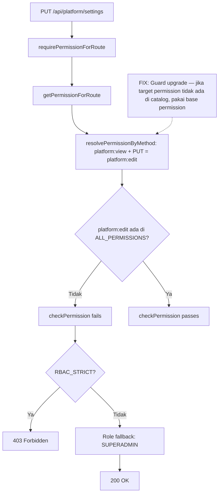

# Production Console Errors — Analisis & Fix Plan (2026-10-16)

> **Sumber:** Console errors dari https://qalcuity.com (production)
> **Status:** Root cause teridentifikasi, menunggu implementasi

---

## Ringkasan Error

| # | Error | Jumlah | Severity | Status |
|---|-------|--------|----------|--------|
| 1 | React #418/#423 hydration mismatch | 4x | 🟡 Medium | Fix sudah di codebase — **perlu redeploy** |
| 2 | `PUT /api/platform/settings` → 403 | 2x | 🔴 High | **Bug baru — perlu fix code** |
| 3 | `POST /api/finance/payments` → 400 | ~10x | 🟠 Medium | **Bug baru — perlu fix code** |
| 4 | `content-script.js` TypeError | 1x | ⚪ N/A | Browser extension, BUKAN kode kita |

---

## Error #1: React #418/#423 Hydration Mismatch

### Root Cause
Sudah dianalisis di `plans/production-console-errors-2026-10-15.md` (error #8). Fix ada di codebase (commit bcde957) tapi production build saat ini belum menyertakan fix tersebut.

### Fix
**Tidak perlu code change.** Perlu **redeploy production** ke VPS agar build terbaru (dengan fix hydration) aktif.

### Action
- Jalankan `bash update.sh` dari local → pull + build di VPS

---

## Error #2: PUT /api/platform/settings → 403 Forbidden

### Root Cause (TERKONFIRMASI)

**Bug sistemik di permission upgrade logic.** Jalur kode lengkap:

```
1. PUT /api/platform/settings
   → requirePermissionForRoute(req)                    [session.ts:192]
   → getPermissionForRoute('/api/platform/settings', 'PUT')
   → route config: { permission: 'platform:view' }     [route-permissions.ts:349]
   → resolvePermissionByMethod('platform:view', 'PUT')
   → METHOD_ACTION_MAP.PUT = 'edit'                    [route-permissions.ts:513]
   → return 'platform:edit'                            [route-permissions.ts:547]

2. checkPermission(session, 'platform:edit')           [session.ts:251]
   → hasPermission(session, 'platform:edit')           [permissions.ts:56]
   → getUserPermissions(session)
     → SYSTEM_ROLE_PERMISSIONS['SUPERADMIN'] = ['*']
     → resolvePermissions(['*'])
     → return ALL_PERMISSIONS                          [engine.ts:89-90]
     → ALL_PERMISSIONS = Object.values(PERMISSIONS)    [permissions.ts:120]
     → PERMISSIONS hanya punya PLATFORM_VIEW ('platform:view') — TIDAK ADA 'platform:edit'
   → hasFlatPermission(permissions, 'platform:edit')
   → permissions.includes('platform:edit') → FALSE     [engine.ts:132-133]

3. RBAC_STRICT=true (.env.production line 130)
   → return 403 Forbidden, NO role fallback            [session.ts:265-276]
```

**Kunci:** `resolvePermissions(['*'])` mengembalikan `ALL_PERMISSIONS` (flat list), dan `hasFlatPermission` menggunakan `Array.includes()` (exact match). Karena `platform:edit` tidak pernah didefinisikan di `PERMISSIONS` catalog, wildcard `*` SUPERADMIN pun **gagal** — berbeda dengan `matchPermission` yang punya khusus check `granted === '*'`.

### Dampak Sistemik — 8 Route Terdampak

`resolvePermissionByMethod` meng-upgrade `module:view` → `module:action` berdasarkan HTTP method. Untuk modul yang di `MODULE_PERMISSIONS` hanya punya `['view']`, upgrade menghasilkan permission yang **tidak ada di catalog**:

| Route | Method | Upgrade ke | Module di catalog | Status |
|-------|--------|-----------|-------------------|--------|
| `/api/platform/settings` | PUT | `platform:edit` | `['view']` | 🔴 403 |
| `/api/platform/tenants/[id]` | PUT | `platform:edit` | `['view']` | 🔴 403 |
| `/api/platform/tenants` | POST | `platform:create` | `['view']` | 🔴 403 |
| `/api/platform/support/tickets` | POST | `platform:create` | `['view']` | 🔴 403 |
| `/api/ai/anomalies/[id]` | PATCH | `ai:edit` | `['view']` | 🔴 403 |
| `/api/ai/anomalies` | POST | `ai:create` | `['view']` | 🔴 403 |
| `/api/notifications` | PUT | `notification:edit` | `['view']` | 🔴 403 |
| `/api/notifications` | DELETE | `notification:delete` | `['view']` | 🔴 403 |

Modul view-only yang **tidak terdampak** (route-nya GET-only): `audit`, `dashboard`.

### Fix: Guard di `resolvePermissionByMethod`

**Pendekatan:** Sebelum upgrade, cek apakah permission hasil upgrade valid di `ALL_PERMISSIONS`. Jika tidak ada, jangan upgrade — pakai base permission apa adanya.

**File:** `apps/web/lib/route-permissions.ts`

```typescript
// Tambah import
import { ALL_PERMISSIONS } from '@qalcuity/permissions';

function resolvePermissionByMethod(basePermission: string, method: string): string {
    const parts = basePermission.split(':');
    if (parts.length !== 2) return basePermission;

    const [module, action] = parts;

    // If action is already specific (not 'view'), keep it as-is
    if (action !== 'view' && SPECIFIC_ACTIONS.has(action)) {
        return basePermission;
    }

    // If action is 'view', upgrade based on HTTP method
    if (action === 'view') {
        const resolvedAction = METHOD_ACTION_MAP[method] || 'view';
        const upgraded = `${module}:${resolvedAction}`;
        // Guard: only upgrade if the target permission exists in catalog.
        // View-only modules (platform, audit, etc.) keep base permission.
        if (ALL_PERMISSIONS.includes(upgraded)) {
            return upgraded;
        }
        return basePermission;
    }

    return basePermission;
}
```

### Mengapa Fix Ini Aman

1. **Modul CRUD lengkap** (finance, crm, hr, dll) → upgrade tetap berjalan normal, tidak ada perubahan behavior
2. **Modul view-only** → semua method menggunakan `module:view` — ini benar karena:
   - `platform:view` hanya dimiliki SUPERADMIN
   - `notification:view` dimiliki MEMBER — tapi PUT/DELETE notifikasi adalah operasi self-service (mark-read / delete notifikasi sendiri)
   - `ai:view` dimiliki MEMBER — POST anomaly scan adalah operasi yang diizinkan untuk MEMBER
3. **Tidak menyentuh Permission Engine** (`packages/permissions/`) — sesuai AGENT.md Rule 5
4. **Forward-compatible** — jika nanti `platform:edit` ditambahkan ke catalog, guard otomatis meng-upgrade

---

## Error #3: POST /api/finance/payments → 400 Bad Request

### Root Cause

**Frontend validation terlalu longgar.** Di `apps/web/app/dashboard/finance/payments/page.tsx`:

```typescript
// Line 520 — hanya truthy check
if (!recordForm.amount) {
    // ...
    return;
}

// Line 524 — kirim Number(recordForm.amount)
body: JSON.stringify({
    amount: Number(recordForm.amount),  // Number("0") = 0
    // ...
})
```

Masalah:
1. Input `amount` adalah **string** dari text field (`recordForm.amount: ''`)
2. `!"0"` = `false` — string `"0"` adalah truthy, jadi check `if (!recordForm.amount)` **lolos**
3. `Number("0") = 0` dikirim ke server
4. Zod schema: `amount: z.number().min(0.01)` → **gagal** → 400

Input element juga tidak punya atribut `min`:
```tsx
// Line 455-461
<input type="number" ... />  // TIDAK ADA min="0.01"
```

Repeated ~10x POST menunjukkan user terus mengklik "Record Payment" tanpa memahami error (kemungkinan Zod error message tidak ditampilkan dengan jelas ke user).

### Fix

**File:** `apps/web/app/dashboard/finance/payments/page.tsx`

1. **Tambah `min="0.01"` ke input amount** — cegah input 0 di level browser
2. **Perkuat frontend validation** — cek numerik, bukan hanya truthy:
   ```typescript
   const amountNum = Number(recordForm.amount);
   if (!recordForm.amount || isNaN(amountNum) || amountNum < 0.01) {
       // tampilkan error "Jumlah pembayaran harus lebih dari 0"
       return;
   }
   ```
3. **Pastikan Zod error message dari response ditampilkan ke user** — cek bagian error handling POST handler, pastikan `formatZodError` result di-pass ke toast/alert

---

## Error #4: content-script.js TypeError

**Bukan kode Qalcuity.** `chrome-extension://.../content-script.js` adalah error dari browser extension yang terinstall di browser user. Tidak perlu action.

---

## Rencana Implementasi

### Step 1: Fix permission upgrade guard
- Edit `apps/web/lib/route-permissions.ts` — tambah import `ALL_PERMISSIONS` + guard di `resolvePermissionByMethod`
- Jalankan `npx tsc --noEmit`

### Step 2: Fix payment amount validation
- Edit `apps/web/app/dashboard/finance/payments/page.tsx` — tambah `min` attr + perkuat validation
- Verifikasi error handling menampilkan Zod error ke user
- Jalankan `npx tsc --noEmit`

### Step 3: Update dokumentasi
- Update `CURRENT.md` — Session 82 entry
- Update `plans/production-console-errors-2026-10-15.md` — tandai error #8 sebagai "fix confirmed, awaiting deploy"

### Step 4: Deploy ke production
- Jalankan `bash update.sh` dari local → VPS pull + build
- Verifikasi di https://qalcuity.com:
  - Platform settings save tidak lagi 403
  - Payment creation dengan amount valid berhasil
  - Hydration errors hilang

---

## Diagram Alir Bug 403


