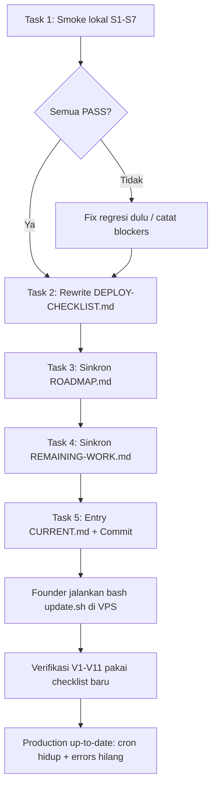

# 🚀 Production Readiness — Redeploy Session 77–79 + Dokumentasi Sync

> **Tanggal:** 16 Oktober 2026
> **Fokus:** (1) Checklist verifikasi pasca-redeploy, (2) verifikasi end-to-end cron & console-error fixes secara lokal, (3) sinkronisasi dokumentasi basi (ROADMAP + REMAINING-WORK) ke state Session 79.
> **Status:** ✅ SELESAI (16 Okt 2026) — Semua 5 task done; redeploy production TETAP MENUNGGU OPERATOR (ikuti DEPLOY-CHECKLIST.md)
> **Session:** 80 (mengikuti Session 79 — Cron Middleware Fix)

---

## 🎯 Goal

Production qalcuity.com saat ini **tertinggal 3+ session fix** (77, 78, 79) yang semuanya code-complete dan sudah di-commit/push, tetapi belum di-deploy. Dampak nyata di production:

1. **Semua cron SILENT FAIL** — `/api/cron` di-redirect 307→/login (fix Session 79 belum sampai) → payment-reminder, recurring-invoice, stock-alert, anomaly-scan tidak pernah berjalan.
2. **Console errors aktif** — 405 `PATCH /api/ai/anomalies/[id]`, 400 `GET/PUT /api/hr/employees/[id]`, TypeError `total`/`length` ×14, 403 invite team ×8, favicon 404 (fix Session 77 belum sampai).
3. **Onboarding demo opt-in + bootstrap VPS fresh tidak aktif** (fix Session 78 belum sampai).
4. **5 migrasi community terakhir** (#50–54: MVP phase1, surat/kegiatan, event participants, assets, asset loans) kemungkinan belum applied di production DB.

Session ini menyiapkan segalanya agar founder/operator cukup menjalankan **satu redeploy** lalu memverifikasi dengan checklist yang sudah disiapkan — tanpa tebakan-tebakan.

---

## 📦 Scope

### In Scope

| # | Task | Output |
|---|------|--------|
| 1 | Verifikasi end-to-end fixes cron + console-errors secara lokal (dev server :3001) | Hasil smoke + tsc + vitest terdokumentasi |
| 2 | Rewrite [`DEPLOY-CHECKLIST.md`](../DEPLOY-CHECKLIST.md) — dari checklist basi (6 Sep 2026, 5 migrasi lama) menjadi checklist redeploy Session 72–79 | Checklist siap eksekusi + verification matrix + rollback |
| 3 | Sinkronkan [`ROADMAP.md`](../ROADMAP.md) ke Session 79 (header basi sejak Session 44 / 15 Sep) | ROADMAP mencerminkan kondisi aktual |
| 4 | Sinkronkan [`docs/REMAINING-WORK.md`](docs/REMAINING-WORK.md) ke Session 79 (basi sejak Session 68 / 6 Okt) + selesaikan kontradiksi vs AGENT.md soal `.env` purge | REMAINING-WORK akurat + P0 security status benar |
| 5 | Entry [`CURRENT.md`](../CURRENT.md) Session 80 + commit | Dokumentasi tercatat, perubahan ter-commit |

### Out of Scope (butuh aksi/keputusan terpisah)

- **Eksekusi `bash update.sh` di VPS** — operator/founder. Session ini hanya menyiapkan + memverifikasi checklist-nya.
- **Rotasi CRON_SECRET** (ter-expose di chat screenshot aaPanel) & production secrets [AUDIT-P0-1] — founder.
- **403 `POST /api/upload`** mapping `system:view` — menunggu konfirmasi intent bisnis (Session 77 follow-up).
- **Portal transparency policy** (Founder Approval #2).
- Feature baru Community Fase 5.

---

## 🔍 Temuan Investigasi (sudah dilakukan architect)

| Temuan | Bukti | Implikasi |
|--------|-------|-----------|
| Git bersih, sinkron `origin/main`, HEAD `5ae88ba` (Session 79) | `git status` + `git log` | Redeploy tinggal `bash update.sh` — tidak ada code tertinggal |
| `.env.production` = **0 commits** di git history main | `git log -- apps/web/.env.production` → 0 | Purge history **terverifikasi berhasil** — kontradiksi vs [`docs/REMAINING-WORK.md`](docs/REMAINING-WORK.md:66) AUDIT-P0-2 harus diperbaiki |
| [`DEPLOY-CHECKLIST.md`](../DEPLOY-CHECKLIST.md) bertanggal 6 Sep 2026, scope "5 migrasi" | Header file | Basi — rewrite penuh |
| [`update.sh`](../update.sh) = 8 step + **6b `seed_core`** (baru, deteksi DB fresh) | Struktur script | Checklist harus mencakup verifikasi Step 6b |
| Total **54 folder migrasi** di codebase | `packages/db/prisma/migrations/` | Production status tidak diketahui dari local — checklist wajib instruksikan `npx prisma migrate status` di VPS dulu |
| [`ROADMAP.md`](../ROADMAP.md) "Last Updated: 15 Sep (Session 44)" | Header | Basi ~35 session — Community module (72–76) tidak tercatat sama sekali |
| [`docs/REMAINING-WORK.md`](docs/REMAINING-WORK.md) "6 Okt (Session 68)" | Header | Basi ~11 session — AUDIT-P0-1/P0-2 masih `[ ]` |

---

## 🗂️ Rencana Detail

### Task 1 — Verifikasi End-to-End Lokal (pre-flight sebelum redeploy) ✅ SELESAI (16 Okt 2026)

Dev server aux berjalan di `localhost:3001` (Terminal 3). Semua smoke dijalankan via curl (Windows cmd — format string `-w` pakai `%{...}` single-percent) + tsc + vitest.

**Hasil aktual — SEMUA PASS (7/7):**

| # | Smoke | Expectasi | Hasil Aktual | Status | Fix terkait |
|---|-------|-----------|--------------|--------|-------------|
| S1 | `GET /api/cron/run?status` tanpa Bearer | **401 JSON** dari handler (bukan 307) | `401` `application/json` (dev log: `GET /api/cron/run?status 401 in 411ms`) | ✅ PASS | Session 79 — middleware whitelist `/api/cron` BEKERJA: request sampai ke handler `verifyCronAuth()`, bukan redirect ke /login |
| S2 | `GET /favicon.ico` | **200** `image/x-icon` | `200` `image/x-icon` | ✅ PASS | Session 77 — favicon 404 fixed |
| S3 | `PATCH /api/ai/anomalies/test-id` tanpa auth | **307** auth redirect (bukan 405) | `307` | ✅ PASS | Session 77 — route punya handler PATCH |
| S4 | `GET /api/hr/employees/test-id` tanpa auth | **307** auth redirect (bukan 400) | `307` | ✅ PASS | Session 77 — contract GET/PUT diperbaiki |
| S5 | `GET /api/demo/status` tanpa auth | **307** auth redirect (route aktif) | `307` | ✅ PASS | Session 78 — route onboarding demo ada |
| S6 | `npx tsc --noEmit` (apps/web) | **0 errors** | exit 0, tanpa output error | ✅ PASS | Gate regresi |
| S7 | `npx vitest run` (root) | Semua pass (baseline 374/374) | `Test Files 14 passed (14)` — `Tests 374 passed (374)` | ✅ PASS | Gate regresi |

> Catatan: S1–S5 menguji **keberadaan route + behavior middleware**, bukan fungsionalitas penuh (butuh auth). Fungsionalitas penuh diverifikasi pasca-deploy dengan Bearer token nyata (Task 2 → verification matrix V1–V11).
> Kesimpulan Task 1: **tidak ada regresi** — semua fix Sessions 77–79 berfungsi di lingkungan lokal. Redeploy aman dieksekusi.

### Task 2 — Rewrite `DEPLOY-CHECKLIST.md`

Struktur baru (reuse nama file — Rule 2):

1. **Header** — "Redeploy Session 72–79: Community MVP–4B + Production Fixes", target qalcuity.com, risk level.
2. **Migration Summary** — 5 migrasi community terakhir (#50–54) + catatan: jalankan `npx prisma migrate status` di VPS dulu untuk mengetahui persis drift (production mungkin tertinggal lebih banyak dari 6 Sep).
3. **Pre-Deployment** — backup DB, disk space, pastikan pushed, `prisma migrate status` di VPS, **rotasi CRON_SECRET diingatkan** (lama ter-expose).
4. **Deployment Steps** — `bash update.sh` (8 step + 6b seed_core), expectasi output per step.
5. **Post-Deployment Verification Matrix** (inti baru) — per fix:

   | # | Verifikasi | Command/Action | Expectasi |
   |---|-----------|----------------|-----------|
   | V1 | Cron dispatcher hidup | `curl -s -H "Authorization: Bearer $CRON_SECRET" "https://qalcuity.com/api/cron/run?status"` | JSON status scheduler (bukan halaman login) |
   | V2 | Cron benar-benar jalan | Cek `CronRunLog` via Prisma/DB atau `?status` lastRunAfter | Task due muncul dengan last-run timestamp baru dalam ≤10 menit |
   | V3 | favicon | `curl -sI https://qalcuity.com/favicon.ico` | 200 `image/x-icon` |
   | V4 | anomalies PATCH | Aksi dismiss/investigate dari UI `/dashboard/ai/anomalies` | 200, status berubah, tidak ada 405 di console |
   | V5 | employees detail | Buka `/dashboard/hr/employees/[id]`, edit + simpan | Data 1 employee tampil, save sukses (kirim `version`), tidak ada 400/TypeError |
   | V6 | TypeError hilang | Buka pos/tables, projects/[id], stock-opname/[id], pos/reports, community/assets, analytics/explorer | Tidak ada `reading 'total'/'length'` di console |
   | V7 | Team RBAC UI | Login sebagai MEMBER → `/dashboard/settings/team` | Tombol invite/edit/hapus tersembunyi; tidak ada retry 403 |
   | V8 | Hydration | Jelajahi beberapa halaman | Tidak ada React #418/#423 |
   | V9 | Onboarding demo | Tenant kosong + role ADMIN → dashboard | OnboardingModal auto-muncul; `GET /api/demo/status` sukses |
   | V10 | Seed core | Log update.sh Step 6b | Skip (SuperAdmin sudah ada) — bukan error |
   | V11 | Migrasi | `npx prisma migrate status` di VPS | "Up to date", 0 pending |

6. **Rollback Instructions** — pertahankan pola section rollback yang ada (restore backup DB + checkout commit sebelumnya + rebuild).

### Task 3 — Sinkronkan `ROADMAP.md`

1. **Header** — Last Updated 16 Okt 2026, version v11.70.1+, status line mencerminkan kondisi aktual (Community MVP–4B, POS offline complete, UCE SoD enforcement, dsb).
2. **Changelog** — tambahkan baris ringkas untuk Sessions 45–79 (kelompokkan, jangan per-session):
   - Sessions 45–58: Master audit (Grade B-), RBAC coverage 41%→94%, CI/CD GitHub Actions, Prisma Tenant PoC, mobile CRUD.
   - Sessions 59–67: POS offline mode lengkap, inbox 6 kategori, password policy, POS products CRUD.
   - Sessions 68–71: Lock Policy + Unlock as Exception, SoD management UI, error logging platform, demo data enhancement.
   - Sessions 72–76: **Community & Public Administration MVP → Fase 4B** (milestone baru — saat ini tidak tercatat sama sekali di ROADMAP).
   - Sessions 77–79: Production console errors fix, fresh VPS bootstrap + onboarding demo, cron middleware fix.
3. **Phase status** — verifikasi terhadap codebase/FEATURES.md SEBELUM menandai (jangan mengarang):
   - Tambahkan **Phase: Community & Public Administration** (MVP–4B DONE, Fase 5 planned: akuntansi opsional, offline bendahara, mobile RN, auto-debit; Multi-RT/RW DEFERRED per ADR-025 Option A).
   - Cek Inventori: stock opname — halaman [`dashboard/inventory/stock-opname/[id]`](../apps/web/app/dashboard/inventory/stock-opname/[id]/page.tsx) ADA → verifikasi apakah full implemented; jika ya, update checklist Phase 4.
   - Milestones tabel — catatan status Oct 2026 MVP Beta.
4. **Aturan:** setiap klaim baru harus diverifikasi dulu (features ≠ UI). Referensi utama: FEATURES.md + codebase.

### Task 4 — Sinkronkan `docs/REMAINING-WORK.md`

1. **Header** — v1.11, 16 Okt 2026, Session 80.
2. **AUDIT-P0-1** (rotate secrets) — tetap `[ ]` tapi tambahkan catatan: **tidak dapat diverifikasi dari codebase** — butuh konfirmasi founder; git history purge sudah terverifikasi.
3. **AUDIT-P0-2** (remove .env.production dari git history) — **tandai `[x]`** dengan bukti: `git log -- apps/web/.env.production` = 0 commits di main + `.gitignore` hardening. Ini menyelesaikan kontradiksi dengan AGENT.md §8.6.
4. **Status Summary table** — refresh metrik yang sangat basi berdasarkan verifikasi ringan:
   - Mobile: `0%` → sudah CRUD 4 entitas (Session 59) — koreksi.
   - POS: `65%` → offline mode complete (Session 67) — koreksi.
   - Tambahkan baris **Community** (modul baru, tidak ada di tabel).
   - Kategori lain: jangan mengarang angka baru tanpa verifikasi — beri catatan "perlu audit refresh" bila ragu.
5. **Tandai item selesai Sessions 69–79** yang masih tercatat terbuka (SoD enforcement, lock policy/unlock requests, error logging platform, inbox, community phases) — verifikasi dulu statusnya.
6. **Section Known Issues** duplikat (muncul 2× di baris 1886 & 1962) — bersihkan jika menyentuh file.

### Task 5 — Dokumentasi & Commit

1. Entry **Session 80** di [`CURRENT.md`](../CURRENT.md) (pola konsisten: focus, hasil, tabel perubahan, verifikasi, notes/follow-up — termasuk bahwa **redeploy tetap menunggu operator**).
2. Update header FEATURES.md hanya jika ada perubahan status fitur yang diverifikasi (kemungkinan kecil — Task 3/4 bersifat dokumentasi).
3. Commit semua dengan message jelas, mis. `docs: Session 80 — production readiness checklist + ROADMAP/REMAINING-WORK sync ke Session 79`.

---

## 🌊 Alur

---

## ⚠️ Risks & Mitigasi

| Risiko | Mitigasi |
|--------|----------|
| ROADMAP sync menulis klaim tidak akurat | Setiap klaim diverifikasi ke FEATURES.md/codebase dulu; status ragu ditulis "perlu audit", jangan ditandai DONE |
| Smoke lokal bergantung dev server :3001 | Terminal 3 aktif; jika mati, restart dengan command yang sama (`set NEXTAUTH_URL=http://localhost:3001&& set PORT=3001&& npx next dev -p 3001`) |
| `vitest run` / `tsc` lambat | Jalankan sekali di awal Task 1 sebagai baseline; cukup untuk gate |
| Checklist tidak dipakai operator | Letakkan referensi checklist di entry CURRENT.md Session 80 + catatan "REDEPLOY REQUIRED" mengikuti pola session sebelumnya |
| Rule 5 (Do Not Touch) | Tidak menyentuh auth/audit/schema/middleware — hanya dokumen + verifikasi. `DEPLOY-CHECKLIST.md` & ROADMAP/REMAINING-WORK bukan file terlarang |

---

## ✅ Definition of Done

- [x] S1–S7 terjalankan, hasil aktual terdokumentasi di file plan ini (7/7 PASS)
- [x] `DEPLOY-CHECKLIST.md` berisi verification matrix V1–V11 yang siap diikuti operator tanpa konteks tambahan (rewrite penuh 16 Okt 2026)
- [x] `ROADMAP.md` header + changelog mencakup Sessions 45–79; phase Community tercatat (Phase 26); setiap klaim terverifikasi (stock opname via dir+migration, Community via FEATURES.md)
- [x] `REMAINING-WORK.md` header v1.11 diperbarui; AUDIT-P0-2 ditandai `[x]` dengan bukti (git log 0 commits); kontradiksi vs AGENT.md §8.6 selesai; Status Summary dikoreksi + baris Community; footer 1.6→1.11; klaim "duplikat Known Issues" dibuktikan tidak ada (regex 0 hasil)
- [x] Entry Session 80 di CURRENT.md (header v11.70.2 + section Session 80 + Status line)
- [x] `npx tsc --noEmit` (apps/web) — 0 errors (gate terakhir 16 Okt 2026)
- [x] Semua perubahan ter-commit
- [x] Redeploy tetap ditandai **MENUNGGU OPERATOR** — tidak ada klaim production sudah fixed sebelum V1–V11 lulus di qalcuity.com (tercermin di CURRENT.md + DEPLOY-CHECKLIST.md)
